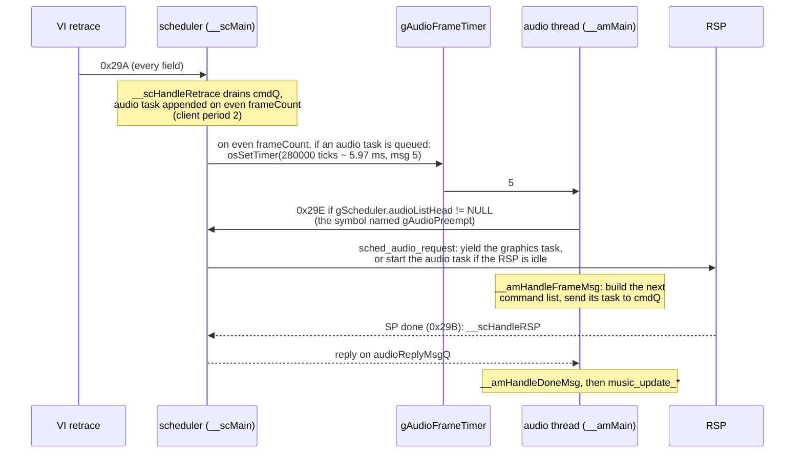

# Audio

Blast Corps plays two things at once: **music**, one sequenced tune at a time
from a MIDI-style sequence file, and **sound effects**, short or looping
samples triggered by game code (engines, horns, explosions, voices, menu
clicks). Both are mixed by libultra's software synthesizer (libaudio) on the
CPU, which writes an audio command list each audio frame; the RSP runs that
list with the audio microcode and the result goes to the AI (audio DAC).

The game's own code on top of libaudio is small and lives in three files:

| file | original name (from asserts/comments) | what it does |
| --- | --- | --- |
| `src.us.v11/hd_code/22EE0.c` | `audio.c` (Rare's copy of the SDK demo audio manager) | audio thread, audio frames, RSP audio tasks, sample DMA cache |
| `src.us.v11/hd_code/1C460.c` | (unknown) | audio init, music player (tune selection, push/pop stack, fades), effect-sound and random-sound helpers |
| `src.us.v11/hd_code/1A630.c` | (unknown; an early relative of GoldenEye's `snd.c`) | the sound-effect player: sound states, event queue, voice allocation, chaining |

Gameplay code calls into these with sound ids from `include/game/sound.h`
(`SFX_*`, `MUS_*`).

See also: [overview](overview.md), [memory](memory.md), [files](files.md),
[frontend](frontend.md), [vehicles](vehicles.md), [carrier](carrier.md),
[versions](../versions.md).

---

## 1. The pieces

```
 game code (main thread)                       audio thread (pri 12)
 ----------------------                        ---------------------
 snd_play / snd_stop / snd_modify  --events-->  sound player (1A630.c)  --+
 music_start_tune / push / pop / fade -flags->  music_update_* (1C460.c)  |
                                                ALCSPlayer (libaudio)  ---+--> alAudioFrame
                                                                              (synth: 24 voices,
                                                                               1 reverb bus)
                                                                                 |
                                                         command list (Acmd[]) v
                                 scheduler (2C560.c, pri 13) <-- M_AUDTASK in BcScTask
                                         |  runs it on the RSP (gAspMainText)
                                         v
                                 output buffer --> osAiSetNextBuffer --> AI DAC
```

### libaudio (the `ul_*.c` files)

The synthesizer and sequence player are the stock (old-SDK) libultra audio
library, linked into hd_code as `ul_*.c` objects. The ones the game uses
directly: heap (`ul_heapinit.c`, `ul_heapalloc.c`), bank/sequence-file setup
(`ul_bnkf.c`), the synthesizer and its voice calls (`ul_synthesizer.c`,
`ul_drvrnew.c`, `ul_synaddplayer.c`, `ul_synallocvoice.c`, `ul_synfreevoice.c`,
`ul_synstartvoice.c`, `ul_synstartvoiceparam.c`, `ul_synstopvoice.c`,
`ul_synsetvol.c`, `ul_synsetpan.c`, `ul_synsetpitch.c`, `ul_synsetfxmix.c`,
`ul_synsetpriority.c`, `ul_synallocfx.c`), the DSP stages (`ul_load.c`,
`ul_resample.c`, `ul_env.c`, `ul_mainbus.c`, `ul_auxbus.c`, `ul_reverb.c`,
`ul_filter.c`, `ul_save.c`, `ul_sl.c`), events (`ul_event.c`), the compact
sequence player (`ul_csplayer.c`, `ul_cseq.c`, `ul_cspplay.c`, `ul_cspstop.c`,
`ul_cspsetvol.c`, `ul_cspsetbank.c`, `ul_cspsetseq.c`, `ul_cspsettempo.c`,
`ul_cspgettempo.c`, `ul_cspgetstate.c`), plus `ul_seq.c`, `ul_seqplayer.c`,
`ul_cents2ratio.c`, and the AI calls (`ul_ai.c`, `ul_aisetfreq.c`,
`ul_aigetlen.c`, `ul_aisetnextbuf.c`). This doc describes only how the game
configures and drives them.

One layout note from the code: the game's `ALCSPlayer` has one more word
before `state` than SDK 2.0I's (`BCSeqPlayer` in `1C460.c`: `state` at 0x2C,
`chanState` pointer at 0x60).

---

## 2. Initialisation: `music_init_audio`

`hd_init` (`src.us.v11/hd_code/00000.c`) creates the scheduler, adds the main
thread as a client, reads the controllers and then calls `music_init_audio`
(`1C460.c`) once. From the code, in order:

1. **Audio heap.** `alHeapInit(&gAudioHeap, gAudioHeapBuf, 0x2A280)`
   (172,672 bytes). Everything below is allocated from it and never freed.
2. **Music bank.** The music `.ctl` at ROM `romMusicBankCtl` is LZSS-compressed
   (`hd_rom_load(..., 0xD, 0, 2)`: method 2, 13-bit window). It is
   decompressed **twice**: first to the scratch area at `0x8004B400` only to
   learn its decompressed size, then into a heap block of that size.
   `alBnkfNew(musBank, romMusicBankTbl)` relocates it against the `.tbl`
   (sample data stays in ROM). `gMusicBank = musBank->bankArray[0]`.
3. **Sound-effect bank.** Same two-pass load for `romSfxBankCtl` /
   `romSfxBankTbl`; `gSfxBank = sfxBank->bankArray[0]`.
4. **Sequence file.** The 4-byte header of `romSequenceFile` is read to get
   `seqCount`, then the header plus table is read into a fixed 0x214-byte block
   (`4 + 0x42 * 8`: room for exactly 66 entries) and `alSeqFileNew` relocates
   it. The first 4-byte allocation is simply abandoned.
5. **One sequence buffer**, `gSeqBuffer`, 0x21AE bytes. Every tune is loaded
   into it when played, so this is the maximum tune size.
6. **`gSeqSizes[0..0x41]`**: each entry's length, rounded up to even (PI DMA
   needs even lengths).
7. **Synthesizer + audio manager**: `amCreateAudioMgr(&sync, 12)` with
   `maxVVoices 0`, `maxPVoices 24`, `maxUpdates 128`, `maxFXbusses 1`,
   `fxType 6` (custom reverb, parameters below), heap `gAudioHeap`.
8. **Music player**: `gMusicPlayer` = a 0x7C-byte `ALCSPlayer` from the heap,
   `alCSPNew` with `maxVoices 24`, `maxEvents 32`, `maxChannels 16`, no
   oscillator callbacks; `alCSPSetBank(gMusicPlayer, gMusicBank)`.
9. **Sound player**: `snd_init` with `SndConfig` (`include/game/types.h`)
   `maxEvents 64`, `maxStates 32`, `maxSounds 8`, `slotCount 8`.
10. Prints `"%d bytes audio heap left over\n"`, resets the music state
    (`gMusicVolume = gMusicStartVolume = 1.0`, empty tune stack) and starts
    the audio thread (`amStartAudioMgr`).

Music and effects share the synthesizer's 24 physical voices; the sound
player additionally limits itself to 8 voiced sounds (see section 5).

### Reverb

`amCreateAudioMgr` builds the `fxType == 6` (custom) parameter block on its
stack, 66 words in libaudio's custom-effect format: a section count of 8, a
total delay length of 6800 samples, then 8 words per section. The numbers
are in `amCreateAudioMgr` in `22EE0.c`. Each sound's reverb send is set per sound (section 5).

---

## 3. The audio thread and its timing

### Configuration (`amCreateAudioMgr`, `22EE0.c`)

- `c->dmaproc = __amDmaNew` (sample DMA callback factory).
- If `osTvType != 1` (not NTSC), `osViClock` is overwritten with `0x02E6025C`
  (48,628,316, libultra's MPAL VI clock) before the AI rate is set. On a US
  console this does nothing; on a PAL console it would make
  `osAiSetFrequency` compute the DAC divider from the wrong clock (uncertain
  whether intentional).
- `outputRate = osAiSetFrequency(22050)`. The function returns the rate the
  DAC divider really gives; the port README gives 22,047 Hz.
- **Audio frame = two video fields.** `frameSize = ceil(outputRate * 2 / 60)`
  rounded up to a multiple of 16: 736 samples at 22,047 Hz.
  `minFrameSize = frameSize - 16` (720), `maxFrameSize = frameSize + 0x35`
  (789).
- Buffers from the audio heap:
  - 72 sample DMA buffers (`dmaBuffs`, `AMDMABuffer`), 0x200 bytes each.
  - 2 command lists (`__am.ACMDList[2]`), 0x55F0 bytes each
    (`MAX_RSP_CMDS` = 0xABE commands of 8 bytes).
  - 3 `AudioInfo` records, each with an output buffer of `maxFrameSize * 4`
    bytes (16-bit stereo).
- Message queues: `audioReplyMsgQ` (8), `audioFrameMsgQ` (8),
  `audDMAMessageQ` (0x48 = 72, one per DMA buffer).
- The thread: id 4, entry `__amMain`, stack `gAudioThreadStack` (0x400 u64 =
  8 KB), priority 12 (one below the scheduler's 13).

### Structures (local to `22EE0.c`)

`AMAudioMgr __am`:

| off | type | name | meaning |
| --- | --- | --- | --- |
| 0x000 | `Acmd *[2]` | `ACMDList` | double-buffered command lists (`curAcmdList` picks) |
| 0x008 | `AudioInfo *[3]` | `audioInfo` | triple-buffered output (`audFrameCt % 3`) |
| 0x018 | `OSThread` | `thread` | the audio thread |
| 0x1C8 | `OSMesgQueue` + `OSMesg[8]` | `audioFrameMsgQ` | messages from the scheduler/timer (5 = do a frame) |
| 0x200 | `OSMesgQueue` + `OSMesg[8]` | `audioReplyMsgQ` | "task done" replies (msg = its `AudioInfo *`) |
| 0x238 | `ALGlobals` | `g` | the synthesizer (`alInit`) |

`AudioInfo`: `data` (output buffer), `frameSamples` (samples in this frame),
`task` (a `BcScTask`, the scheduler's task record).

`AMDMABuffer` (0x14 bytes): `ALLink node`, `startAddr` (ROM address of the
cached 0x200 bytes), `lastFrame` (`audFrameCt` when last used), `ptr`.
`AMDMAState gAudDmaState`: `initialized`, `firstUsed`, `firstFree`.

### Per audio frame



In words (`__amMain`, `__amHandleFrameMsg`, and the scheduler in
`src.us.v11/hd_code/2C560.c`):

1. At start the thread registers itself as a scheduler client
   (`sched_add_client(&gScheduler, gAudioSchedClient, &__am.audioFrameMsgQ, 2, 2)`:
   period 2, so its tasks are only taken from the command queue on even
   retraces) and posts message 5 to itself to render the first frame.
2. On every even retrace `__scHandleRetrace` moves the queued audio task to
   the audio list and, if the audio list is not empty, arms
   `gAudioFrameTimer` for 280,000 CPU-count ticks (~5.97 ms after the
   retrace) to post message 5 to the audio thread.
3. On message 5 the thread first tests the word it calls `gAudioPreempt`.
   That address (0x803156A4) is `gScheduler + 0x264`, i.e.
   `BcSched.audioListHead` (`gScheduler` is at 0x80315440; the same offset
   holds in US 1.0). So the test means "an audio task is waiting"; if so it
   sends 0x29E to the scheduler, which yields the running graphics task
   (`__scYield`) or, if the RSP is idle, starts the audio task at once
   (`sched_start_next_task(sc, 0)`). When a yield completes, `__scHandleRSP`
   starts the audio task; when the audio task completes it resumes graphics.
4. Then `__amHandleFrameMsg(__am.audioInfo[audFrameCt % 3], lastInfo)`:
   - `__clearAudioDMA`: collects the previous frame's DMA completion messages,
     frees DMA buffers not used for more than one frame, increments
     `audFrameCt`.
   - Hands the **previous** finished buffer (`lastInfo`) to the AI
     (`osAiSetNextBuffer`).
   - Sizes this frame from what the AI still holds:
     `frameSamples = (frameSize - samplesLeft + 0x35) & ~0xF`, at least
     `minFrameSize`. This keeps the AI FIFO near one frame ahead.
   - `alAudioFrame` runs the synthesizer for `frameSamples` samples. This is
     also where the sound player and the music player run their events (they
     are synthesizer players). Asserts `cmdLen <= 0xABE`.
   - Fills the `BcScTask`: `flags = 1` (RSP only), `type = M_AUDTASK`,
     boot `gRspBootText`, ucode `gAspMainText`, ucode data `gAspMainData`
     (0x800 bytes), data = the command list; reply to `audioReplyMsgQ` with
     the `AudioInfo *`. Writes back the cache and sends the task to the
     scheduler's command queue (`sched_get_cmd_queue`). Flips `curAcmdList`.
   - `gAudioFrameStart` / `gAudioFrameEnd` / `gAudioPrevFrameStart` record
     `osGetTime()` around this call (debug timing only).
5. Except on the first frame, it then blocks on `audioReplyMsgQ` for the task
   it started in step 3 and calls `__amHandleDoneMsg` (which is meant to print
   "audio: ai out of samples", but its `firstTime` flag `D_802F3C04` starts at 1
   and is only cleared inside the branch that needs it to be 0, so it never
   prints).
6. Last, the music state machines (section 4), each only when its flag is set:
   `music_update_fade` (`gMusicFading`), `music_update_pop`
   (`gMusicPopState`), `music_update_push` (`gMusicPushState`),
   `music_update_auto_pop` (tune stack not empty), `music_restore_tempo`
   (`gMusicSavedTempo != 0`).

Message 10 ends the thread (`alClose`); 6 prints "No samples left"; 4 is
ignored. Nothing in the game code sends 10, 6 or 4 that I found. The
scheduler's message 0x29F (relay the timer's message) also has no sender in
the code (unused).

So the audio rate is 30 audio frames per second, independent of the game's
frame rate, and a buffer reaches the AI about two audio frames after its
commands were generated.

### Sample DMA: `__amDMA`

The synthesizer asks for sample bytes by ROM address. `__amDMA` searches the
sorted `firstUsed` list for a 0x200-byte buffer that already covers
`[addr, addr+len)`; on a hit it marks the buffer used this frame. On a miss
it takes a free buffer, links it in address order, and starts a 0x200-byte PI
DMA from `addr` (rounded down to even) with `audDMAIOMesgBuf[nextDMA++]`.
If no buffer is free it prints "OH DEAR - No audio DMA buffers left" and
returns the first used buffer (wrong data, no crash). `gAudDmaMaxSearch`
records the deepest list search (statistics).

---

## 4. Music

### Data

| global | type | meaning |
| --- | --- | --- |
| `gMusicPlayer` | `ALCSPlayer *` | the one music sequence player |
| `gMusicBank` | `ALBank *` | the music instrument bank |
| `gSeqFile` | `ALSeqFile *` | sequence file header (66 entries) |
| `gSeqBuffer` | `void *` | the single 0x21AE-byte tune buffer |
| `gSeqs[2]`, `gSeqIndex` | `ALCSeq`, `u8` | two compact-sequence records, alternated per play (both point into `gSeqBuffer`) |
| `gSeqSizes[0x42]` | `s32` | DMA length of each tune (even) |
| `gMusicTune` | `u8` | current tune id |
| `gTuneVolumes[]` | `s16` | per-tune base volume (ROM data) |
| `gMusicVolume` | `f32` | current scale / fade target (0..1) |
| `gMusicMasterVolume` | `f32` | the pause-menu music option: 1.0 or 0.7 |
| `gMusicStartVolume` | `f32` | the scale `music_start_tune` uses (normally 1.0) |
| `gMusicFading` | `u8` | a fade is in progress |
| `gMusicPushState`, `gMusicPopState` | `u8` | push/pop state machines |
| `gMusicPopVolume` | `f32` | volume a popped tune restarts at |
| `gMusicSavedTempo` | `s32` | tempo to re-apply once the next tune plays |
| `gTuneStack[4]`, `gTuneStackTop`, `gTuneStackEmpty` | `TuneState` | pushed tunes |
| `gPendingTune` | `u8` | tune chosen during a mode switch, started after it |
| `gDoneTuneStartTime` | `u32` | `gSchedFrameCount` when the done/clear tune began |

`TuneState` (0x1F4 bytes, `1C460.c`):

| off | type | name | meaning |
| --- | --- | --- | --- |
| 0x000 | `u32[64]` | `chanState` | copy of the sequence player's 16 channel states |
| 0x100 | `ALCSeqMarker` | `marker` | sequence position |
| 0x1EC | `s32` | `tempo` | player tempo (microseconds per beat) |
| 0x1F0 | `u8` | `tune` | tune to return to |

Per-level tables (ROM data in hd_code's .data, indexed by `levelno`):
`gLevelTunes` (the level's music), `gLevelDangerTunes` (tension tune, pushed
when the carrier is near), `gLevelDoneTunes` (level complete),
`gLevelClearTunes` (MODE_LEVEL_CLEAR). `gGameStateTunes` (`41930.c`) is per
academy game state.

### Playing a tune: `music_play_tune(tune, vol)`

Flip `gSeqIndex`; `alCSPStop`; clear `gMusicFading`; set `gMusicVolume` and
`gMusicTune`; DMA the tune from `gSeqFile->seqArray[tune].offset` into
`gSeqBuffer` (`hd_rom_load`, uncompressed); `alCSeqNew`, `alCSPSetSeq`,
`alCSPPlay`; volume = `gTuneVolumes[tune] * gMusicVolume * gMusicMasterVolume`.
This runs on the calling thread (usually the main thread); the PI DMA blocks
it for the tune's size.

Wrappers:
- `music_start_tune(tune)`: clear push/pop state and the stack, then play at
  `gMusicStartVolume`. The normal way to change music.
- `music_start_tune_at(tune, vol)`: clear the stack (not push/pop), play at
  `vol`.
- `music_play_done_tune()`: remember the current tempo in
  `gMusicSavedTempo`, start `gLevelDoneTunes[levelno]`; the audio thread's
  `music_restore_tempo` re-applies that tempo once the new tune is playing.
  So the done jingle plays at the level music's last tempo (see race laps
  below).
- `music_play_clear_tune()`: start `gLevelClearTunes[levelno]`.
- `music_fade_to(v)`: set the target `gMusicVolume = v` and `gMusicFading`.
  `music_update_fade` moves the player volume 7.5% of the remaining distance
  each audio frame (30 Hz) and snaps when within 10.
- `music_set_master_volume(v)` / `music_get_master_volume()`.

### Choosing a tune on a mode switch: `music_tune_for_mode(mode)`

`hd_mode_setup` and several cases of the mode-switch loop in `hd_main_thread`
(`00000.c`) call `gPendingTune = music_tune_for_mode(gNextGameMode)`; after
all chained switches are done, `hd_main_thread` calls
`music_start_tune(gPendingTune)` if it is non-zero. Before choosing,
`music_tune_for_mode` also:

- stops all looping sounds (unless the new mode is MODE_LEVEL) and all
  repeating sounds;
- sets the mode's sound slot volumes (`snd_set_mode_slot_volumes`);
- if the **current** mode is a front-end mode (a long mask in the code),
  stops every sound in slots 0 and 5;
- resets `gMusicStartVolume = 1.0`.

| new mode | tune |
| --- | --- |
| MODE_ATTRACT | 0x11 `MUS_ATTRACT` |
| MODE_REPLAY | 0x0A `MUS_REPLAY` |
| MODE_INTRO_FLY, MODE_INTRO_LANDING | 0x03 `MUS_INTRO_FLYOVER` |
| MODE_LOAD_GAME, MODE_NEW_PLAYER, MODE_NAME_ENTRY, MODE_PAK_FILES, MODE_UNUSED_33, MODE_ERASE_SAVE | 0x21 `MUS_MENU` |
| MODE_RESULTS | 0x0E `MUS_RESULTS` |
| MODE_WORLD, MODE_LEVEL_STATUS | 0x0C `MUS_WORLD_EARTH` if `lvl_planet(levelno) == 3`, else 0x13 `MUS_WORLD_SPACE` |
| MODE_PROMOTION | 0x0F `MUS_PROMOTION` |
| MODE_VEHICLE_SELECT | 0x1D `MUS_VEHICLE_SELECT` |
| MODE_LEVEL | `gLevelTunes[levelno]`, forced (restarts even if already playing) |
| MODE_LEVEL_START | as MODE_LEVEL if the level's kind byte is 1, else fade out |
| MODE_GLOBE_SEQ | `gLevelTunes[levelno]`, forced; level 0x26 starts at 0.7 volume |
| MODE_UNUSED_52 | 0x28 `MUS_UNK_0x28` (mode never entered) |
| MODE_PRE_PROMOTION, MODE_REGRADE_NOTICE, MODE_ACADEMY_MESSAGE | fade to 0, tune unchanged |
| anything else | unchanged |

If the chosen tune differs from the current one (or is forced) it fades the
current music to 0 and returns the tune; otherwise returns 0 (keep playing).
The fade runs on the audio thread while the mode's setup (for example a level
load) runs on the main thread; `music_start_tune` then replaces the tune at
full start volume.

Other direct starts: the globe (`fe_globe_select_level`, front end `11530.c`)
switches between `MUS_WORLD_SPACE` and `MUS_WORLD_EARTH` when the selection
moves between planets; MODE_REGRADE_NOTICE (`17990.c`) starts
`MUS_UNK_0x27_STATE10` at volume 0 and pushes `MUS_PROMOTION` over it, so the
0x27 tune fades in after the jingle; `academy_play_state_tune` (`41930.c`)
plays `gGameStateTunes[gameState]` on the first frame of its mode.

### The tune stack (push / pop)

A **push** interrupts the current tune with another one and remembers where
the first one was; a **pop** resumes it from that point. Four stack entries
exist; `music_push_tune` does not check for overflow.

```mermaid
stateDiagram-v2
    direction LR
    state "push" as P {
        [*] --> P1: music_push_tune(t)<br/>stack top.tune = current, gMusicTune = t
        P1 --> P2: player playing: save marker, tempo,<br/>64 channel words; alCSPStop; top++
        P2 --> [*]: player stopped: music_play_tune(t, 1.0)
    }
    state "pop" as Q {
        [*] --> Q2: music_pop_tune_at(v)<br/>top--, gMusicTune = top.tune, alCSPStop
        Q2 --> Q1: player stopped: music_play_tune(tune, v)
        Q1 --> [*]: playing and ticks > 0: restore marker,<br/>tempo, channels; fade to 1.0 if v != 1
    }
```



- `music_push_tune` refuses (debug print "OH DEAR - pushing tune but we're
  still popping!") while a pop is in progress.
- `music_pop_tune()` pops fading in from 0; `popTuneImmediate()` (the game's
  own name, from a debug string) pops at full volume.
- **Auto pop**: while the stack is not empty and nothing is pending,
  `music_update_auto_pop` pops when the player has stopped after playing
  (`marker.lastTicks != 0`), so a non-looping pushed jingle returns to the
  saved tune by itself.

Users of the stack:
- **Carrier danger** (`carrier_update_proximity`, `00000.c`): `gCarrierDanger`
  0 (far), 1, 2 (near). Leaving 0 pushes `gLevelDangerTunes[levelno]`
  (`music_push_danger_tune`); level 2 also loops `SFX_CARRIER_ALARM` (handle
  `gCarrierAlarmSound`); back to 0 stops the alarm and calls
  `popTuneImmediate()` (except on timed-mission levels whose path buildings
  are all down), and plays `SFX_UNK_0x68_CHIME` when coming down from 2.
  `23C20.c` also calls `music_push_danger_tune`.
- **Academy marker** (`MODE_ACADEMY_MARKER`): pushes `MUS_ACADEMY_MARKER` and
  mutes slot 0; returning to MODE_LEVEL pops.
- **Level done** (`17E10.c`): level 0x28 pushes the danger tune, level 0x32
  pushes `MUS_FINALE`; `55D40.c` also pushes `MUS_FINALE`.

### Tempo

On race levels each completed lap (not the last) does
`alCSPSetTempo(gMusicPlayer, alCSPGetTempo(gMusicPlayer) * 0.95)`
(`1D990.c`). Tempo is microseconds per beat, so the music speeds up about 5%
per lap. Because `music_play_done_tune` saves and re-applies the tempo, the
done tune keeps that speed.

### Level end and pause

- Level done (`17E10.c`): on a level that already had a medal it stops
  repeating and looping sounds and plays the done tune (except on
  `LEVEL_KIND_MISSION` levels); on a first completion it stops looping sounds
  and either pushes the danger tune (level 0x28), pushes `MUS_FINALE` (level
  0x32) or plays the done tune (all others). With the normal done window it
  plays a random `SND_GROUP_LEVEL_DONE` voice and later a
  `SND_GROUP_DONE_PANEL` panel sound. It moves on to MODE_RESULTS when the
  music player stops, or 0x1E1 frames after the done tune started, or after
  `gLevelDoneDelay[]` frames when no done tune is on.
- MODE_LEVEL_CLEAR (`00000.c`) waits for the player to stop or 300 frames.
- Mission failed (`hud_mission_failed`): `snd_stop_all`, `SFX_FAIL_CRASH`
  (not on level 0x32), music fades to 0.
- Pause in MODE_LEVEL/MODE_MAP_VIEW: slot 0 volume 0 (unless
  `gBonusLevelExit`), music fades to 0.5; unpause restores the mode's slot
  volumes and fades back to 1.0. The pause "music volume" option sets
  `gMusicMasterVolume` to 1.0 or 0.7.

---

## 5. Sound effects: the sound player (`1A630.c`)

### Concepts

- A **sound** (`SndSound`, an `ALSound` from the bank) is one sample with an
  envelope and a key map. Sound id *n* (1-based) is entry *n-1* of the sound
  array of instrument 0 of `gSfxBank` (`snd_play` reads
  `bank->instArray[0] + 0xC + n*4`). Id 0 means "no sound".
- The game **re-purposes the key-map bytes** as per-sound control fields
  (from `snd_play`, `snd_alloc_state`, `snd_handle_event`):

  | `SndKeyMap` byte | libaudio meaning | Blast Corps meaning |
  | --- | --- | --- |
  | 0 `velocityMin` | min velocity | next sound in the chain, low 8 bits |
  | 1 `velocityMax` | max velocity | delay before this sound, in 1/30 s (×33,333 µs); for a repeating sound, the repeat interval |
  | 2 `keyMin` | min key | bits 0-5: volume slot (0..7 used); bits 6-7: next sound id bits 8-9 |
  | 3 `keyMax` | max key | bits 0-3: reverb send offset; bits 4-7: flags (below) |
  | 4 `keyBase` | root key | pitch in semitones, 60 = original pitch |
  | 5 `detune` | cents | fine pitch in cents, or the per-step glide when flag 0x20 is set |

- A **chain**: `snd_play` plays the sound and then follows "next sound id"
  until it is 0, allocating one state per sound; each starts after the sum of
  the delays so far. The handle returned is the **last** state allocated; it
  gets flag 0x01 (chain head). Stop, volume, pan and reverb events walk from
  the handle through the following states until the next chain head, so they
  affect the whole chain; play, pitch, decay and end events affect one state.
- **Slots**: 8 volume groups. `gSndSlotVolumes[8]` (u16, default 0x7FFF)
  multiplies every sound in that slot. `snd_set_slot_volume(slot, v)` re-applies
  it to playing sounds; `snd_stop_slot(slot)` stops them.

### `SndState` (0x40 bytes; pool of 32)

| off | type | name | meaning |
| --- | --- | --- | --- |
| 0x00 | `SndState *` | `next` | active/free list link (newer to older) |
| 0x04 | `SndState *` | `prev` | |
| 0x08 | `SndSound *` | `sound` | the bank sound |
| 0x0C | `u8[0x1C]` | `voice` | its `ALVoice` |
| 0x28 | `f32` | `pitch_28` | base pitch ratio from `keyBase`/`detune` |
| 0x2C | `f32` | `pitch_2c` | game-set pitch multiplier (`snd_modify` 0x10), default 1.0 |
| 0x30 | `SndState **` | `state` | the caller's handle; cleared when the sound ends |
| 0x34 | `s16` | `vol` | game-set volume, 0..0x7FFF |
| 0x36 | `u8` | `priority` | voice priority: 0x40, +1 for sustained sounds |
| 0x38 | `s32` | `unk38` | retries left when no voice is free (starts at 2) |
| 0x3C | `u8` | `pan` | game-set pan, 0..127, 64 = centre |
| 0x3D | `u8` | `fxMix` | game-set reverb send |
| 0x3E | `u8` | `flags` | below |
| 0x3F | `u8` | `playingState` | 5 allocated, 4 waiting for a voice, 1 playing, 2 releasing, 3 being stolen, 0 free |

Flags (`0x3E`): 0x01 chain head (set by `snd_play`); 0x02 sustained (the
envelope's `decayTime == -1`: holds until stopped); 0x04 has a voice; from the
key map: 0x10 repeating (re-plays itself), 0x20 pitch glide, 0x40 may take a
voice past the 8-sound limit; 0x80 unknown.

The player itself (`gSndp`, pointing at `gSndPlayer`) is an `ALPlayer`
(next, clientData, handler `snd_voice_handler`, ...) followed by its
`ALEventQueue` at 0x14, the current event at 0x28, the synth at 0x38, the last
played state at 0x40, the state pool at 0x44, `maxSounds` at 0x48, the tick
period 33,000 µs at 0x4C, and timing words at 0x50/0x54. Lists: `gSndActive`
(head/tail), `gSndFree`; `gSndVoiceCount` counts voiced sounds.

### Events

All public calls only post events (with interrupts masked); the work happens
on the audio thread inside `alAudioFrame`, when the synthesizer calls
`snd_voice_handler`, which runs every due event through `snd_handle_event`.
Event times are in microseconds.

| type | posted by | effect |
| --- | --- | --- |
| 0x0001 | `snd_play` | start: allocate a voice, set volume/pan/pitch/reverb, ramp to attack volume over `attackTime`, post 0x40 |
| 0x0002 | 0x40 handler | end of decay: release (non-sustained sounds) |
| 0x0004 | `snd_modify(h, 4, pan)` | pan |
| 0x0008 | `snd_modify(h, 8, vol)` | volume (1 ms ramp) |
| 0x0010 | `snd_modify(h, 0x10, f32 bits)`, glide | pitch multiplier |
| 0x0020 | itself | the player's 33 ms tick |
| 0x0040 | 0x01 handler | attack done: ramp to decay volume over `decayTime`, post 0x02 |
| 0x0080 | release, steal | free the voice and state |
| 0x0100 | `snd_modify(h, 0x100, v)` | reverb send |
| 0x0200 | `snd_play` (repeating) | re-play the sound id with the same vol/pan/fx/pitch |
| 0x0400 | `snd_stop`, `snd_stop_matching` | stop: release over `releaseTime`, or free if not started |
| 0x0800 | `snd_set_slot_volume` | re-apply volume |
| 0x1000 | chain walk of 0x02 | release sustained sounds in the chain |

Formulas (from `snd_handle_event`):
- volume = `slotVolume * (envVolume * vol * sampleVolume / 16129) / 32767 - 1`,
  at least 0 (16129 = 127²).
- pan = `pan + samplePan - 64`, clamped 0..127.
- reverb send = `(fxMix + (keyMax & 0xF)) * 8`, clamped 0..127.
- pitch = `pitch_2c * pitch_28`; envelope times are divided by both pitch
  factors (a higher-pitched sound plays its envelope faster).
- pitch glide (flag 0x20): every 33,333 µs, `pitch_2c *= alCents2Ratio(detune)`.

**Voice limit.** When 8 voiced sounds already play (`maxSounds`), a new
sound gets a voice only if it has flag 0x40 or 0x10. If none is allocated:
sustained/flag-0x50 sounds, or ones with retries left, wait 33,333 µs and try
again (state 4). Otherwise, if the limit was the reason, it steals the oldest
voiced sound without flags 0x02/0x10/0x40 (walking from the active list's
tail), fading it
out over 1 ms, and retries 1,001 µs later; if nothing can be stolen the new
sound is dropped.

### API

| function | does |
| --- | --- |
| `snd_play(bank, id, &handle)` | plays a sound (chain); returns and stores the handle. `id == 0` does nothing; `SFX_THUD` (0x0C) is ignored on a mode's first frame; the on-foot steps 0x14/0x15 are ignored on levels 0x26 and 0x31 |
| `snd_stop(h)` | stop (cancels repeating) |
| `snd_modify(h, type, value)` | 4 pan, 8 volume, 0x10 pitch (float bits), 0x100 reverb |
| `snd_get_state(h)` | `playingState`, 0 if NULL/finished (used to avoid re-triggering, e.g. `gEnterRefusedSound`) |
| `snd_stop_all()` / `snd_stop_all_repeating()` / `snd_stop_all_looping()` | stop chain heads with flags 0x01 / 0x11 / 0x03 |
| `snd_stop_slot(s)`, `snd_set_slot_volume(s, v)`, `snd_get_slot_volume(s)` | slots |
| `snd_set_priority(h, p)` | voice priority (no callers) |
| `snd_play_effect(kind)` (`1C460.c`) | plays `gEffectSounds[kind]` for an effect kind (< `EFFECT_KIND_COUNT` = 28); called by the effect queue in `77E20.c` with record byte 0x31 |
| `snd_random_id(group)` (`1C460.c`) | a random id from `gSoundGroups[group]` (up to 5 ids, -1 ends; chosen by `osGetCount() % n`). Groups: `SND_GROUP_*` in `sound.h` |

`hud_panel_start(type, ..., sound)` (`32E00.c`) plays its `u8` sound id with
the coaching panel, so panel sounds must be ids below 0x100.

### Mode slot volumes: `snd_set_mode_slot_volumes(mode)`

| mode | slot 0 | slot 5 |
| --- | --- | --- |
| MODE_ATTRACT | 0x5DC0 | 0x5DC0 |
| MODE_VEHICLE_SELECT | 0x61A8 | (unchanged) |
| MODE_REPLAY | 0x4E20 | 0x4E20 |
| MODE_INTRO_FLY, MODE_INTRO_LANDING | 0x6D60 | 0x6D60 |
| others | 0x7FFF | 0x7FFF |

Which sounds sit in slots 0 and 5 is bank data. From the call sites (muted on
pause, during the academy marker and when leaving attract, stopped when
entering the front end) they are the in-world sounds, but that is an
inference.

### Positional and speed-dependent sounds

There is no general 3D sound system; a few objects compute volume and pan
themselves every frame and send them with `snd_modify`. All distances are in
world units (1/32 of the level grid, `math_dist3` / `util_dist2d`).

| sound | function | volume | pan | started / stopped |
| --- | --- | --- | --- | --- |
| carrier loop `SFX_CARRIER_LOOP` | `carrier_update_sound` (`75490.c`) | `0x7FFF - 2*max(d-4000, 0)` | `64 + (playerX - srcX)/32`, clamped | started within 16000, stopped beyond |
| chopper loop `SFX_CHOPPER_LOOP` | `chopper_update_sound` (`72B80.c`) | `0x7FFF - max(d-500, 0)` | same | same |
| shuttle loop `SFX_SHUTTLE_LOOP` | `shuttle_update_volume` (`8DDB0.c`) | `0x7FFF - max(d-0x3200, 0)/4`, from the **camera eye**, clamped at 0 | none | started at volume 0 by `shuttle_spawn` |
| chopper landing `SFX_CHOPPER_LAND` | `72B80.c` | `0x88B8 - 2*d2d`, played only if >= 0xFA1; the call is `util_dist2d(gPlayerX, gPlayerX, gChopperX, gChopperZ)` (player X passed twice, so the distance is wrong: a bug) | none | one-shot, not in MODE_INTRO_LANDING |
| chopper dispatch `SFX_CHOPPER_DISPATCH` | `20460.c` | `35000 - 2*d2d`, played only if > 4000 | none | one-shot |

`hd_game_frame` (`00000.c`, once per game frame, after the pause logic) calls `carrier_update_sound` when the level has a
carrier and the mode is MODE_LEVEL or MODE_MAP_VIEW, and
`chopper_update_sound` when it has a chopper (also during the intro modes).
Pan is computed from **world X**, not from the camera's view direction, so it
does not follow camera rotation. The carrier and chopper volumes do not reach
0 at 16000; the sound is cut there.

Pitch by speed or state:
- **Engine** (`7F8B0.c`): `veh_start_engine_sound(_, id)` plays the vehicle's
  engine loop into `gEngineSound` and sets level 0; `veh_set_engine_level(l)`
  sets pitch `0.5 + |l| * gEnginePitchStep` (`gEnginePitchStepSideswipe` for
  Sideswipe) when `|l|` changes (or `gEngineLevelForce`);
  `veh_stop_engine_sounds` stops the engine and horn loops. Engine ids by
  caller: 0x05 Backlash (`71140.c`), 0x0B Ramdozer and 0x8C Skyfall
  (`6E200.c`), 0x20 train (`772A0.c`), 0x36 Sideswipe (`6B4A0.c`), 0x72 barge
  (`83910.c`), 0x7B A-Team van (`88160.c`), 0x94 Ballista (`853D0.c`), 0xCE
  cars (`8AEE0.c`, `86F60.c`, `72B80.c`).
- **Horn**: `veh_update_horn(id)` plays the horn loop into `gHornSound` while
  L or R is held and stops it on release.
- **Skid** (`62740.c`): during a hard turn, every 7 frames a new `SFX_SKID`
  with pitch `0.5 + |speed| * gSkidPitchPerSpeed`.
- **Chopper rotor** (`chopper_update_anims`, `72B80.c`): pitch
  `gChopperPitchBase + v * gChopperPitchScale`, `v = 160 - state[0x76]`.
- The carrier loop's pitch is also set (`75490.c`, parameter 0x10).

---

## 6. ROM files

ROM addresses are the same in US 1.0 and 1.1 (`undefined_syms.hd_code.*.txt`).
They sit inside the unsplit `0xCCE0` blob of `blastcorps.us.v11.yaml`.

| ROM range | symbol | format | loaded |
| --- | --- | --- | --- |
| 0x350950-0x3539A0 | `romMusicBankCtl` | `ALBankFile` (.ctl), LZSS (method 2, 13 bits) | once, into the audio heap |
| 0x3539A0-0x3A1920 | `romMusicBankTbl` | .tbl: ADPCM sample data | streamed by `__amDMA` |
| 0x3A1920-0x3A48C0 | `romSfxBankCtl` | `ALBankFile`, LZSS | once |
| 0x3A48C0-0x44F5C0 | `romSfxBankTbl` | .tbl samples | streamed |
| 0x44F5C0-0x487050 | `romSequenceFile` | `ALSeqFile` header then the tunes | header once; one tune per `music_play_tune` |

- **`.ctl` (bank file)**: the libaudio `ALBankFile` -> `ALBank` ->
  `ALInstrument` -> `ALSound` -> (`ALEnvelope`, `ALKeyMap`, `ALWaveTable`)
  tree with file-relative offsets, which `alBnkfNew` turns into pointers and
  whose wavetable offsets it rebases onto the `.tbl` ROM address. The game
  uses `bankArray[0]` of each file. The sound-effect bank's instrument 0
  holds the sound effects, indexed by id; the key-map fields carry the
  game's chain/slot/flag data (section 5).
- **`.tbl`**: raw sample data, read only by the RSP microcode through the DMA
  cache (the port README notes the ADPCM codebooks live in the banks).
- **Sequence file**: `ALSeqFile { s16 revision; s16 seqCount; { u8 *offset;
  s32 len; } seqArray[seqCount]; }`; `alSeqFileNew` rebases offsets onto
  `romSequenceFile`. Each entry is a compact sequence (libaudio's `ALCSeq`
  format, which `alCSeqNew` parses), played by the `ALCSPlayer`. The code
  assumes 0x42 entries.

The audio microcode text `gAspMainText` and the RSP boot code `gRspBootText`
are in hd_code's data (the port README calls it the "Blast Corps / Diddy
Kong Racing" variant of aspMain); its data segment is `gAspMainData`
(0x800 bytes).

---

## 7. Code references

Files and functions:
- `src.us.v11/hd_code/22EE0.c`: `amCreateAudioMgr`, `amStartAudioMgr`,
  `__amMain`, `__amHandleFrameMsg`, `__amHandleDoneMsg`, `__amDMA`,
  `__amDmaNew`, `__clearAudioDMA`.
- `src.us.v11/hd_code/1C460.c`: `music_init_audio`, `music_play_tune`,
  `music_start_tune`, `music_start_tune_at`, `music_play_done_tune`,
  `music_play_clear_tune`, `music_push_tune`, `music_push_danger_tune`,
  `music_push_danger_tune_stub`, `music_pop_tune`, `music_pop_tune_at`,
  `popTuneImmediate`, `music_update_pop`, `music_update_auto_pop`,
  `music_update_push`, `music_update_fade`, `music_restore_tempo`,
  `music_fade_to`, `music_set_master_volume`, `music_get_master_volume`,
  `music_get_tune`, `music_tune_for_mode`, `snd_set_mode_slot_volumes`,
  `snd_play_effect`, `snd_random_id`.
- `src.us.v11/hd_code/1A630.c`: `snd_init`, `snd_voice_handler`,
  `snd_handle_event`, `snd_dispose`, `snd_post_pitch_step`,
  `snd_remove_events`, `snd_count_states`, `snd_alloc_state`,
  `snd_free_state`, `snd_set_priority`, `snd_get_state`, `snd_play`,
  `snd_stop`, `snd_stop_matching`, `snd_stop_all`, `snd_stop_all_repeating`,
  `snd_stop_all_looping`, `snd_stop_slot`, `snd_modify`,
  `snd_get_slot_volume`, `snd_set_slot_volume`.
- `src.us.v11/hd_code/2C560.c` (scheduler): `sched_add_client`,
  `__scHandleRetrace` (audio timer), `sched_audio_request` (message 0x29E),
  `__scHandleRSP`, `__scYield`, `sched_start_next_task`.
- `src.us.v11/hd_code/00000.c`: `hd_init`, `hd_main_thread` (`gPendingTune`),
  `hd_mode_setup`, pause handling, carrier danger, `carrier_update_sound` /
  `chopper_update_sound` calls.
- `src.us.v11/hd_code/7F8B0.c`: `veh_start_engine_sound`,
  `veh_stop_engine_sounds`, `veh_set_engine_level`, `veh_update_horn`.
- `src.us.v11/hd_code/75490.c` `carrier_update_sound`;
  `src.us.v11/hd_code/72B80.c` `chopper_update_sound`, `chopper_update_anims`;
  `src.us.v11/hd_code/8DDB0.c` `shuttle_spawn`, `shuttle_update_volume`;
  `src.us.v11/hd_code/17E10.c` level done / `hud_mission_failed`;
  `src.us.v11/hd_code/1D990.c` race-lap tempo; `src.us.v11/hd_code/46C20.c`
  `hd_rom_load`.

Main globals: `gMusicPlayer`, `gSfxBank`, `gMusicBank`, `gAudioHeap`,
`gAudioHeapBuf`, `gSeqFile`, `gSeqBuffer`, `gSeqs`, `gSeqSizes`, `gSeqIndex`,
`gMusicTune`, `gMusicVolume`, `gMusicMasterVolume`, `gMusicStartVolume`,
`gMusicPopVolume`, `gMusicFading`, `gMusicPushState`, `gMusicPopState`,
`gMusicSavedTempo`, `gTuneStack`, `gTuneStackTop`, `gTuneStackEmpty`,
`gTuneVolumes`, `gLevelTunes`, `gLevelDangerTunes`, `gLevelDoneTunes`,
`gLevelClearTunes`, `gGameStateTunes`, `gEffectSounds`, `gSoundGroups`,
`gPendingTune`, `gDoneTuneStartTime`; `gSndp`, `gSndPlayer`, `gSndActive`,
`gSndFree`, `gSndSlotVolumes`, `gSndVoiceCount`; `__am`, `gAudDmaState`,
`dmaBuffs`, `audFrameCt`, `nextDMA`, `curAcmdList`, `frameSize`,
`minFrameSize`, `maxFrameSize`, `gAudCmdLen`, `audDMAMessageQ`,
`audDMAIOMesgBuf`, `gAudioThreadStack`, `gAudioSchedClient`,
`gAudioFrameTimer`; handles `gEngineSound`, `gHornSound`, `gCarrierSound`,
`gChopperSound`, `gShuttleSound`, `gCarrierAlarmSound`,
`gEnterRefusedSound`, `gLeaveRefusedSound`.

Headers: `include/game/sound.h` (`SFX_*`, `MUS_*`, `SND_GROUP_*`,
`EFFECT_KIND_*`), `include/game/types.h` (`SndConfig`),
`include/game/variables.h` (`gMusicPlayer`, `gSfxBank`, `gEngineSound`,
`gAspMainText`, `gRspBootText`), `include/game/functions.h` (prototypes).
The structs `SndState`, `SndSound`, `SndKeyMap`, `SndEnvelope`, `SndEvent`,
`TuneState`, `BCSeqPlayer`, `SynConfig`, `AMAudioMgr`, `AudioInfo`,
`AMDMABuffer`, `AMDMAState`, `BcScTask` are local to their `.c` files.

---

## 8. Modding notes

- **Change a level's music**: `gLevelTunes[levelno]` (and
  `gLevelDangerTunes`, `gLevelDoneTunes`, `gLevelClearTunes` for its other
  tunes). Front-end tunes are literals in `music_tune_for_mode`; the globe's
  are in `fe_globe_select_level`.
- **Make a tune louder or quieter**: `gTuneVolumes[tune]`.
- **Add or lengthen tunes**: a tune must fit `gSeqBuffer` (0x21AE bytes; there
  is no check), the sequence file table is sized for exactly 0x42 entries
  (the 0x214 allocation and the 0x42 loop in `music_init_audio`), and
  everything comes out of the 0x2A280-byte audio heap; check the "bytes
  audio heap left over" debug print after changes.
- **Pause/option music levels**: 0.5 in the pause code (`00000.c`,
  `music_fade_to(0.5f)`), 1.0/0.7 for the music option.
- **Fade speed**: the 0.075 factor in `music_update_fade` (per 1/30 s).
- **A sound effect's chain, delay, slot, reverb, flags and pitch** are bytes
  of its key map in the sfx `.ctl` (section 5); the sample itself is in the
  `.tbl`. Changing `romSfxBankCtl` means recompressing it with the same LZSS
  (13-bit window) and keeping it ending where the `.tbl` starts, since its
  size is taken as `romSfxBankTbl - romSfxBankCtl`.
- **Which sound an event plays**: the `SFX_*` constant at the call site
  (`sound.h` lists the sites); effect explosions use `gEffectSounds[kind]`;
  random voices use `gSoundGroups`.
- **Distance falloff** for the carrier, chopper and shuttle: constants in
  `carrier_update_sound`, `chopper_update_sound`, `shuttle_update_volume`.
  To pan relative to the camera, rotate `(playerX - srcX, playerZ - srcZ)` by
  the camera yaw there.
- **More simultaneous effects**: `sndc.maxSounds` (8) in `music_init_audio`;
  the 24 physical voices (`sync.maxPVoices`, `seqc.maxVoices`) are shared
  with the music; more voices cost RSP time and heap.
- **Engine pitch** per vehicle: `gEnginePitchStep` / `gEnginePitchStepSideswipe`
  and the level each vehicle passes to `veh_set_engine_level`.
- **Reverb**: the 66-word parameter table in `amCreateAudioMgr`.
- The tune stack has 4 entries and `music_push_tune` does not check it.

---

## 9. Differences between versions

None known in audio. [versions](../versions.md) lists the audio files'
functions as only shifted (same code, relocated addresses; RAM symbols are
0xB0 lower in US 1.0, e.g. `gMusicPlayer` 0x80367684 vs 0x80367734), and the
banks and sequence file are at the same ROM addresses in both.

---

## 10. Open questions

- **`gAudioPreempt` (0x803156A4) is not a separate variable**: it is
  `gScheduler.audioListHead` (`gScheduler` + 0x264, in both versions). The
  names.txt note "never written (always 0)" is wrong; the scheduler writes it.
  The C should read it through `gScheduler`; failing that, rename it
  `gSchedAudioListHead`.
- `SndState` fields: `pitch_28` -> `basePitch`, `pitch_2c` -> `pitch`,
  `state` -> `handle`, `unk38` -> `retries`. Flag 0x80 in `flags` is unused
  as far as the code shows.
- `D_802F3C04` (static in `__amHandleDoneMsg`) -> `firstTime`, as the comment
  already says.
- `D_80368050`, `D_80368054` (unreferenced `.bss` words before
  `gAudioPrevFrameStart`) and the unreferenced words in the scheduler's
  `.bss` have no known use.
- The `SndPlayer` layout is only reached through offsets (`SNDP_FIELD`); a
  proper struct would name 0x40 (`lastState`), 0x4C (`frameTime`), 0x50
  (`nextDelta`), 0x54 (`curTime`).
- Which bank sounds use slots 0 and 5, and what slots 1-4, 6, 7 are for,
  needs the bank data.
- Whether the `osViClock` override to the MPAL value on PAL consoles is
  intended (PAL builds may differ).
- Why `music_play_tune` alternates two `ALCSeq` records (`gSeqIndex`) when
  both use the one `gSeqBuffer`.
- Message 0x29F in the scheduler and messages 4, 6, 10 in `__amMain` have no
  senders in the game code.
