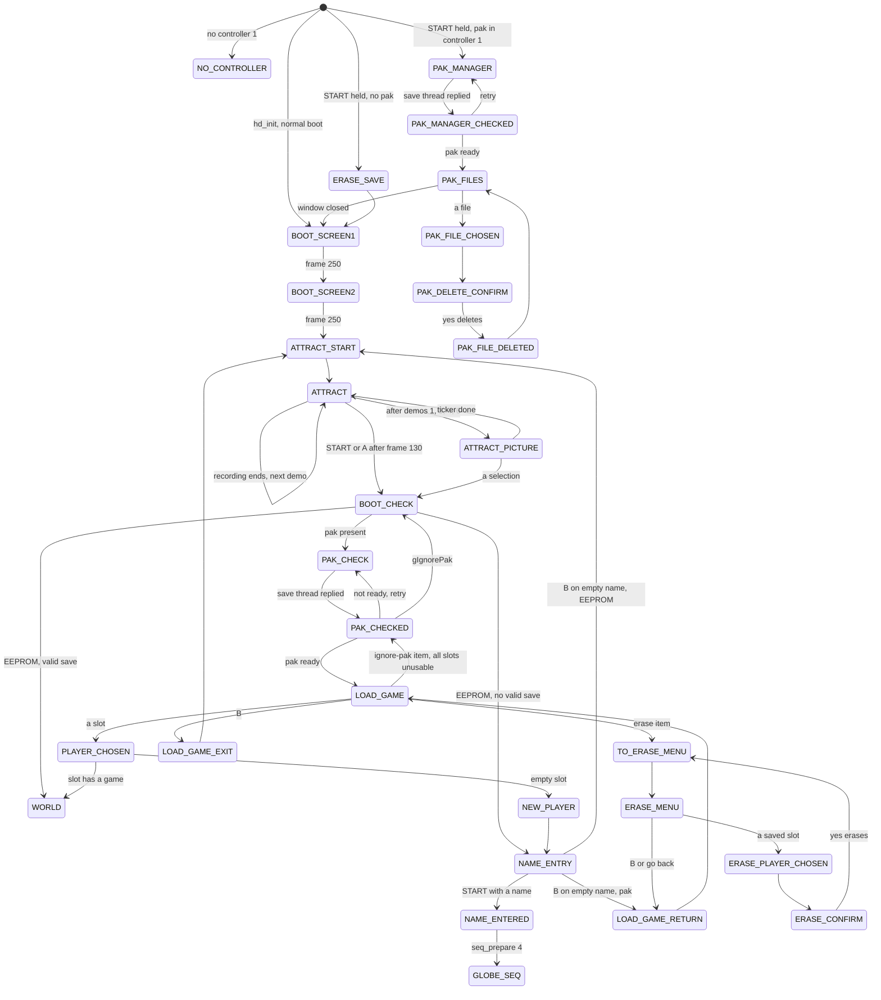
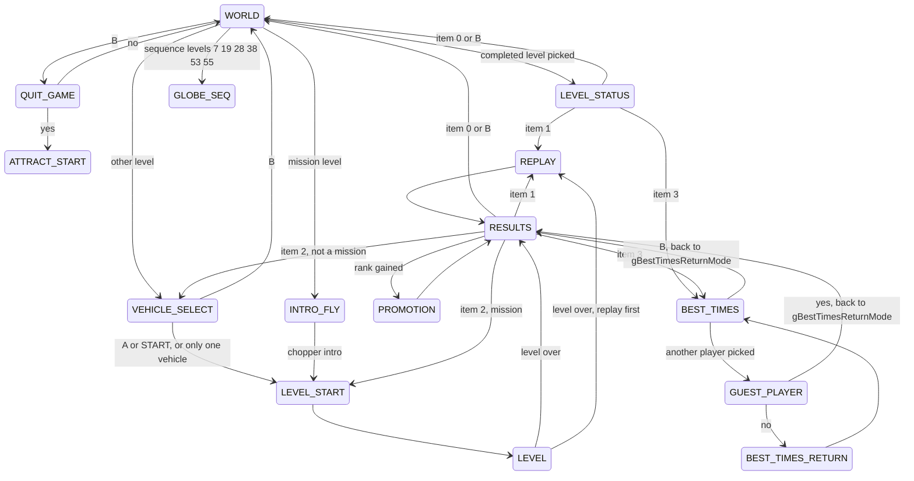

# Front end

The front end is everything around the levels: the two boot logo screens, the
attract demos, the save-slot menus, name entry, the level-select globe with
its solar system, the vehicle select, the results, promotion and best-times
screens, and the Controller Pak / EEPROM save code. Most of it is a separate
code segment, `hd_front_end`, that `hd_code` loads over a fixed RAM area when
it needs it and gives up when a level is loaded. The menus themselves are
"Yoshi" text windows run by `hd_code` (`26570.c`, Rare's `yoshi.c`); the
front end fills in their items and reacts to the selections.

Everything below is from the code (US 1.1) unless it says otherwise. Game
modes are named by their `MODE_*` macros in `include/game/game.h`.

See also: [overview](overview.md), [memory](memory.md), [files](files.md),
[levels](levels.md), [rendering](rendering.md), [audio](audio.md),
[scoring](scoring.md), [vehicles](vehicles.md), [versions](../versions.md).

## 1. The `hd_front_end` segment

### What it contains

`hd_front_end.us.v11.yaml` describes it: one code segment with VRAM
0x801E7000.

| ROM part | VRAM | contents |
| --- | --- | --- |
| text 0x00000-0x20090 | 0x801E7000 | the game files below, then the old-SDK libultra Pfs/EEPROM objects (`ul_*.c`) |
| 0x20090-0x21040 | 0x80207090 | RSP microcode, IMEM text: the line ("L3D") build of Fast3D, `gL3dText`, which `hd_code`'s `rsp_init_ucode_table` DMAs; the globe's route lines need it (`gSPLineW3D`) |
| .data / .rodata 0x21040-0x29E90 | 0x80208040 | menu items and text, the globe level table, rank titles, constants |
| .bss | 0x80210E90-0x8021ED00 | the front end's variables |

The whole area is 0x37D00 bytes and ends at 0x8021ED00, which is also the
staging buffer `hd_rom_load` decompresses from, and `init`'s VRAM.

| file | Rare's name (asserts) | role |
| --- | --- | --- |
| `00000.c` | `digger_loop.c` | vehicle select (`fe_digger_*`) |
| `01C40.c` | `player.c` | save slots, the scrolling name ticker, load/erase menus, name entry, results medals, pending saves, mission regrading |
| `06790.c` | | promotion screen (`fe_promo_*`) |
| `07390.c` | | the save thread's error screen (`fe_pak_error_frame`) |
| `07800.c` | `stats.c` | grading a finished level (`fe_stats_*`), boot screens (`fe_boot_screen_*`) |
| `09570.c` | | globe mesh, level icons, academy icons, star field, `fe_lvlsel_level_open` |
| `0C450.c` | | the solar-system node scene (`fe_solar_*`) |
| `0DE70.c` | | the three 3D scene blobs (logos, promotion) and the spinning comm-point model |
| `0E7B0.c` | `pfsHandler.c` | the save thread and its commands (`fe_pak_*`) |
| `10850.c` | `bestTimes.c` | best-times screen (`fe_best_*`) |
| `11530.c` | | level-select globe: level table `gGlobeLevels`, frame, routes, flight marker, unlocking |
| `17990.c` | `back_loop.c` | `fe_back_loop`, the per-frame loop of all menu modes |
| `196F0.c` | | 320x240 background pictures (`fe_bg_*`) |
| `1A240.c` | | the attract mode's picture screen (`fe_attract_pic_*`) |
| `1AE80.c` | | `fe_pak_restore_from_eeprom` |
| `1B100.c` | | hand-written asm: model loading and animation for the 3D models (`fe_load_model`, `fe_anim_*`, `fe_veh_*_tex_anims`) |
| `ul_*.c` | libultra `src/io/*` | old-SDK `osPfs*`, `osEeprom*`, CRC, `__osPfs*` |

The pause menu and the in-level text pages are not in this segment; they are
`hd_code` (section 9).

### When it is loaded

`hd_load_front_end` (`src.us.v11/hd_code/46C20.c`) blanks the screen and, if
`frontEndPresent` is 0, inflates the segment from ROM (`gFeRomStartPtr` ..
`gFeRomEndPtr`, gzip via `hd_rom_load(..., 0xD, 10, 1)`) to 0x801E7000,
zeroes the rest of the 0x37D00-byte area (this is the .bss clear), sets
`frontEndPresent = 1` and starts the save thread (`fe_pak_start_thread`).
The port hooks it with `PORT_FE_LOADED()`.

It is called:

- from `hd_mode_setup` (`hd_code/00000.c`) whenever the next mode is any
  front-end mode (the long mode mask in that function: boot screens, menus,
  world, results, vehicle select, promotion, pak modes, ...);
- from `hd_main_thread`'s mode switch for `MODE_WORLD`, for
  `MODE_LEVEL_STATUS` coming from `MODE_GLOBE_SEQ`, and for `MODE_REPLAY`
  coming from a level end;
- from `academy_advance_state` (`hd_code/41930.c`) before regrading.

It goes away with a level: `hd_setup_level` removes the save thread's
scheduler client and destroys the thread (asserting `!pakBusy` and an empty
reply queue) when `frontEndPresent` is set, and `lvl_read_header`
(`hd_code/5CB60.c`) sets `frontEndPresent = 0` after the level file is in.
The next front-end mode loads the segment again (and its .data comes back
fresh from ROM, which is why front-end state that must survive a level lives
in `hd_code`'s variables: `players`, `saveIt`, `gBestTimes`, ...).

Consequence: **saving only happens while the front end is present.** A
finished level only marks `saveIt[player] = level + 1`; the actual writes are
sent by `fe_player_save_pending` when `MODE_WORLD` is entered (or by the
academy's state 6).

### How hd_code calls into it

There is no jump table. `hd_code` calls front-end functions directly at
their fixed addresses (the yaml notes that 307 of the 917 `jal` words in the
front end land inside it; the rest call `hd_code`). It is only legal to call
them while `frontEndPresent` is 1; several asserts check this
(`fe_best_clear_times`, `stats_save_status`, the academy).

The entry points `hd_code` uses:

| caller (`hd_code`) | front-end function |
| --- | --- |
| `hd_main_thread` frame dispatch | `fe_globe_frame` (`MODE_WORLD`), `fe_digger_frame` (`MODE_VEHICLE_SELECT`), `fe_boot_screen_frame` (boot screens), `fe_back_loop` (every other front-end mode) |
| `hd_main_thread` mode switch | `fe_boot_screen_init`, `fe_bg_load`, `fe_player_build_load_menu`, `fe_player_build_erase_menu`, `fe_player_ticker_reset` / `_set_text`, `fe_player_panel_init`, `fe_player_new_game`, `fe_pak_restore_from_eeprom`, `fe_pak_list_files`, `fe_player_update_level_kinds`, `fe_open_reachable_levels`, `fe_player_save_pending`, `fe_globe_init`, `fe_attract_pic_load`, `fe_stats_grade_level`, `fe_stats_count_unlocks`, `fe_comm_point_load`, `fe_player_medals_init` / `_show_quiet`, `fe_promo_init`, `fe_digger_init`, `fe_player_name_entry_open`, `fe_best_color_items` |
| `hd_mode_setup` | `fe_best_build_menu` (for `MODE_BEST_TIMES`) |
| `hd_load_front_end` | `fe_pak_start_thread` |
| `seq_get_loop_done` (`54E30.c`) | `fe_player_loop_done_mode` |
| academy (`41930.c`) | `fe_bg_load`, `fe_player_save_pending`, `fe_best_clear_times`, `fe_player_regrade_missions`, `fe_player_regrade_platinum` |

## 2. The front-end state flow

### The mode machinery

`gGameMode` and `gNextGameMode` are u64 with one bit per mode.
`hd_main_thread` (`hd_code/00000.c`) loops forever:

1. While `gNextGameMode != 0`: run the set-up case for `gNextGameMode` in
   its big switch (it can queue a follow-up in `gGameModeAfterNext`), then
   `gPrevGameMode = gGameMode; gGameMode = gNextGameMode; gNextGameMode =
   gGameModeAfterNext`.
2. Start `gPendingTune`, then run frames of the current mode until some code
   sets `gNextGameMode`. The frame function is picked by mode:
   `MODE_WORLD` -> `fe_globe_frame`; the menu modes -> `fe_back_loop`;
   `MODE_VEHICLE_SELECT` -> `fe_digger_frame`; `MODE_BOOT_SCREEN1/2` ->
   `fe_boot_screen_frame`; everything else (`MODE_ATTRACT`,
   `MODE_GLOBE_SEQ`, the level modes, `MODE_YOSHI_PAGES`) -> `hd_game_frame`.
   `gFramesInMode` counts the frames of the mode.
3. After the mode ends, the request modes are serviced: `MODE_SEQ_SKIP` /
   `MODE_SEQ_END` -> `seq_finish`, `MODE_ACADEMY_NEXT` ->
   `academy_next_mode`; and when going to `MODE_WORLD` for the starting
   player, `academy_advance_state` may announce a new game state.

`fade_to_mode(m)` / `fade_to_mode_speed(m, speed)` set a pending mode
(`postFadeLoop_done`); `fade_draw` (`hd_code/30430.c`) sets `gNextGameMode`
once the fade to black completes.

Most front-end modes are "wait for the window" modes: the set-up opens a
Yoshi window with `yoshi_demand(YOSHI_DEMAND_OPEN | YW_*)`, `fe_back_loop`
reacts to `yoshiSelection` (an item index, or 0xFFFF for B), and once the
window has closed (`yoshiState == 1`, no fade, no pending window) a second
switch in `fe_back_loop` moves on. Several modes (`MODE_NEW_PLAYER`,
`MODE_TO_ERASE_MENU`, `MODE_LOAD_GAME_RETURN`, ...) exist only to let a
window close before the next one opens.

### Boot, menus and the pak manager



`MODE_NO_CONTROLLER` opens `YW_NO_CONTROLLER` and has no way out in the code
(no case in `fe_back_loop`'s idle switch): the player must reset.

### World, levels and results



(`LEVEL_STATUS` also goes to `VEHICLE_SELECT` / `LEVEL_START` with item 2,
and `BEST_TIMES` / `GUEST_PLAYER` go back to whichever of `LEVEL_STATUS` or
`MODE_RESULTS` opened it; the diagram shows one of each to stay readable.
The level end and replay modes are covered in [scoring](scoring.md) and
[camera](camera.md).)

The results/level-status menu items are counted from the end of the window:
`fe_back_loop` computes `i = first + count - selection - 1`, so the last
item is 0 (back to the world), then 1 replay, 2 play again, 3 best times.

### Modes the front end uses

| macro | bit | set-up (in `hd_main_thread` unless noted) | frame |
| --- | --- | --- | --- |
| `MODE_BOOT_SCREEN1` / `2` | 0x10 / 0x20 | `fe_boot_screen_init(1 / 2)` | `fe_boot_screen_frame` |
| `MODE_ATTRACT_START` | 0x400000000000000 | demo counter -1, `gWorldEntered = 0`, queue `MODE_ATTRACT` | (none) |
| `MODE_ATTRACT` | 0x2 | next demo or the picture screen (section 7) | `hd_game_frame` |
| `MODE_ATTRACT_PICTURE` | 0x1000000000000 | `fe_bg_load(7)`, `fe_attract_pic_load` | `fe_back_loop` |
| `MODE_BOOT_CHECK` | 0x20000000000000 | pak or EEPROM decision (section 6) | `fe_back_loop` |
| `MODE_PAK_CHECK`, `MODE_PAK_CHECKED` | 0x10000000, 0x8000 | pak init request, `YW_PAK_CHECK` | `fe_back_loop` |
| `MODE_LOAD_GAME`, `_RETURN`, `_EXIT` | 0x10000, 0x200000, 0x8000000000000000 | `fe_player_build_load_menu`, `YW_PLAYER_MENU` | `fe_back_loop` |
| `MODE_PLAYER_CHOSEN`, `MODE_NEW_PLAYER` | 0x2000000, 0x20000 | (waits) | `fe_back_loop` |
| `MODE_NAME_ENTRY`, `MODE_NAME_ENTERED` | 0x40000, 0x1000000 | `fe_player_name_entry_open`, `YW_NAME_ENTRY` | `fe_back_loop` + `fe_player_name_entry_draw` |
| `MODE_ERASE_MENU`, `_PLAYER_CHOSEN`, `_CONFIRM`, `MODE_TO_ERASE_MENU` | 0x400000, 0x100000, 0x80000, 0x800000 | `fe_player_build_erase_menu`, `YW_CONFIRM` | `fe_back_loop` |
| `MODE_ERASE_SAVE` | 0x40000000000000 | EEPROM probe, `YW_CONFIRM` | `fe_back_loop` |
| `MODE_PAK_MANAGER`, `_CHECKED`, `MODE_PAK_FILES`, `MODE_PAK_FILE_CHOSEN`, `MODE_PAK_DELETE_CONFIRM`, `MODE_PAK_FILE_DELETED` | 0x80000000000, 0x2000000000, 0x100000000, 0x4000000000, 0x8000000000, 0x10000000000 | section 6 | `fe_back_loop` |
| `MODE_NO_CONTROLLER` | 0x800000000000000 | `YW_NO_CONTROLLER` | `fe_back_loop` |
| `MODE_WORLD` | 0x4000 | `fe_player_save_pending`, `fe_globe_init` | `fe_globe_frame` |
| `MODE_QUIT_GAME` | 0x4000000000000000 | `YW_CONFIRM` | `fe_back_loop` |
| `MODE_LEVEL_STATUS` | 0x80 | results window of the level kind, medals | `fe_back_loop` |
| `MODE_RESULTS` | 0x8000000 | grading, `saveIt`, results window | `fe_back_loop` |
| `MODE_PROMOTION` | 0x40000000 | `fe_promo_init`, `fe_bg_load(3)` | `fe_back_loop` + `fe_promo_draw` |
| `MODE_BEST_TIMES`, `_RETURN` | 0x40000000000, 0x200000000000000 | `fe_best_build_menu` (from `hd_mode_setup`), `YW_BEST_TIMES` | `fe_back_loop` |
| `MODE_GUEST_PLAYER` | 0x100000000000000 | `YW_CONFIRM` | `fe_back_loop` |
| `MODE_VEHICLE_SELECT` | 0x20000000 | `fe_digger_init`, `fe_bg_load(2)` | `fe_digger_frame` |
| `MODE_ACADEMY_MESSAGE`, `MODE_REGRADE_NOTICE`, `_END` | 0x800000000000, 0x4000000000000, 0x8000000000000 | academy announcements (see [scoring](scoring.md)) | `fe_back_loop` |
| never entered | `MODE_PRE_PROMOTION`, `MODE_UNUSED_33`, `MODE_UNUSED_WINDOW_13`, `MODE_UNUSED_41`, `MODE_UNUSED_52`, `MODE_BEST_TIMES_UNUSED` | handled in places, set nowhere | |

### What `fe_back_loop` does each frame

`src.us.v11/hd_front_end/17990.c`, in order:

1. In `MODE_PAK_CHECK` / `MODE_PAK_MANAGER`: keep a ticking loop sound
   playing; once the window is open (`yoshiState == 2`) take the save
   thread's reply from `pakToGameMessageQ`, set `gPakReady = !reply`, read
   the four slots if ready (`fe_player_load_slots`), close the window and go
   to `MODE_PAK_CHECKED` / `MODE_PAK_MANAGER_CHECKED`.
2. If `yoshiSelection` is non-zero, act on it for the current mode (the
   first switch), then clear it (kept in `gLastYoshiSelection`).
3. Send last frame's display list to the RSP (`rsp_send_task`), flip
   `gBufferIndex`, start this frame's list: segments 0/1/2, the static init
   lists, a fill. Results and level status clear a depth rectangle
   (220,110)-(300,160) for the comm-point model; promotion clears the whole
   depth buffer.
4. Draw: background picture (`fe_bg_draw`), the regrade window first in the
   regrade modes, the lit player panel and scrolling name ticker
   (`fe_player_draw_panel`), the title logo (`title_draw_attract`, which
   outside the attract demo draws the logo), the load/erase menu's ticker
   update when the highlighted slot changes, promotion, the attract picture,
   results medals and comm-point model, the blinking comm-point count,
   best-times player cycling and the vehicle icon, text, fade, Yoshi windows,
   and the name-entry wheel.
5. Wait for this frame's texture DMAs and decode them.
6. If the window is closed and nothing is fading or pending, the second
   switch picks the next mode (the "wait" modes above).

## 3. Boot screens

`fe_boot_screen_init(n)` (`07800.c`) loads 3D scene blob `n` with
`fe_scene_load` (`0DE70.c`: scene 0 = `romUsaStarScene`, used by the
promotion screen; 1 = `romNinLogoScene`; 2 = `romReflectLogoScene`; each is
gzip with a header giving the display list, a texture list resolved by
`tex_resolve_dl` and the segment-6 base) and inflates two IA8 textures, a
256x32 banner (`romBootBanner`) and a 40x24 icon (`romBootIcon`), onto the
heap.

`fe_boot_screen_frame` builds the whole frame itself:

| frame | what happens |
| --- | --- |
| 0-20 | scene 1 fades its background up to grey 185; scene 2 stays black |
| 20 | the scene's "in" sound (`SFX_BOOT1_IN` / `SFX_BOOT2_IN`) |
| 20-80 | the camera flies in from distance 7600+400 to 400 while the scene spins (3 degrees a frame) |
| 75 | the "land" sound (`SFX_BOOT2_LAND` / `SFX_BOOT1_LAND`) |
| > 80 | scene 1 only: the banner and icon fade in over the scene (as old-style texture rectangles) |
| 221-250 | fade to black |
| 250 | `MODE_BOOT_SCREEN1` -> `MODE_BOOT_SCREEN2`; `MODE_BOOT_SCREEN2` -> `MODE_ATTRACT_START` (with a chime if `gDebugCheats`) |

The set-up of `MODE_BOOT_SCREEN1` also spins for 15 scheduler frames before
it starts. There is no button skip in this code. Measured (bc_headless):
each boot screen ran 251 frames at one retrace per frame, so about 4.2 s
each at 60 Hz, and the first frame was sent at retrace 45.

## 4. Menus

### The panel and ticker

Many menu screens show a lit band near the bottom with a scrolling ticker
(`fe_player_panel_init`, `fe_player_ticker_set_text`, `fe_player_draw_panel`
in `01C40.c`). For a slot with a game the ticker holds the player's name,
rank title (`gRankTitles[PlayerInfo.title]`), medal counts with medal
sprites, the last mission's money (pak saves only, not EEPROM) and a rank
icon. During the attract picture screen it holds one of four character
biographies instead, chosen by the picture number. The band fades in or out
by mode (`gPanelAlpha`). Slot 4 means "no player" (a blank ticker).

### Load game, erase, ignore pak

`fe_player_load_slots` reads the four player records (save command 6 per
slot) and sets `gSlotState[i]`: 1 a saved game, 2 a fresh "new game" record,
0 unusable. A failed read other than a bad CRC tries to create the file
(command 3) if the slot is below `gPakFullSlot`; if that fails the slot is
marked full. A bad CRC/semaphore (0x6E382) or a created file gets a fresh
record (`fe_player_new_game`).

`fe_player_build_load_menu` puts the four slot labels in menu items 2-5
(unusable slots disabled) and item 6 is either the erase entry or, when all
four slots are unusable (`gLoadMenuFullSlot == 4`), an "ignore pak" entry
that sets `gIgnorePak` and goes back to `MODE_BOOT_CHECK`, which then uses
the EEPROM instead. The highlighted slot's ticker follows the cursor
(`fe_back_loop` watches `gYoshiWindows[YW_PLAYER_MENU].sel`).

Picking a slot sets `gLoadedPlayer = playerNumberAtStart = playerNumber`;
state 1 fades to the world, otherwise `MODE_NEW_PLAYER` -> name entry.

The erase menu (`fe_player_build_erase_menu`) enables only saved slots;
confirming calls `fe_player_new_game(slot, 0, 0)`, which zeroes the record,
gives it the starting vehicles (`fe_player_init_vehicles`: 0x1063E), gives
it the placeholder name, and sends a write (7) and a valid semaphore (21).

### Name entry

`fe_player_name_entry_open` (called for `MODE_NAME_ENTRY` with max length 7,
box width 0x1E and the target `players[playerNumber].name`, 8 bytes) and
`fe_player_name_entry_draw`:

- A wheel of 33 characters (26 letters, then 7 symbols, the last being
  delete, 0x7F) laid on an ellipse (radius 120 x 96). The stick X turns it
  (squared response, dead zone 10); releasing the stick snaps to the next
  slot (one slot = 0x7C2 angle units). A tick sound plays per slot.
- A takes the highlighted character, which flies into the name box; B, or A
  on delete, removes the last character. B on an empty name leaves: to the
  load menu (pak) or the attract sequence (EEPROM).
- START with at least one character sets `gSlotState = 1` and goes to
  `MODE_NAME_ENTERED`, which writes the record (7) and a valid semaphore
  (21), prepares sequence 4 and fades to `MODE_GLOBE_SEQ` (the intro
  sequence).

The set-up first sends an "invalid" semaphore (20) and waits for it, so an
interrupted name entry leaves a slot the next boot treats as bad.

### Pause menu (in `hd_code`)

`hd_handle_yoshi_selection` (`hd_code/00000.c`) runs the in-level windows:
item 1 options (with 9 music volume 1.0/0.7 and 7 control method, saved per
vehicle in `PlayerInfo.controlModes`), 2 status (`stats_finish_level`), 3
retry (missions -> `MODE_LEVEL_START`, others -> `MODE_VEHICLE_SELECT`), 4
back to the world, 8 the text pages (section 9).

### Level status and results

`MODE_LEVEL_STATUS` (a completed level picked on the globe) and
`MODE_RESULTS` (after playing) share the window per level kind
(`gYoshiResultsWindowByKind[lowest_set_bit(gLevelKind)]`), the panel, and
the medal display (`fe_player_medals_init`, `fe_player_draw_medals`): for a
mission two medal sprites; for a timed level the medal won plus a smaller
icon of the next medal with its target time from `LevelInfo.medalTimes`. If
the level has communication points (`gGlobeLevels[level].commRoutes`), the
comm-point model spins on the right (`fe_comm_point_load` /
`fe_comm_point_draw`, model 0x96) with a blinking count of those found
(`fe_stats_count_unlocks`, at most 2).

`MODE_RESULTS`'s set-up does the bookkeeping: `saveIt[player] = level + 1`
(asserting nothing else is pending), the mission's status stream into
`pakBuffer` (`record_status`, then `saveLevel`), the time (`nss.tc`, 1/10 s,
capped at 59999), and the grade (`fe_stats_grade_level`; see
[scoring](scoring.md)). If a rank was gained, `MODE_PROMOTION` is queued.
On a first clear by the starting player `gRouteRevealFlags` is set so the
globe animates the new routes. With EEPROM saves one results item
(`gYoshiFeItems[29]`) has its flag bit 0 cleared (which item is uncertain).

### Promotion

`fe_promo_init` / `fe_promo_draw` (`06790.c`), over scene 0 and background
picture 3. The scene grows with a sine to scale 2.84 over 90 frames, holds
145 frames and shrinks (x0.9 a frame), spinning faster as it shrinks. The two
title lines fade in at frame 50; at 200 they give way to the new rank title
(split into two lines after `gRankTitleLine1Words[rank]` words); at 290 that
fades and the mode returns to `MODE_RESULTS`. With `gDebugCheats`, A skips
to the end.

### Best times and guest players

`fe_best_build_menu` (`10850.c`, called from `hd_mode_setup`) reads the
level's time block of every saved slot that has finished the level (command
8) and builds, for each best-time slot the starting player has a time in
(vehicles the starting player has unlocked; a timed mission shows only slot
0), four rows (one per player) sorted by time, each with the medal of that
time (`fe_stats_grade_time`). The groups are then sorted by their best time.
Rows are coloured by owner (`fe_best_color_items`): the starting player,
the highlighted player, others. Z or R moves the highlight to the next
player with rows (`fe_best_next_player`); the vehicle icon of the current
row is drawn on the left (`fe_best_draw_icon`).

A on a row of another saved player opens `MODE_GUEST_PLAYER`. Yes fades back
to `gBestTimesReturnMode` (`MODE_LEVEL_STATUS` or `MODE_RESULTS`) with
`playerNumber` set to that slot: the return set-up switches
`gLoadedPlayer`, saves the status, and the level can then be played as that
player (saves go to that slot's `saveIt`, the ticker gets a guest prefix,
and the vehicle select only offers vehicles the starting player has a time
in). `MODE_WORLD` puts `playerNumberAtStart` back.

### Vehicle select (`digger_loop.c`)

`fe_digger_init` (`00000.c`) lists every vehicle type (0..18) that is in
`LevelInfo.vehicles` and in the starting player's `vehiclesUnlocked`, loads
its model (`fe_load_model`), places them 380 units apart on X and starts
each model's animation channel from per-vehicle tables (`gDiggerAnimChannel`,
`gDiggerAnimSpeed`, ...). If only one vehicle qualifies it returns 0 and the
set-up goes straight to `MODE_LEVEL_START`. The starting slot is the level's
best vehicle (from level status), the current vehicle (from a level or the
results), or the middle one (from the world).

`fe_digger_frame`: stick left/right accumulates into a scroll counter
(threshold 750; a fresh push or D-pad left/right moves at once), checked
only on frames where `gBufferIndex == 0`; the camera eases (factor 0.1) to
the chosen vehicle's X and its view distance `gDiggerViewDist`; the chosen
vehicle spins 4 degrees a frame and plays its select sound. A or START fades
to `MODE_LEVEL_START` with `gDiggerVehicle`; B goes back to level status /
results (whichever came before) or the world.

### Quit

B on the globe (only when it is idle) fades to `MODE_QUIT_GAME`, a
`YW_CONFIRM` window: yes goes to the attract sequence, no back to the world.

## 5. The level-select globe

### Data

`gGlobeLevels[60]` (`GlobeLevel`, `include/game/types.h`, defined in
`11530.c`):

| offset | type | field | meaning |
| --- | --- | --- | --- |
| 0x00 | u8 | `unk0` | unknown (most entries 0x64, some smaller or 0) |
| 0x01 | u8 | `unk1` | unknown (1 or 0) |
| 0x04 | char* | `name` | English level name |
| 0x08 | u16* | `jname` | Japanese glyph string in `hd_code` .data |
| 0x0C | s32 | `unkC` | always 0 in the table |
| 0x10 | f32 | `lat` | latitude, degrees |
| 0x14 | f32 | `lon` | longitude, degrees |
| 0x18 | s8[4] | `commRoutes` | levels opened by the level's communication point j, -1 ends |
| 0x1C | s8[8] | `routes` | levels opened when this one is done, -1 ends |
| 0x24 | f32[3] | `x, y, z` | position on the globe, filled at init (radius 250) |

`fe_globe_init` converts every entry's lat/lon with
`fe_globe_latlon_to_xyz(lat, lon, ..., 250)`: x = cos(-lon) cos(lat) r,
y = sin(lat) r, z = sin(-lon) cos(lat) r. Level placement is therefore just
these two angles. `lvl_planet(level)` (`hd_code/1D990.c`) puts five levels
on other bodies of the solar system (nodes 0, 1, 2, 4, 5); every other level
is on Earth (node 3).

### Unlocking

A level is *done* when `PlayerInfo.medal[level]` is 1..5 (the code's
`LEVEL_DONE` test, `> 0 && < 6`); 8 means *open* but not done; 0 locked.

- `fe_open_reachable_levels(8)` (`11530.c`), run when the world is first
  entered after loading (`gWorldEntered == 0`) and whenever a level is
  picked (`fe_player_load_level_save`), marks as open every level in a done
  level's `routes[]` (unless `fe_globe_level_locked`) and every
  `commRoutes[j]` whose bit j is set in that level's `PlayerInfo.commPts`.
- `fe_globe_level_locked(level)` keeps a level shut while
  `LevelInfo.gameState > PlayerInfo.gameState` for mission levels
  (`kind & LEVEL_KIND_ANY_MISSION`) and levels 0x2B-0x2E, and keeps five
  levels shut until a prerequisite is done: 0x0A needs 0x37, 0x0F needs
  0x1C, 0x3A needs 0x35, 0x05 needs 0x07, 0x10 needs 0x13 (the
  prerequisites are the five vehicle-introduction levels that
  `seq_get_loop_done` runs as sequences). Level 0 is never locked.
- `fe_lvlsel_level_open` (`09570.c`) is the "can be picked/drawn" test: not
  locked, on Earth, and done, level 0, or reachable from a done level by a
  route or a taken comm point.

The academy's `gameState` and the regrading of missions are in
[scoring](scoring.md).

### Drawing

`fe_globe_init` builds, on the heap:

- the globe mesh (`fe_lvlsel_build_globe_dl`): it inflates the world
  texture file (`romWorldTexturesRaw` .. `romAttractPictures`), takes the
  star, flight-marker, glow and sun textures from its tail, and builds a
  cube-sphere of six faces with 8x8 vertices each pushed to radius 250
  (`fe_lvlsel_build_globe_vtx`), each of the 7x7 cells textured with five
  mip levels (17x17 down to 2x2 RGBA16);
- the level icons (`fe_lvlsel_build_level_icons_dl`): one quad per pickable
  level, drawn by category = medal value 8..0 with its own combiner; done
  levels without platinum get a second larger quad, red when no comm point
  is left to find and green when some are; mission levels are drawn 1.75x;
- the academy icons (`fe_lvlsel_build_academy_dl`) for academy markers found
  (`PlayerInfo.academy`, `gAcademyMarkers`);
- 0x200 random star quads (`fe_lvlsel_build_starfield_dl`), double-buffered
  in the dynamic buffers;
- two 0x17000-byte vertex buffers for the routes.

`fe_globe_frame` sends three RSP tasks each frame: the scene (stars, the
solar system and the level name with its vehicle icons,
`fe_globe_build_scene_dl`), the routes (`fe_globe_build_routes_dl`, line
microcode), and the flight marker plus the fade (`fe_globe_build_plane_dl`).

The solar system (`0C450.c`) is a node tree `gSolarNodes[7]` (`Node`, 0x3C
bytes: size, spin period, orbit radius, sibling, child, colour, angle, world
position, camera eye, depth). `fe_solar_build_mtx` walks it with a float
matrix stack, advancing each node's orbit angle; the camera looks at the
node of the selected level's body (`gGlobePlanet`) from the globe's camera
direction. Nodes are depth-sorted (`text_shell_sort`); Earth (node 3) is the
textured globe (`fe_globe_draw_earth`), the sun (node 6) a 32x32 sprite, the
others glow sprites. While on Earth, nodes behind Earth are not drawn.

Routes (`fe_globe_draw_routes`, `fe_globe_draw_route`): every done level's
routes are drawn as great-circle arcs (3 to 15 segments, by distance / 32)
with `gSPLineW3D`: normal routes red to pink, comm-point routes green to
yellow and arched above the surface, plus a dim straight pass first.
Brightness follows the dot product with the camera, and only routes with an
Earth end and facing the camera are drawn. New routes after a first clear
grow over 90 frames from the end of the zoom, with a looping sound.

### Input and camera

| state (`gGlobeState`) | what happens |
| --- | --- |
| 0 | zoom in from distance 6250 to 925, 200 a frame, overlay fading in |
| 1 | idle: stick picks routes, A or START selects, B quits |
| 2 | selected: zoom on to 300 (50 a frame), overlays fade; then `gNextGameMode = seq_get_loop_done(levelno)` |

The stick picks a destination by direction: of the routes leaving the
selected level, the one whose on-screen direction (`math_angle_2d_deg` of
its first segment) is nearest the stick angle, within 45 degrees, becomes
`gGlobeStickLevel`; pushing the stick past a dead zone (squared length 1500)
after it was centred flies there. The flight marker
(`fe_globe_draw_plane`) travels along the arc (progress += 0.4 / steps a
frame, raised by sin(pi t) x steps / 64); the level name fades out and back
in at the half-way point, and the globe light follows the marker. The camera
lat/lon chase the selected level each frame by a step proportional to the
angle difference times max(stick^2 / 4, 500) / 10000. Changing bodies
restarts the zoom and switches between `MUS_WORLD_EARTH` and
`MUS_WORLD_SPACE` (`fe_globe_select_level`).

Selecting sets `levelno` and calls `fe_player_load_level_save`: for a done
level it asks for the saved status (command 12, missions) and the level's
time block (command 8, reply); otherwise a no-op with reply (22) and the
times are cleared. The next mode's set-up waits for that reply.

`seq_get_loop_done` (`hd_code/54E30.c`) picks the mode: levels 38, 55, 28,
53, 7 and 19 run a sequence (`MODE_GLOBE_SEQ`); otherwise
`fe_player_loop_done_mode`: done -> `MODE_LEVEL_STATUS`, mission ->
`MODE_INTRO_FLY` (0x800), else `MODE_VEHICLE_SELECT`.

## 6. Save data

### The save thread

`fe_pak_start_thread` (`0E7B0.c`) creates `gPakThread` (priority 11, above
the main thread's 10, stack 0x1000), the request queue `gPakRequestQueue`
(8), the reply queue `pakToGameMessageQ` (8), and a scheduler client that
gives it a retrace message each frame. `fe_pak_thread` takes one request at a
time:

```
OSMesg request = cmd | arg << 8 | player << 16 | reply << 24
```

It sets `pakBusy`, waits for the main thread's controller read to finish
(`cont_wait_read`), sets the pak extension name to `player + 0x11` (one file
per player), runs the command, and repeats it once per retrace until it
settles. If `reply` is set it sends the final result (an `s32` in the
OSMesg) to `pakToGameMessageQ`. It spins while `gPreNmi` is set, so it does
not start a write during a reset.

| cmd | function | what |
| --- | --- | --- |
| 1, 2 | `fe_pak_init_pak` | pak in controller 1? then `osPfsInitPak` (1 = no pak) |
| 3 | `fe_pak_create_file` | `osPfsAllocateFile` of the player's file |
| 4 | `fe_pak_delete_file` | delete the current player's file |
| 5 | `fe_pak_delete_listed_file` | delete the file behind pak-manager item `arg` (list starts at item 37) |
| 6 / 7 | `fe_pak_rw_player` | read / write the 0x100-byte player record |
| 8 / 9 | `fe_pak_rw_times` | read / write level `arg`'s 0x20-byte time block |
| 10 / 11 | `fe_pak_rw_eeprom_times` | read / write the EEPROM time words of levels `arg`, `arg + 1` |
| 12 / 13 | `fe_pak_rw_status` | read / write the 0x40-byte level status block (`pakBuffer`) |
| 14 | `osPfsFreeBlocks` | free bytes into `gPakFreeBytes` |
| 15 | `fe_pak_is_missing` | 1 if no pak in controller 1 |
| 16 | `osEepromProbe` | EEPROM present? (always done after one pass) |
| 17 | `fe_pak_get_file_state` | `osPfsFileState` of note `player` into the file list |
| 18 | `osPfsChecker` | repair the pak file system |
| 19 | | returns 10: the "stuck" state after a fatal error |
| 20 / 21 | `fe_pak_put_semaphore` | write the invalid / valid semaphore |
| 22 | | no-op (returns 0; used to synchronise) |

Result handling (libultra `PFS_*` codes, plus the game's own 0x6E382 for a
bad CRC or semaphore):

Each pass starts with error window 0x5B as the default; it is drawn (see
below) whenever a pass neither finishes nor switches command.

- 0, `PFS_ERR_INVALID` (5), `PFS_ERR_EXIST` (9): done.
- `PFS_ERR_NOPACK` (1): done during the boot check, otherwise retried
  every retrace with window 0x5B up (results the switch does not handle,
  such as `PFS_ERR_CONTRFAIL`, behave the same way).
- `PFS_ERR_INCONSISTENT` (3): run `osPfsChecker` (18) and requeue the
  command (with no reply), up to 4 times; then error window 0x5C.
- `PFS_DATA_FULL` (7), and `PFS_DIR_FULL` (8) in the load/pak-check modes
  with a pak present: note the slot in `gPakFullSlot` (the lowest such
  player) and finish. `PFS_DIR_FULL` anywhere else is retried with window
  0x5B.
- `PFS_ERR_BAD_DATA` (6), `PFS_ERR_ID_FATAL` (10), `PFS_ERR_DEVICE` (11),
  and 0x6E382 outside the load menus and boot check: retry up to 4 times,
  then write the invalid semaphore, show error window 0x5C (0x5D for
  0x6E382) and switch to command 19, which returns 10 forever: the error
  window stays until reset.
- `PFS_ERR_NEW_PACK` (2): the code's test can never be true (it compares a
  variable reset at the top of the pass), so it is retried.

While retrying, the thread draws its own frames with `fe_pak_error_frame`
(`07390.c`: black screen plus the Yoshi window), but only when the main
thread is blocked waiting on `pakToGameMessageQ` (so the two never build a
frame at once) and no reset is pending; afterwards it closes the window.

### The CRC

`fe_pak_add_crc(data, size)` / `fe_pak_check_crc` keep a 4-byte check in the
last four bytes of every block. With those bytes zeroed, byte j is the 8-bit
sum over every 0x80-byte chunk i of `__osContDataCrc(data + i * 0x80 + j *
0x20)` (libultra's CRC-8 of 32 bytes), for the lanes that lie inside the
block. A mismatch returns 0x6E382.

### The semaphore

An 8-byte "semaphore" marks whether a save completed:

- 0x87569AB6CD076AEC = valid (command 21), written last;
- 0x2704197125121981 = invalid (command 20), written first and on a fatal
  error.

`fe_pak_rw_player` (read) returns 0x6E382 unless the stored semaphore is
the valid one, so a save interrupted between 20 and 21 makes the slot read
as damaged (and the load menu then gives it a fresh record).

A full save of player i (`fe_player_save_pending`): 20, 7 (record), 9
(level's time block), 11 (EEPROM times), 13 (status, if `saveLevel` is the
current player's), 21 with reply; the music fades out first.

### The player record (`PlayerInfo`, 0x100 bytes)

From `include/game/types.h`; `players[4]` in `hd_code`.

| offset | type | field | meaning |
| --- | --- | --- | --- |
| 0x00 | char[8] | `name` | 7 characters + NUL; a fixed placeholder name when fresh (`gSlotState` 2) |
| 0x08 | u8 | `levelno` | level last played (set when saving) |
| 0x0A | u16 | `units` | medal points: gold 3, silver 2, bronze 1; 360 max |
| 0x0C | u8 | `title` | rank, index into `gRankTitles` (units / 12) |
| 0x10 | u32 | `vehiclesUnlocked` | bit per vehicle type; 0x1063E when new |
| 0x14 | s32 | `money` | the last mission's money |
| 0x18 | u8[60] | `medal` | per level: 0 locked, 1 bronze, 2 silver, 3 gold, 4 platinum, 5 done without a medal, 8 open |
| 0x54 | u8[60] | `commPts` | per level: bit j = communication point j taken |
| 0x90 | u8 | `academy` | bit per academy marker found (6) |
| 0x91 | u8 | `gameState` | progress state 0-13 (academy) |
| 0x92 | u8[60] | `bestVehicle` | per level: vehicle of the best result |
| 0xCE | u8[0x12] | `hintShows` | times each hint window 0x46-0x57 was shown |
| 0xEE | u8 | `demosSeen` | vehicle-demo sequences seen |
| 0xF0 | u32 | `controlModes` | bit per vehicle: alternative control method |
| 0xFC | u32 | `crc` | the block's 4 CRC bytes |

### Per-level time block (0x20 bytes)

`gBestTimes[player][16]` (u16, 1/10 s) holds the *current level's* times,
one slot per vehicle through `gVehicleTimeSlot[vehicle]` (slot 0 is also
the mission time). It is loaded per level (command 8), not for all levels at
once. The last four bytes are the CRC, so only slots 0-13 can hold times
(the debug print lists 14).

### Level status block (0x40 bytes)

`pakBuffer`: a completed mission's saved state stream (`record_status`
writes it, `apply_status` replays it when the level is loaded again; at
most `LEVEL_SAVE_SIZE - 4` bytes), CRC at the end. Only mission levels
(`kind == LEVEL_KIND_MISSION`) other than the three "dummy" levels 0x26,
0x2F and 0x31 (`DUMMY_LEVELS` in `stats.c`) have one. The first u64 being
0x1234567887654321 means "no status yet": `stats_save_status`
(`hd_code/409D0.c`) then rebuilds it. See [destruction](destruction.md) and
[levels](levels.md).

### Controller Pak file

One file per save slot, created with `osPfsAllocateFile(company 0x3031
("01"), game 0x4E424345 ("NBCE"), gPakGameName, extension = player + 0x11,
0xE00 bytes)`: 14 pages of 256 bytes. Names are converted to and from the
pak character set by `fe_pak_ascii_to_chars` / `fe_pak_chars_to_ascii`
(`gPakCharset`, 0x45 entries; unknown characters become code 0xF going in
and '-' coming out).

| offset | size | contents |
| --- | --- | --- |
| 0x000 | 0x100 | `PlayerInfo` (CRC at 0xFC) |
| 0x100 + level x 0x20 | 0x20 each, 60 levels | time block of the level (CRC in its last 4 bytes) |
| 0x880 + n x 0x40 | 0x40 each | status block of the n-th status-saving mission level (n = how many such levels come before it) |
| 0xDE0 | 0x20 | semaphore: the u64, then 24 bytes copied from the save thread's stack |

The status area has room for 21 blocks before 0xDE0 (from the layout;
`fe_pak_start_thread` asserts the 0xDE0 used size is below 0xE00). The 24
stack bytes after the semaphore are whatever was on the stack: two saves of
the same progress need not be byte-identical (the port emulates this with
`PORT_SAVE_SEMBLOCK`).

### EEPROM (4 Kbit, 64 blocks of 8 bytes)

With EEPROM there is one player, slot 0.

| bytes | blocks | contents |
| --- | --- | --- |
| 0x000-0x0FF | 0-31 | `PlayerInfo` (`osEepromLongWrite/Read` at block 0) |
| 0x100 + level x 4 | 32-61 | `gEepTimes`: per level two u16, the best time and the same XOR 0x55AA; written two levels (one block) at a time |
| 0x1F0-0x1F7 | 62 | not used by this code |
| 0x1F8-0x1FF | 63 | the semaphore |

The EEPROM keeps only the best time of each level, for the vehicle in
`bestVehicle[level]` (`fe_pak_rw_eeprom_times`); a read checks each done
level's pair against the XOR copy (0x6E382 on a mismatch; levels 0x26, 0x2F,
0x31 skipped). The time blocks and status blocks do not go to the EEPROM:
in EEPROM mode commands 8/9 and 12/13 copy to and from a RAM save image
`gSaveImage` laid out like the pak file. At boot,
`fe_pak_restore_from_eeprom` (`1AE80.c`) rebuilds that image: it reads the
time words (command 10, every second level), and for each done level writes
a time block with the best vehicle's time (command 9) and, for missions, a
"no status yet" status block (command 13). So after power-off, EEPROM games
keep only one time per level (the best vehicle's), and the missions' saved
states are rebuilt when the level is next visited. (The other slots of that
time block are whatever `gBestTimes` held: the `fe_best_clear_times` call
in the loop tests the global `levelno`, not the loop's level, so it does
not clear them. This looks like a bug; its effect has not been checked.)

If `osEepromProbe` finds no EEPROM, or `gDebugRamEeprom` is set, the record
goes to the RAM array `gDummyEeprom` instead (the debug output says so).

### The boot-time check (`MODE_BOOT_CHECK`)

Reached from the attract sequence by START. The set-up (in
`hd_main_thread`):

1. Stop sounds, set up the logo and background picture 1.
2. Command 15 with reply: if no pak is in controller 1, or `gIgnorePak` is
   set, `gUseEeprom = 1`.
3. Pak: queue `MODE_PAK_CHECK` (command 1 with reply, `YW_PAK_CHECK`; the
   reply leads to the load menu, or the check again if the pak is not
   ready).
4. EEPROM: player 0; command 16 (probe) into `gEepromPresent`; command 6
   (read record, which also checks the CRC and semaphore); if that worked,
   `fe_pak_restore_from_eeprom`. Any failure -> fresh record
   (`fe_player_new_game(0, 1, 1)`, with an invalid semaphore) and
   `MODE_NAME_ENTRY`; success -> `gSlotState[0] = 1` and `MODE_WORLD`.

### Start held at boot

`cont_boot_check_start` (`hd_code/48D00.c`), called from `hd_init`, reads
controller 1. START held and a Controller Pak in controller 1
(`cont_query_present` bit 0) sets `gBootPakManager`; START held without one
sets `gBootEraseSave`. `hd_init` then starts in `MODE_PAK_MANAGER` or
`MODE_ERASE_SAVE` instead of the boot screens (no controller at all:
`MODE_NO_CONTROLLER`).

**Pak manager.** `MODE_PAK_MANAGER` sends command 1 and shows
`YW_PAK_CHECK` until the pak initialises. `MODE_PAK_FILES` calls
`fe_pak_list_files`: command 17 for each of the 16 notes, each existing file
becomes menu item 37 + n with its name, extension and size in pages (empty
pak: one placeholder line), then command 14 for the free pages; it also sets
the window's item count and the delete-confirm text. Picking a file asks for
confirmation (`YW_CONFIRM`); yes sends command 5 and the list is rebuilt.
Closing the list goes to the boot screens. This lists and deletes any game's
notes, not just this game's.

**Erase saved game.** `MODE_ERASE_SAVE` probes the EEPROM (command 16); if
present it asks for confirmation and yes writes a fresh record with the
invalid semaphore (`fe_player_new_game(playerNumber, 0, 1)`; the record
goes to the EEPROM because `fe_pak_rw_player` treats `MODE_ERASE_SAVE` as
EEPROM mode). Then the boot screens.

## 7. Attract demos

### The recording format

`hd_code/17210.c` (Rare's `recording.c`). The same recorder makes the
post-level replay: `rec_start_recording` at level start, `rec_record` every
frame, `rec_start_replay` to play it back. It is run-length: an entry is
written when the buttons or stick change (or the run reaches 255, or a mode
change is pending), holding the *previous* input and how many extra frames
it lasted.

```c
typedef struct {          /* RecEntry, 5 bytes */
    u8 btnHi;             /* button word, high byte */
    u8 btnLo;             /* low byte */
    u8 count;             /* extra frames this input lasts (run length - 1) */
    s8 stickX;
    s8 stickY;
} RecEntry;
```

`gRecBuffer` holds at most 0x400 entries (0x1400 bytes); a longer run stops
recording.

The ROM recordings (`romDemoRecordings` .. `romFeBgPicture1`, gzip) are a
chain of records:

| offset | type | meaning |
| --- | --- | --- |
| 0x000 | u16 | `gRecDemoLength`: frame at which the attract title effect starts (see below) |
| 0x002 | u16 | read, not used |
| 0x004 | 4 bytes | not read |
| 0x008 | u16 | `gRecLength`: number of entries |
| 0x00A | u8 | level number (written to `levelno`) |
| 0x00B | u8 | starting vehicle (`gRecVehicle`) |
| 0x00C | RecEntry[0x400] | the input stream (0x1400 bytes) |
| 0x140C | s16 | length L of the vehicle state |
| 0x140E | L bytes (2-aligned) | the starting vehicle's saved state |

The next record starts at 0x140E + L. The fixed 0x1400-byte entry area is
exactly `gRecBuffer`'s size, so the ROM demos look like dumps of the
in-game recorder plus a header and a vehicle snapshot (an inference from
the layout). `rec_restore_start_vehicle`, at level set-up, loads the
snapshot into the vehicle's code (`driver_load_state`,
`sideswipe_load_state`, ..., for vehicle types 0-5, 9, 10, 16) and enters
it.

Playback (`rec_next`): each frame returns the current entry as
`gRecButtons` / `gRecStickX` / `gRecStickY` and moves on after `count + 1`
frames. In the attract mode and in sequences (except with vehicle 9) a
lone A is turned into B and a lone B into A (from the code; why is not
known, possibly a later button-layout change). When the entries run out
the demo fades back to `MODE_ATTRACT` (attract), ends the sequence
(`MODE_SEQ_END`) or ends the replay.

Recordings 0-8 are the attract demos. Recordings 0 and 9-13 are also used
by `seq_start_level` (`hd_code/54E30.c`) for sequences: level 47 plays
recording 0, and the vehicle introductions on levels 55, 28, 53, 7, 19 play
9-13 with vehicles 5, 1, 2, 3, 9. Which level each attract demo shows is in
the recording header (ROM data, not listed here).

### The attract sequence

`MODE_ATTRACT_START` sets `gRecDemoNumber = -1`, `gRecDemoNoLogo = 1`.
Each `MODE_ATTRACT` set-up then:

- if the demo that just ended was 1, 3, 4 or 6 (and we came from a demo),
  shows the picture screen instead (`MODE_ATTRACT_PICTURE`);
- otherwise advances `gRecDemoNumber` (8 wraps to 0) and flips
  `gRecDemoNoLogo` (the wrap sets it to 0), loads the recording
  (`rec_start_playback`) and the level (`hd_setup_level(0)`); demo 0 also
  loads a banner (`hud_load_demo_banner`).

The order is therefore: demo 0, 1, picture, 2, 3, picture, 4, picture, 5,
6, picture, 7, 8, then demo 0 again, and so on. Measured in bc_headless
(no input, no EEPROM, 16000 frames from boot): exactly this order, nine
different levels, and the sequence repeated from demo 0 after about 9330
frames; each picture screen lasted about 740 frames at one retrace per
frame, the demos two retraces per frame. Even demos draw the title
logo over the level (`title_draw_logo`). Odd demos (`gRecDemoNoLogo = 1`)
hide the level's vehicles and draw the title vehicles instead
(`title_draw_vehicles`); after `gRecDemoLength` frames the scene fades to
black over 120 scheduler frames while the camera's eye distance is scaled
by `gAttractCamZoom` (`hd_code/00000.c`), leaving the title vehicles.
`hud_attract_messages` (`hd_code/17E10.c`) opens each demo's caption
windows at fixed frames (demo 0: 150, 400, 700; demos 1 and 6: 180 and 470;
the others: 180). START or A are accepted from frame 130
(`gAttractStartOk`) and go to `MODE_BOOT_CHECK`.

The picture screen (`1A240.c`) inflates four 160x120 RGBA16 pictures
(`romAttractPictures`), shows picture `gAttractPicIndex & 3` in a frame with
a flickering cross-fade and static sound, and runs the panel ticker with the
matching biography; when the ticker reaches its end the window closes and
the next demo starts. Any selection goes to `MODE_BOOT_CHECK`.

## 8. Background pictures

`fe_bg_load(mode)` (`196F0.c`) inflates one of three 320x240 RGBA16
pictures onto the heap and tints it in place: modes 1-3 use picture 1, 4/7/8
picture 2, 5/6/9 picture 3; modes 3/7/9 shift the colours towards red (r x
1.25, g = min(b, 3), b / 4), modes 2/6/8 towards blue (r = b / 3, g =
min(b, 2), b = old r x 0.8125), others are left as they are. `fe_bg_draw`
copies it as 64x16 texture rectangles (copy mode), or translucent at alpha
0x60 in the regrade modes. Users: 1 boot check, menus, results, quit; 2
vehicle select; 3 best times and promotion; 4 regrade notice; 7 attract
picture; the academy picks per game state (`gGameStateBackgrounds`).

## 9. Text windows and the text pages

All menus are Yoshi windows (`hd_code/26570.c`). A window (`YoshiWindow`,
0x1C bytes, in `gYoshiWindows[]`) has a size, position, flags, a first item
and item count into the item table, open/close/move sounds and the selected
item (`sel`). Items (`YoshiItem`, 0x1C bytes; the front end's table is
`gYoshiFeItems`, in-level `gYoshiGameItems`) hold flags, position, size,
English text, Japanese glyph text, a sprite, a sound and colours; flag bits
0x81 make an item selectable. The front end edits these items at run time
(slot labels, file names, confirm prompts in item 9, ...).

`yoshi_demand(YOSHI_DEMAND_OPEN | id)` asks for window `id` (with
`YOSHI_DEMAND_FORCE` to replace an open one, `YOSHI_DEMAND_OFF` to close);
`yoshi_run_window` steps `yoshiState`: 1 closed, 4 opening, 2 open, 8
closing. A selects the current item (`yoshiSelection = sel`); B returns
0xFFFF when the window allows it. `currentYoshiWindow` is the open window.

The text pages (`MODE_YOSHI_PAGES`) are in-level: pause item 8
(`hd_handle_yoshi_selection`) opens window `YW_PAGES_FIRST` (0x5E); in
`hd_game_frame` R opens the next page up to `YW_PAGES_LAST` (0x6B), Z the
previous one (14 pages), with a denied sound at either end; B goes back to
the pause options window and the mode returns to `MODE_LEVEL`.

## Code references

- `src.us.v11/hd_front_end/`: `17990.c` `fe_back_loop`; `01C40.c`
  `fe_player_*`, `gRankTitles`; `0E7B0.c` `fe_pak_*`; `1AE80.c`
  `fe_pak_restore_from_eeprom`; `11530.c` `fe_globe_*`,
  `fe_open_reachable_levels`, `fe_globe_level_locked`, `gGlobeLevels`;
  `09570.c` `fe_lvlsel_*`; `0C450.c` `fe_solar_*`; `00000.c`
  `fe_digger_*`; `10850.c` `fe_best_*`; `06790.c` `fe_promo_*`; `07800.c`
  `fe_stats_*`, `fe_boot_screen_*`; `0DE70.c` `fe_scene_*`,
  `fe_comm_point_*`; `196F0.c` `fe_bg_*`; `1A240.c` `fe_attract_pic_*`;
  `07390.c` `fe_pak_error_frame`; `1B100.c` `fe_load_model`, `fe_anim_*`.
- `src.us.v11/hd_code/`: `00000.c` `hd_main_thread`, `hd_init`,
  `hd_mode_setup`, `hd_setup_level`, `hd_handle_yoshi_selection`;
  `46C20.c` `hd_load_front_end`, `hd_rom_load`; `48D00.c`
  `cont_boot_check_start`, `cont_query_present`; `17210.c` `rec_*`;
  `17E10.c` `hud_attract_messages`, `title_draw_attract`; `54E30.c`
  `seq_prepare`, `seq_start_level`, `seq_get_loop_done`; `26570.c`
  `yoshi_*`; `30430.c` `fade_draw`; `41930.c` `academy_*`; `409D0.c`
  `stats_save_status`; `1D990.c` `lvl_planet`.
- Structs: `PlayerInfo`, `LevelInfo`, `GlobeLevel`, `Score`, `RankTitle`
  (`include/game/types.h`); file-local `RecEntry` (17210.c),
  `YoshiWindow` / `YoshiItem` (26570.c), `Node` (0C450.c), `OldPfsState`
  (0E7B0.c).
- Main globals: `gGameMode`, `gNextGameMode`, `gGameModeAfterNext`,
  `gPrevGameMode`, `gFramesInMode`, `frontEndPresent`, `players`,
  `playerNumber`, `playerNumberAtStart`, `gLoadedPlayer`, `gSlotState`,
  `saveIt`, `saveLevel`, `gUseEeprom`, `gEepromPresent`, `gIgnorePak`,
  `gPakReady`, `gPakRequestQueue`, `pakToGameMessageQ`, `pakBusy`,
  `pakBuffer`, `gBestTimes`, `gEepTimes`, `gSaveImage`, `gDummyEeprom`,
  `gVehicleTimeSlot`, `levelno`, `gRecDemoNumber`, `gRecDemoNoLogo`,
  `gRecBuffer`, `yoshiState`, `yoshiSelection`, `currentYoshiWindow`,
  `gYoshiWindows`, `gYoshiFeItems`, `gBootPakManager`, `gBootEraseSave`.

## Modding notes

- **Routes between levels / what a level opens:** `gGlobeLevels[].routes`
  and `.commRoutes` in `src.us.v11/hd_front_end/11530.c`. Changing this
  table changes the ROM (the matching build), fine for `NON_MATCHING` and
  the port.
- **Where a level sits on the globe:** `.lat` / `.lon` in the same table
  (degrees; the code converts to radius 250).
- **Extra unlock conditions:** `fe_globe_level_locked` (`11530.c`).
- **Skip the boot logos:** `hd_init` sets the first mode
  (`MODE_BOOT_SCREEN1`); each screen lasts 250 frames
  (`fe_boot_screen_frame`).
- **Attract order:** the `MODE_ATTRACT` case of `hd_main_thread` (nine
  demos, pictures after 1, 3, 4, 6); caption timing in
  `hud_attract_messages`.
- **Starting vehicles of a new player:** `fe_player_init_vehicles`
  (0x1063E).
- **Name length:** the `7` passed to `fe_player_name_entry_open` in the
  `MODE_NAME_ENTRY` set-up; `PlayerInfo.name` is 8 bytes, so 7 is the
  maximum. The wheel's characters are `gNameEntryLetters[0]` and
  `gNameEntrySymbols[0]` (`01C40.c`).
- **Medal times and mission grade thresholds:** `LevelInfo.medalTimes` (ROM
  data) and `fe_stats_grade_time` / `fe_stats_grade_level` (`07800.c`);
  details in [scoring](scoring.md).
- **Rank titles:** `gRankTitles` and `gRankTitleLine1Words` (`01C40.c`).
- **Globe camera:** zoom distances 6250 / 925 / 300 and steps in
  `fe_globe_frame`; flight speed in `fe_globe_draw_plane`.
- **Vehicle select spacing and scroll speed:** 380 in `fe_digger_init`, 750
  in `fe_digger_frame`.
- **Save layout:** offsets in `fe_pak_rw_*` and `PFS_FILE_SIZE` (`0E7B0.c`).
  Changing them breaks compatibility with real saves and with the port's
  `.eep` / `.mpk` files.

## Differences between versions

From [versions](../versions.md) and the `#if VERSION_US_V10` blocks:

- **Vehicle select** (`fe_digger_init`, `fe_digger_frame`): US 1.1
  remembers the level's vehicle in `gDiggerPrevVehicle` and B restores it;
  US 1.0 kept the vehicle browsed to. Assert line numbers differ.
- **Best times** (`fe_best_build_menu`, `fe_best_player_listed`,
  `fe_best_color_items`): US 1.1 counts the time rows itself
  (`gBestItemCount`); US 1.0 used the window's item count, which on a timed
  mission includes the blank last item, so the highlight loops also touched
  that item.
- **Link order:** in US 1.0 the globe and solar-system files (`09570.c`,
  `0C450.c`) are linked after `17990.c`; all other front-end functions only
  move.

## Open questions

- `GlobeLevel.unk0`, `unk1`, `unkC`: meaning unknown (suggest checking
  their readers; possibly a display scale or flag).
- Recording header bytes 2-7 (`unk26` is read but unused); suggested name
  for the word at 0: `titleFrame` (it is `gRecDemoLength`, which only drives
  the title effect, so `gRecDemoLength` might better be
  `gRecTitleStartFrame`).
- Why playback swaps A and B (not for vehicle 9).
- Which results item is `gYoshiFeItems[29]` (disabled with EEPROM saves).
- Which levels the level-icon category 0 draws (`fe_lvlsel_build_level_icons_dl`:
  pickable levels whose medal value is 0, e.g. level 0 before it is opened).
- What the error windows 0x5B, 0x5C, 0x5D say (no `YW_*` names yet; suggest
  `YW_PAK_ERROR`, `YW_PAK_ERROR_FATAL`, `YW_PAK_ERROR_BAD_CRC`).
- `D_802081AC`, `D_802081B0`, `D_802081B4` (`00000.c` statics):
  `sDiggerArrowStep`, `sDiggerTitlePulse`, `sDiggerTitlePulseDir`.
- `D_0048F5A0_end`, `D_0048F970_end` (`07800.c`): the ROM ends of the boot
  banner and icon blobs, `romBootBannerEnd` / `romBootIconEnd`.
- `D_80208048` (`00000.c` .data, 0xFFFF0000, unreferenced in C).
- `D_80366A10`, `D_80366A11`, `D_80366BA8` (`hd_code/17E10.c`, attract
  title state): reset at the start of a title demo; purpose not traced.
- `Node.unk*` in `0C450.c`: names suggested by their use: `unk0` size,
  `unk8` period, `unkC` orbitRadius, `unk10` next, `unk14` child, `unk18`
  rgb, `unk1C` angle, `unk20..28` pos, `unk2C..34` eye, `unk38` depth (the
  comments already say this).
- (Answered by measurement.) A level's heap does overwrite the front-end
  area: in all nine attract levels the heap pointer after set-up was past
  0x801E7000 (0x801F32C8 to 0x80219820; see [memory](memory.md)), so
  `frontEndPresent` has to be cleared.
