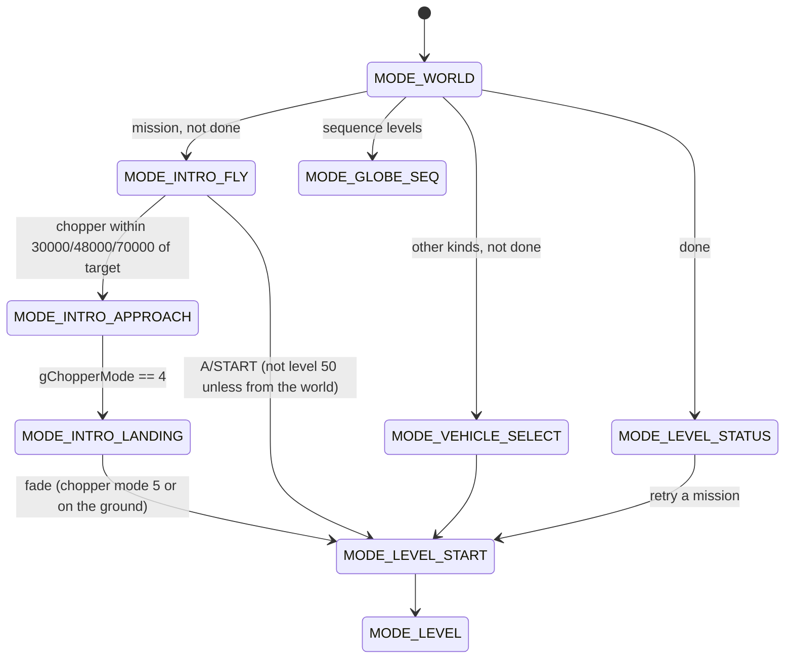

# Levels

A level in Blast Corps is one compressed file in the ROM (60 of them, level
numbers 0-59) plus a set of per-level tables that live in the code. The file
holds the level's geometry and display lists, its collision and ground grids,
and lists of things to place: buildings, vehicles, the missile carrier, RDUs,
TNT crates, push blocks, ammo crates, communication points, switch walls,
gates, moving bridge parts and so on. When a level starts, `hd_setup_level`
inflates the file onto the heap, and `initlevel` walks its header and turns
each section into the game's runtime records (heap arrays, global pointers).

This document covers the file's header and the record layout of every
section, the order of the setup calls, the level numbers and kinds as the
code tells them apart, the scripted paths (train line, shuttle and camera
splines, the carrier's route record) and every hard-coded level-number check
found in the code. How the file is found and decompressed is in
[files](files.md); what the gameplay code does with the sections is in
[collision](collision.md), [destruction](destruction.md),
[carrier](carrier.md), [vehicles](vehicles.md) and [scoring](scoring.md).

Everything below is from the code unless marked otherwise. Offsets are hex.
"BE" means the code assembles the value from bytes, big-endian (it works at
any alignment and on either byte order); other fields are read as native
halfwords/words (big-endian on the N64; the port's loader swaps them, see
`port/src/load/schemas.h` `swap_level`).

## Units

- Positions in the level file are "map units". The game keeps world
  positions in 1/32 map units, so almost every coordinate read from the file
  is shifted left by 5 (`<< 5`) when it is stored.
- Collision triangle vertices are shifted by 3 instead (`lvl_build_coll_tri`),
  i.e. they are kept at 1/8 map units; the switch-side test in
  `veh_hit_switch_triangle` divides world coordinates by 4 (`gCollX >> 2`) to
  match.
- Headings are 12-bit (0..0xFFF). The community notes
  ([blast_corps_levels.txt](../blast_corps_levels.txt)) give 0 = +Z,
  0x400 = +X, 0x800 = -Z, 0xC00 = -X; not checked against the code here.

## How it works

### The level file and the header

`lvl_load_file(level, dest, &size)` (00000.c) picks the ROM start of the
level's file (symbols `romChimpRaw`, `romLagpRaw`, `romValleyRaw`,
`romFactRaw`, `romDipRaw`, `romBeetleRaw`, `romBonus1Raw`..`romBonus3Raw`,
then `romLevel9Raw`..`romLevel59Raw`) and its length (next file's start minus
this one's; level 59 ends at `romWorldTexturesRaw`), then `hd_rom_load(...,
12, 10, 1)` inflates it. The ROM layout (`blastcorps.us.v11.assets.yaml`)
stores each level as two rzip streams, `levelN` and `levelN_dl`, and
`hd_rom_load` runs two decompression passes, so the display-list stream ends
up right after the level data; the header offsets 0x78..0xC0 point into that
second part. See [files](files.md) for the loader itself.

Note the order quirk: level 1's file (`romLagpRaw`) is the first one in the
ROM and level 0's (`romChimpRaw`) the second; `lvl_load_file`'s switch lists
`case 1` before `case 0`.

The inflated file is `gLevelData` (`u8 *`, variables.h). It begins with a
0xC8-byte header. Every word from 0x20 on is an offset from the start of the
file (`OBJ_PTR(obj, off) = obj + *(s32 *)(obj + off)`), and most sections are
the range between one offset and the next, so the header is one long chain
of section boundaries.

| off | type | read by | meaning |
| --- | --- | --- | --- |
| 0x00 | u16 | `lvl_read_header` -> `gLevelCols` | visibility-grid columns (also the cell-index stride) |
| 0x02 | u16 | -> `gLevelRows` | visibility-grid rows |
| 0x04 | u16 | -> `gLevelCellW` (<< 5) | visibility-cell width |
| 0x06 | u16 | -> `gLevelCellD` (<< 5) | visibility-cell depth |
| 0x08 | u16 | -> `gGroundCols` | ground-grid columns |
| 0x0A | u16 | -> `gGroundRows` | ground-grid rows |
| 0x0C | u16 | -> `gGroundCellW` (<< 5) | ground-cell width |
| 0x0E | u16 | -> `gGroundCellD` (<< 5) | ground-cell depth |
| 0x10 | u16 | -> `gCollCols` | collision-grid columns |
| 0x12 | u16 | -> `gCollRows` | collision-grid rows |
| 0x14 | u16 | -> `gCollCellW` (<< 5) | collision-cell width |
| 0x16 | u16 | -> `gCollCellD` (<< 5) | collision-cell depth |
| 0x18 | s32 | -> `gLevelGravity` (f32, converted from the integer) | gravity (community notes: -4 normal, -2 on the planets; unverified) |
| 0x1C | s32 | -> `gLevelDlProfile` (a u8: the low byte is kept) | display-list buffer profile, 0 or 1 (`lvl_alloc_dl_buffers`) |
| 0x20..0x24 | off | `crate_spawn_all` | ammo crates (`BoxSpawn`); 0x20 is also the end of the segment-8 vertices |
| 0x24..0x28 | off | `gGuardTris`/`gGuardTrisEnd` | guard triangles |
| 0x28..0x2C | off | `commpt_setup` (8A2E0.c) | communication points |
| 0x2C..0x30 | off | `lvl_resolve_tex_ids` | level texture/animation records |
| 0x30 | off | `lvl_build_ground_grid` | ground grid (cells of floor triangles) |
| 0x34..0x38 | off | `rdu_init` | RDUs |
| 0x38..0x3C | off | `tnt_spawn_all` | TNT crates |
| 0x3C..0x40 | off | `block_spawn_all` | push blocks and their slots |
| 0x40..0x44 | off | `cam_apply_height_zone` | camera height zones |
| 0x44..0x48 | off | `chopper_find_cruise_height` | chopper cruise-height zones |
| 0x48 | off | `cull_walk_grid` | visibility grid: per cell an s16 pair (min, max height) |
| 0x4C | off | `lvl_read_header` | level box: s16 minX, minZ, maxX, maxZ -> `gBoundsMinX/MinZ/MaxX/MaxZ` (map units) |
| 0x50..0x54 | off | `lvl_spawn_vehicles`, `lvl_find_start_vehicle`, `gRespawnPoints` | vehicle spawns (also the respawn points) |
| 0x54 | off | `lvl_spawn_carrier`, `lvl_spawn_chopper` | the carrier record (9 bytes) |
| 0x58..0x5C | off | `gDigTriggers`/`gDigTriggersEnd` | carrier-progress panel events |
| 0x5C..0x60 | off | `lvl_spawn_objects` | object (building) placements |
| 0x60..0x64 | off | `lvl_read_alpha_zones` | vehicle alpha zones |
| 0x64..0x68 | off | `lvl_build_switch_groups` | switch triangle groups |
| 0x68..0x6C | off | `lvl_build_object_groups` | vehicle gate groups (train stops etc.) |
| 0x6C | off | `lvl_build_coll_grid_a` | collision grid A |
| 0x70 | off | `lvl_build_coll_grid_b` | collision grid B |
| 0x74 | off | `lvl_build_part_tris`, `lvl_groups_update_tris`, `lvl_group_move_part`, `lvl_group_get` | moving-part group chain (bridges) |
| 0x78..0x84 | off | `lvl_resolve_dl_textures` (G_SETTIMG ids), `lvl_relocate_dls` (relocation base) | the level's display-list block |
| 0x7C..0x80 | off | `lvl_build_dl_calls` | display lists packed back to back; one `gSPDisplayList` is emitted per list each frame |
| 0x84 | off | `lvl_relocate_dls` | end of the relocated range |
| 0x88..0x8C | off | `lvl_build_visible_dl` | a fixed list copied to the start of each visible list |
| 0x90, 0x94, 0x98, 0x9C | off | `lvl_relocate_dls` -> `gLevelFileDl0..3` | four display lists; [0x90, 0x84) is the range whose `gSPDisplayList` addresses are relocated |
| 0xA0..0xB0 | off x5 | `lvl_build_visible_dls` | boundaries of four 0x14-byte visibility record ranges (list k: [0xA0+4k, 0xA4+4k)) |
| 0xB0..0xC0 | off x5 | `lvl_build_visible_dls` | boundaries of four visibility group ranges |
| 0xC4 | word | (no reader found) | unknown |
| 0xC8.. | data | `gLevelSegment8 = obj + 0xC8` | segment-8 data: `Vtx` records up to the 0x20 offset |

The rendering side of 0x48 and 0x78..0xC0 (cell culling on the RSP, the
visible lists) is in [rendering](rendering.md); only the formats are given
here.

### Section record layouts

Each table gives the on-file layout and where it ends up. "obj" is the level
file.

**0x20 ammo crates** (`crate_spawn_all`, 479D0.c; struct `BoxSpawn`, 8 bytes,
native s16):

| off | type | field | meaning |
| --- | --- | --- | --- |
| 0 | s16 | x | position |
| 2 | s16 | y | |
| 4 | s16 | z | |
| 6 | s16 | type | index into `gCrateTypes` (box size, two textures, radar size, pickup radius, and the vehicle-trigger byte `crate_update(gCurVehicle)` compares) |

Each crate becomes a `Box` in `gCrates[gCrateCount]` with 8 vertices on the
heap.

**0x24 guard triangles** (`ground_scan_guard_tris`, 62740.c): 0x14-byte
triangles, nine s16 (three x, y, z vertices) and a word the scan ignores.
The comment there calls them the J-Bomb anti-clip triangles and the
Ironstone Mine crane area (from the community notes). The scan returns the
one nearest in height and sets `gGuardTrisBestY`.

**0x28 communication points** (`commpt_setup`, 8A2E0.c): 8-byte records
`{s16 x, y, z; u16 w}`; positions << 5, `w` goes to the entry's `unk12`. If
any exist, model 0x96 is loaded (`lvl_load_model(0x96)`).

**0x2C texture/animation records** (`lvl_resolve_tex_ids`; the port schema
names the middle fields): variable length:

| off | type | meaning |
| --- | --- | --- |
| 0 | u32 | id (looked up by `lvl_find_tex_anim` / `lvl_step_tex_anims`) |
| 4 | u8 | count n (must be >= 1) |
| 5, 6 | u8 | unknown |
| 8, A | s16 | unknown |
| C | u32 x (n-1) | texture ids; replaced in place by `tex_get_impl(id)` (the texture's address) |

**0x30 ground grid** (`lvl_build_ground_grid`; read by `ground_scan_grid`):
`gGroundCols * gGroundRows` cells back to back. Each cell is a BE u32 (the
offset of the next cell, from the section start) and then 0x14-byte floor
triangles: nine s16 (vertices), byte 0x12 = surface class (`SURFACE_*` in
types.h: 1 normal, 100 water, 0x65 spin shadow, 0x66 fatal, 0x67 Diamond
Sands bounce), byte 0x13 = a flag (meaning not traced here). `gGroundCells`
gets n + 1 pointers (each cell's first triangle, then the end).

**0x34 RDUs** (`rdu_init`, 26570.c): `{s16 x, y, z}` (6 bytes, native).
Each becomes an `RduRecord` in `gRdus` on the heap; its visibility cell is
`x / (gLevelCellW >> 5) + z / (gLevelCellD >> 5) * gLevelCols`. Positions are
not shifted here.

**0x38 TNT crates** (`tnt_spawn_all`, 48D00.c): 12 bytes:

| off | type | meaning |
| --- | --- | --- |
| 0 | s16 x, y, z | position (<< 5; y is then snapped to the ground with `coll_ground_height`) |
| 6 | u8 | type: index into the box-definition table (`D_802FDB98_boxes`: extents, four face textures, radius) |
| 7 | u8 | timer: fuse = timer * 60 frames |
| 8 | s16 | stored in the crate entry's `unk1A` (unknown) |
| A | s16 | stored in `unk1C` (unknown) |

**0x3C push blocks** (`block_spawn_all`, 4B5E0.c): two counted lists.

```
s16 nBlocks
nBlocks x { s16 x, y, z; s16 model }            8 bytes: gBlocks (model indexes gBlockModels)
s16 nSlots
nSlots x {
    s16 x, y, z
    u8  model        (gBlockModels index)
    u8  n            (triangle count)
    s16 target       (nonzero: also add a gBoxTargets box of +-40 around it)
    n x 0x16-byte triangles (coll_add_dyn_tris -> gDynTris)
}
```

Block y is snapped to the ground. The target boxes are what the "fill the
holes" objectives count (`obj_box_targets_done`, [carrier](carrier.md)).

**0x40 / 0x44 height zones** (60D50.c, struct `HeightZone`, 10 bytes):
`{s16 minX, minZ, maxX, maxZ, height}` (map units). `cam_apply_height_zone`
takes the highest zone over the player from [0x40, 0x44): `gCamHeight =
height * 32 + gCamHeightBase`; a height of 3000 (`HEIGHT_ZONE_NONE`) sets
`gCamNoHeightZone` instead. `chopper_find_cruise_height` does the same over
[0x44, 0x48) for the chopper (`gChopperCruiseY`).

**0x48 visibility grid**: `gLevelCols * gLevelRows` s16 pairs (min height,
max height) per cell, read by `cull_grid_height_range` to build the cell
boxes the RSP visibility test checks. The 0x44 zone list ends where this grid
starts.

**0x50 vehicle spawns** (`lvl_spawn_vehicles`): 9-byte records, all BE:

| off | type | meaning |
| --- | --- | --- |
| 0 | u8 | vehicle type (`VEH_*`, types.h) |
| 1 | s16 x, y, z | position (<< 5) |
| 7 | s16 | heading |

Rules from the code:
- Exactly one type-0 record (the driver) must exist; `lvl_find_start_vehicle`
  scans for it without an end bound. Any other record at exactly the driver's
  position is the vehicle the player starts in (`gStartVehicle`).
- On every level kind except the missions (1, 0x80), a type-1 record
  (Sideswipe) stands for "the vehicle the player picked": the spawn uses
  `gDiggerVehicle` instead, and so does `gStartVehicle`.
- Types 6, 7, 0x0B, 0x11, 0x12 (crane, train, the three barges) set
  `gHaveRideables`.
- An unknown type stops the list (the asm hits its `syscall` debug trap and
  returns; the rest is not spawned).
- The same list is the respawn table: `veh_respawn_if_out` (62740.c) takes
  the first record whose type byte is the vehicle's type on missions, or 1 on
  other kinds, and puts the vehicle back at its x, y, z. So a vehicle's
  respawn point is its own start.

**0x54 carrier record** (`lvl_spawn_carrier`): 9 bytes, all BE:

| off | type | meaning |
| --- | --- | --- |
| 0 | u8 | speed (target speed). 0 = no carrier on this level |
| 1 | s16 | start x (<< 5) |
| 3 | s16 | start z (<< 5) |
| 5 | s16 | heading |
| 7 | s16 | limit (<< 5) -> `gCarrierRouteLen` (route length) |

This record is the whole "route" the file holds: a start, a heading, a speed
and a length. The per-level speed changes (`gCarrierSpeedZones`, by carrier
z), its collision distances (`gCarrierCollideDists`), the obstacle triangles
it must not meet (`gTriTargets`) and the danger distances
(`carrier_update_proximity`) are tables in the code; see
[carrier](carrier.md). The same first byte also decides the chopper (below).

**0x58 panel events** (`dig_coach_update`, 32E00.c, struct `DigTrigger`,
8 bytes):

| off | type | meaning |
| --- | --- | --- |
| 0 | s16 | carrier z (map units): fires once `gCarrierZ >> 5` passes it |
| 2..5 | u8 x4 | the arguments of `hud_panel_start(a, b, c, d)` |
| 6 | u8 | done flag (written into the loaded file when it fires) |
| 7 | u8 | padding |

Only checked while `gHaveCarrier` is set.

**0x5C object placements** (`lvl_spawn_objects`): 14-byte records, BE
except the two u16 at 0xA and 0xC (read natively):

| off | type | meaning |
| --- | --- | --- |
| 0 | u16 x, y, z | position (map units; the model is moved there, the record gets << 5) |
| 6 | u16 | object type: the packed-object index (`lvl_load_object(type)`) and the `LevelObject.kind` |
| 8 | u8 | flag: a path building (`LevelObject.pathBuilding`); also appended to the level's `gPathParts` list, and tinted red during the intro fly-in |
| 9 | u8 | people inside: overrides the model's `numPeople` and is added to `gPeopleTotal` |
| A | u16 | motion type, stored in the model's u16 at 0xE: 0 static, 1 bob, 2 orbit, 3 follow a spline path, 4 maze walker, 5 swing (`spline_object_matrix`, 4EBE0.c). A moving object's vertices are not translated at load |
| C | u16 | tag -> `LevelObject.tag` (the motion's parameter `idx`: path index, speed or amplitude) and byte 0x4F of its collision triangles |

Each placement loads its own copy of the packed object from the ROM
(`lvl_load_object`: table of offsets at ROM 0x6EC4C0, loaded once per level
by `lvl_load_object_table`), resolves its textures, translates the copy
(`lvl_translate_object`) and builds a 0xFC-byte `LevelObject` in `gObjects`
plus its 0x60-byte `CollisionTri`s on the heap (`lvl_add_object`). Type 0x38
(`OBJ_KIND_END`) is the end object (`gEndObjectX/Y/Z`); types 0xBA..0xBC get
a ground height for their blob shadow (`lvl_init_object_shadow`). The object
model format is described in [destruction](destruction.md) (`ObjectModel`,
object.h).

**0x60 alpha zones** (`lvl_read_alpha_zones` -> `gAlphaZones`, 0x24 bytes
each): a byte stream. The first byte is the default vehicle alpha
(`gDefaultVehAlpha`); then records:

| on file | type | runtime (+off) | meaning |
| --- | --- | --- | --- |
| 0 | BE u16 x, y, z | +0, +4, +8 (<< 5) | centre |
| 6 | BE u16 | +0xC (<< 5) | radius |
| 8 | u8 | +0x10 | mode: 1 = flat level, else fade with distance |
| 9 | u8 n | +0x13 | number of ids |
| A | n bytes | +0x15 | vehicle ids the zone applies to |
| A+n | u8 | +0x11 | 1-based `gObjects` index: destroying that object turns the zone off (`obj_check_destroyed`) |
| A+n+1 | u8 | +0x14 | alpha level L (0 = 0xFF) |
| - | - | +0x12 | 1 = on (set at load) |

`veh_zone_alpha` (62740.c) uses it to make vehicles translucent where the
level wants it.

**0x64 switch groups** (`lvl_build_switch_groups` -> `gSwitchGroups`, 0xFC
bytes each; triangles in `gSwitchTris`..`gSwitchTrisEnd`):

```
u8  flag        -> group[0xF9]  (0: never toggles)
u8  nKinds      -> group[0]
nKinds bytes    -> group[1..]   vehicle kinds for which the group is an ordinary wall
u8  nTris       -> group[0xF8]
nTris x 0x14-byte triangles (nine BE s16 vertices, BE u16 at 0x12 = wall heading)
                -> group[8 + 4i] = pointer to triangle i's record
```

A vehicle not in the list passing through toggles `gDriverCanExit`
(`veh_hit_switch_triangle`, 56040.c): the "can't get out here" areas.

**0x68 gate groups** (`lvl_build_object_groups` -> `gCollObjGroups`, 0xDC
bytes; new triangles in `gCollTris`..`gCollTrisEnd`):

```
u8 owner        -> [0xC4]  vehicle type the gate belongs to (e.g. 7, the train)
u8 kind         -> [0xC5]  0: area test, else animation-state test
u8 n            -> [0xC6]
kind 0: n x { BE s16 x6 } (a 2-D triangle, << 5), then a BE word
kind !=0: n x BE s16 ((channel, state) byte pairs for veh_gate_anim_test)
u8 m            -> [0xC7]
m x 0x15-byte triangles: 0x14 bytes as above + byte 0x14 = triangle id
                -> [0xC8 + i] = id; a record is built only for an id not seen before
u8 k            -> [0xD0]
k bytes         -> [0xD1..]   more ids (owned by the vehicle)
```

`veh_update_tris` (56040.c) runs each gate of a vehicle every frame: while
the condition fails, the listed triangles are opened (not solid). This is how
the train's doors only open at a station (the community notes call it the
"train platform and stopping zone"). See [collision](collision.md).

**0x6C / 0x70 collision grids** (`port_build_grid`): `gCollCols *
gCollRows` cells; each is a BE u32 end offset (from the grid start) and
0x16-byte triangles: nine BE s16 vertices, BE u16 at 0x12 (wall heading ->
`CollisionTri.heading`), byte 0x14 (-> `wallSide`), byte 0x15 (-> byte
0x59). Grid A goes to `gCollCellsA`, grid B to `gCollCellsB` (pointer per
cell plus the end). The vehicle collision code tests B and then A, and skips
B for the J-Bomb (`kind != VEH_JBOMB`, 56040.c), so B holds what a flying
J-Bomb may pass over.

**0x74 moving-part groups** (`lvl_build_part_tris`, 77E20.c's group code;
structs `Unk802C2054Group` / `Unk802C2054Record`):

```
s32 nMtx                      bytes of part matrices to allocate (identity),
                              twice: gObjPartMtx0, gObjPartMtx1; must be a multiple of 0x20
groups, back to back:
  0x00 s16 next               -1 = last group (otherwise only the end marker; lvl_group_get follows it)
  0x14 u16 mtxOffset[10]      1-based part -> offset into the part matrices
  0x28 s32 count
  count x 0x44-byte records:
     0x00 s16 index[9]        three vertices
     0x12 u8                  copied to the runtime record's byte 0x24
     0x14 {s32 mtxOffset; s32 base[3]} [3]   which part matrix each vertex follows, and its offset
```

`lvl_build_part_tris` turns the records into 0x28-byte triangles in
`gGroupTris`; each frame `lvl_groups_update_tris` recomputes them from the
parts' bases, which `lvl_group_move_part` sets (used by `bridge_sag_group` on
levels 0, 4, 15, 16, 20: the sagging bridges).

### Runtime records built at load

| global | from | record |
| --- | --- | --- |
| `gObjects`..`gObjectsEnd` | 0x5C | `LevelObject` (0xFC, object.h) |
| `gCollTris`..`gCollTrisEnd` | 0x68 | `CollisionTri` (0x60) |
| `gCollCellsA`, `gCollCellsB` | 0x6C, 0x70 | per-cell pointers into heap `CollisionTri`s |
| `gSwitchGroups`, `gSwitchTris` | 0x64 | 0xFC-byte groups, `CollisionTri`s |
| `gGroundCells` | 0x30 | per-cell pointers into the file |
| `gGroupTris`, `gObjPartMtx0/1` | 0x74 | 0x28-byte triangles, matrices |
| `gAlphaZones`..`gAlphaZonesEnd` | 0x60 | 0x24-byte zones |
| `gRdus`, `gCrates`, `D_8039B070_entries` (TNT), `gBlocks`, `gBlockSlots`, `gBoxTargets` | 0x34, 0x20, 0x38, 0x3C | |
| `gVehicles`..`gVehiclesEnd` | 0x50, 0x54, models | 0x74-byte vehicle records (`veh_add_record`) |
| `gPathParts` | code table + 0x5C flags | `LevelPart` (types.h) |
| `gLevelDl0..3[2]` | `lvl_alloc_dl_buffers` | the per-frame visible lists (two of each) |

### Level setup order

A level is entered through `hd_mode_setup` (heap reset to 0x8004B400, static
segment, flags) and then `hd_setup_level(arg0)`, where `arg0` is a saved
status stream or 0. The call order, all from the code:

```
hd_mode_setup()                      00000.c: heap = 0x8004B400 (+0xA000 RDP output,
                                     +0x20000 ghost buffer on race levels), texture table,
                                     vehicle shadow pool, clears cmo_hit_request, gLevelDone,
                                     gCarrierHit, pause flags ...
hd_setup_level(arg0)                 00000.c
  clear HUD/vehicle flags, gLevelKind = gLevelInfo[levelno].kind
  player position/camera start values (gCamHeading 135, gCamEyeHeight 3000 ...)
  race + MODE_LEVEL_START: ghost_init (unless retry), ghost record + playback
  lvl_load_file(levelno) -> gLevelData, heap past it (16-aligned)
  stats_level_start, hud_init_target_marker
  lvl_init_chopper_pos(levelno)      LevelInfo.chopperPos << 5
  lvl_init_train_line(levelno)       gTrainLineLevels
  cam_set_level_fovy(levelno)        gWideFovLevels: 80 degrees, else 45
  initlevel(gLevelData, arg0)        5CB60.c, below
  lvl_alloc_dl_buffers()
  commpt_load_flags() if the level is done (medal 1..5) and not attract
  obj_tally(kind is 0x20 or 0x80)
  hud_init_objective(levelno)        gFixedEyeLevels, gCurLevelInfo, J-Bomb/camera limits,
                                     objective icon, traffic-light images
  hud_panel_init, HUD icons per vehicle present, fx_init_carrier_blast,
  fx_init_power_pill(levelno), people_init(arg0) (missions only), ptcl/trail/shell init,
  water_init(levelno), fx_init_drift_quads(levelno), util_cam_path_init(levelno),
  util_reset_hint_events, vehicle shadow textures, backdrop_init(mode, levelno),
  camera reset, gLevelMoney, gTimeInLevel = gLevelStartTime = 0,
  rec_restore_start_vehicle (if pending), academy_build_window (if a marker),
  cam_load_level_defaults, fx_alloc_texture_caches

initlevel(obj, arg1)                 5CB60.c
  gLevelStatusArg = arg1
  lvl_read_header                    grid sizes, gravity, bounds, gGuardTris, gRespawnPoints,
                                     gLevelSegment8; resets gMoveableTris, the sphere/stand-on/
                                     point tables (0xFF/-1) and per-level flags (gCarrierContact,
                                     gEndObjectTouched, gPathBuildingsDestroyed, gFailTrigger,
                                     gTrainClosed, gCarrierExplodeDone, gVehSlowed, ...,
                                     gCollExitProbe [US 1.1])
  tex_load_table
  lvl_resolve_dl_textures, lvl_resolve_tex_ids, lvl_relocate_dls
  anim_tex_init
  lvl_build_coll_grid_a, lvl_build_coll_grid_b, lvl_build_switch_groups,
  lvl_build_object_groups, lvl_build_ground_grid, lvl_build_part_tris
  lvl_init_boxes                     corner boxes of the gTriTargets table
  anim_clear_copy_queue, cull_restart_now, lvl_read_alpha_zones, fx_reset,
  obj_clear_delayed_damage
  lvl_spawn_objects                  0x5C placements
  obj_clear_effect_queue
  block_spawn_all                    0x3C
  lvl_spawn_vehicles                 0x50, unless the mode is MODE_LEVEL_STATUS
  gHaveShuttle = gHaveCarrier = gHaveChopper = 0
  MODE_ATTRACT: lvl_spawn_carrier only for demo 0 (gRecDemoNumber == 0)
  otherwise:    lvl_spawn_carrier + lvl_spawn_shuttle unless MODE_LEVEL_STATUS or a status
                stream was given; then always lvl_spawn_chopper
  lvl_load_ghost_model               if a ghost is playing
  commpt_setup                       0x28
  lvl_load_scientist                 academy marker model 0x98, if gAcademyMarkerOn
  gDigTriggers = 0x58..0x5C
  rdu_init (0x34), tnt_spawn_all (0x38), crate_spawn_all (0x20)
  frontEndPresent = 0
  apply_status(arg1)                 if given, and the mode is neither attract nor the globe sequence
```

Things that follow from this order:

- A completed mission (medal 1..5) is entered with its saved status
  (`hd_setup_level(pakBuffer)` in the `MODE_LEVEL_START` case, and
  `gReplayStatus` for its replay). With a status stream there is no carrier
  and no shuttle; `apply_status` re-destroys the saved parts and re-lights
  the saved RDUs (7FB50.c).
- `lvl_spawn_shuttle` spawns the shuttle (vehicle 0xFD) only on a level with
  an entry in `gShuttlePaths` (`util_find_shuttle_path`).
- `lvl_spawn_chopper` spawns the BCT chopper when the carrier record's speed
  byte is nonzero and the kind is not `LEVEL_KIND_MISSION_TIMED`. The chopper
  is tied to the carrier record, not to the kind alone.
- `MODE_LEVEL_STATUS` (a completed level picked on the globe) loads the level
  without vehicles, carrier or shuttle, but still with the chopper (if the
  carrier byte is set).

### Starting a level: modes and the intro

The globe asks `seq_get_loop_done(levelno)` (54E30.c) for the next mode:

- levels 38, 55, 28, 53, 7, 19: a sequence (`MODE_GLOBE_SEQ`, see below);
- otherwise `fe_player_loop_done_mode` (01C40.c): a completed level gives
  `MODE_LEVEL_STATUS` (0x80); a mission (kind & 0x81) gives
  `MODE_INTRO_FLY` (0x800); anything else `MODE_VEHICLE_SELECT`
  (0x20000000), which goes on to `MODE_LEVEL_START`.



- `MODE_INTRO_FLY` (00000.c): `hd_setup_level(0)`, then
  `chopper_fly_to_carrier`. `chopper_update` and `driver_update` run during
  the three intro modes; `chopper_update_mode` (72B80.c) moves to
  `MODE_INTRO_LANDING` at chopper mode 4 and fades to `MODE_LEVEL_START` when
  the chopper reaches mode 5 or its ground height reaches the drop point. The
  approach distance is 48000 on levels 0x1A and 4, 70000 on 0x1D, 0x3A and
  0xD, 30000 otherwise. On level 0x32 the shuttle path (not the chopper)
  ends the intro: `fade_to_mode(MODE_LEVEL_START)` 50 frames in. Path
  buildings are drawn red during `MODE_INTRO_FLY`
  (`lvl_tint_path_building_red`).
- `MODE_LEVEL_START` (00000.c): `hd_mode_setup`, then for a mission
  `hd_setup_level(status or 0)` and `gGameModeAfterNext = MODE_LEVEL`; for
  other kinds `hd_setup_level(0)` and a pause; `hud_mission_intro` (1D990.c)
  then shows the objective and the time limit, beeps once a second and sets
  `MODE_LEVEL` after 4 seconds (240 frames). Entering `MODE_LEVEL` from it
  shows the start hints, records `gLevelStartTime` and starts the demo
  recorder.

### Level kinds

`LevelInfo` (types.h, `gLevelInfo[60]` at 0x802E8F94, ROM data) holds each
level's kind, medal times, race boxes, chopper start, J-Bomb and camera
limits and the vehicles present. `gLevelKind` is the current level's kind.
The kinds are bits (`LEVEL_KIND_*`, game.h):

| kind | name | how the code treats it |
| --- | --- | --- |
| 1 | `LEVEL_KIND_MISSION` | carrier missions: intro fly-in, untimed, saves a status (`record_status`), people, money counter, no vehicle select |
| 0x80 | `LEVEL_KIND_MISSION_TIMED` | the same levels once `PlayerInfo.gameState >= 11`: `fe_player_update_level_kinds` rewrites every kind-1/0x80 entry of `gLevelInfo` to 0x80 (or back to 1) when the world is entered. Timed, "CLEAR CARRIER PATH" (level 0x32: "CLEAR SHUTTLE PATH"), done when the path buildings are down, no chopper |
| 2 | `LEVEL_KIND_RACE` | laps over the `raceArea` quadrants, ghost car, turbo start |
| 4 | `LEVEL_KIND_TARGETS` | destroy `target` buildings |
| 8 | `LEVEL_KIND_DAMAGE` | cause `target` dollars of damage |
| 0x10 | `LEVEL_KIND_RDUS` | light `target` RDUs |
| 0x20 | `LEVEL_KIND_BUILDINGS` | destroy every counted building |
| 0x40 | `LEVEL_KIND_PILL_MAZE` | RDUs with a power pill and a maze walker (motion type 4) that fails the level when it catches you |

Everything that is not a mission is what the game calls a bonus level in
code comments: timed by `medalTimes[3]` (tenths of a second), vehicle chosen
in `MODE_VEHICLE_SELECT` (`gDiggerVehicle` replaces type-1 spawns), turbo
start images loaded, `hud_update_objective` checks the objective every
frame. The objective checks themselves are in [scoring](scoring.md).

Other distinctions the code makes by level number rather than by kind:

- **Planets.** `lvl_planet` (1D990.c): 40 Moon, 43 Mercury, 44 Venus, 45
  Mars, 46 Neptune; every other level is Earth (3). The front end uses it for
  the globe/solar-system view and the tune (`music_tune_for_mode`: 0xC on
  Earth, 0x13 elsewhere). Entering the world with level 43, 44 or 45 done and
  the next one not done moves `levelno` on by one (00000.c, `MODE_WORLD`).
  Level 0x28 (Moon) done opens `YW_MOON_DONE` and pushes the danger tune
  instead of the normal end (17E10.c). On Mars (0x2D), touching an object of
  kind 0xE7..0xE9 fails the mission (`obj_check_mars_fail`).
- **The shuttle level, 0x32 (50).** The academy's last state asserts
  `levelno == 50` and starts its intro (41930.c); `YW_SHUTTLE_INTRO`; the end
  object is hidden until the level is done (`obj_end_object_hidden`); the
  radar is not drawn until it is done; it is done when every building is
  destroyed as well as by the path; done window `YW_SHUTTLE_DONE` with
  `MUS_FINALE`; the intro can't be skipped back unless entered from the world.
- **Sequence levels** (54E30.c `seq_prepare` / `seq_start_level` /
  `seq_finish`): 0x2F (47, attract demo 0 played as a sequence, then level 0),
  0x26 (38, `rec_start_replay`; sequences 1 and 3 start there and go on to
  0x28 or 0x2B), 0x31 (49, `credits_init`; sequence 0 goes on to 0x32), and
  the vehicle demos 55, 28, 53, 7, 19 (demo recordings 9..13 with
  `gDiggerVehicle` 5, 1, 2, 3, 9; each sets a bit of `PlayerInfo.demosSeen`).
  Finishing 38, 47 or 49 sets the level's medal to 5 ("done"). START can't
  leave a sequence on 0x2F or 0x31 (nor on 0x26 unless entered from the
  world).
- **Academy markers** (52D70.c): `academy_place_marker(levelno)` looks the
  level up in `gAcademyMarkers` in `MODE_LEVEL_START` only; the marker uses
  model 0x98 (`lvl_load_scientist`).

### Scripted paths and route data

- **Train.** The train (vehicle 7, 772A0.c) is a player vehicle driven by
  throttle along its heading, not a scripted path. One level table,
  `gTrainLineLevels` (1 entry, `{u8 id; s16 x0, z0, x1, z1}` in map units),
  pins it to a straight line: `lvl_init_train_line` sets `gTrainOnLine` and
  `gTrainLineX0/Z0/X1/Z1` (<< 5), and `train_update` sets x from z on the
  line (z1 == z0 would divide by zero). Its doors/blocking parts are the gate
  groups at 0x68 (`veh_update_tris`, `gTrainClosed`). US 1.1 also respawns it
  when it leaves the track area on levels 0, 0x12 and 0xD
  (`veh_respawn_if_out`).
- **Barges** (types 0x0B, 0x11, 0x12, 83910.c) are likewise driven vehicles:
  spawned from the 0x50 list, three copies of the same code.
- **Shuttle.** `gShuttlePaths` (3 entries: `{s32 level; u8 inLevel; u8
  kind; f32 tension; s16 triggerY ...}`) and `gShuttlePathPoints` (49
  points: `{s32 level; u8 inLevel; u8 idx; s16 x, y, z; s16 rot[3]; u8 speed;
  u8 branch; u8 event}`), cardinal splines evaluated by
  `util_shuttle_path_step` (23C20.c); `inLevel` 0 is the intro path
  (`MODE_INTRO_FLY`), 1 the in-level one.
- **Camera paths.** `gCamPaths` (3 entries, `{s32 level; f32 tension; u8
  speed}`) and `gCamPathPoints` (90 points, `{s32 path; u8 idx; s16 x, y, z;
  u8 speed}`), started by `util_cam_path_init(levelno)` and stepped every
  frame by `util_cam_path_step(levelno)`.
- **Object motion.** Placement motion types 1..5 (above) use `gSplinePaths`
  and `gMazeJunctions` (4EBE0.c), indexed by the placement's tag.
- **Carrier.** Only the 0x54 record in the file; the rest is code tables
  (see 0x54 above and [carrier](carrier.md)).

### Per-level tables in the code

These are keyed by level number and live in hd_code's data, not in the
level files (searched-entry counts from the loops):

| table | used by | entries | what |
| --- | --- | --- | --- |
| `gLevelInfo` | everywhere | 60 | `LevelInfo` |
| `gPathPartsLvl00..3A` | `lvl_pick_object_list` | 20 levels: 0-5, 9, 0xA, 0xC-0x12, 0x1A, 0x1D, 0x21, 0x39, 0x3A | `LevelPart` lists: which parts of the path buildings must fall |
| `gWideFovLevels` | `cam_set_level_fovy` | 5 | 80-degree field of view |
| `gFixedEyeLevels` | `hud_init_objective` | 4 | fixed camera eye position |
| `gTrainLineLevels` | `lvl_init_train_line` | 1 | train line |
| `gBoardZones` | `util_check_board_zone` | 1 | on foot inside the zone near its vehicle: switch to it |
| `gCamPaths`, `gCamPathPoints` | 23C20.c | 3 / 90 | camera splines |
| `gShuttlePaths`, `gShuttlePathPoints` | 23C20.c | 3 / 49 | shuttle splines |
| `gDriftQuadSpawns` | `fx_init_drift_quads` | 4 | drifting textured quads |
| `gWaterLevels` | `water_init` | (bound not read here) | water surface |
| `gPowerPills` | `fx_init_power_pill` | | power pill placement |
| `gCullOverrideQuads` | `cull_override_visible_cells` | 1 | fixed visible-cell list inside an area |
| `gYoshiHints` | `yoshi_show_hint` | 8 | which hint windows a level may show |
| `gDriverExitWalks` | `driver_try_exit` | -1-terminated | exit direction per level and vehicle |
| `gTriTargets` | 77E20.c, `lvl_init_boxes` | -1-terminated | carrier obstacle triangles |
| `gCarrierSpeedZones`, `gCarrierCollideDists` | 75490.c | | carrier speed by z, collision distances |
| `gObjBlockedFullDamage` | 77E20.c | | full damage when blocked |
| `gAcademyMarkers` | 52D70.c | | academy markers |
| `gLevelTunes`, `gLevelDangerTunes`, `gLevelDoneTunes`, `gLevelClearTunes` | 1C460.c | 60 | music |

### Hard-coded level checks

Every `levelno` comparison found in the C (hex as in the code):

| level | where | effect |
| --- | --- | --- |
| 0 | `veh_respawn_if_out` (62740.c, US 1.1) | train out when x < 1000 |
| 0 | `bridge_update_levels` (39050.c) | bridge group 1 sags |
| 0 | 23C20.c hints | `YW_HINT_MARKER_ARROWS`; `YW_HINT_LEVEL0_TRAIN` in the train past x 0x899 |
| 0 | 26570.c `yoshi_show_hint` | hints shown regardless of the per-player show count |
| 0 | 00000.c carrier-end camera | eye raised by 0x5DC000 |
| 4, 15, 16, 20 | `bridge_update_levels` | bridges sag |
| 4, 13, 16, 0x3B | `cam_fixed_heading_area` (00000.c) | camera heading held at 135 degrees in areas (all of 0x3B) |
| 4, 0x1A / 0xD, 0x1D, 0x3A | `port_state1` in 72B80.c | chopper approach distance 48000 / 70000 |
| 7, 19, 28, 53, 55 | 54E30.c, 26570.c | vehicle demo sequences |
| 9 | `veh_hit_switch_triangle` (56040.c) | switch groups also toggle for non-vehicle kinds (>= `VEH_COUNT`) |
| 9, 12, 13, 14, 15, 16, 18, 29, 58 | `carrier_update_proximity` (00000.c) | danger distances (others 12000/6000) |
| 10, 11, 16, 17, 29 | `lvl_alloc_dl_buffers` | display-list buffer sizes (others by `gLevelDlProfile`) |
| 12 | `veh_diamond_sands_damping` | surface 0x67 sets `gBounceDamping = 8` |
| 13, 14, 15, 16, 52 | `hd_build_frame_dl` (00000.c) | fill colour below the backdrop |
| 0xD, 0x12 | `veh_respawn_if_out` (US 1.1) | train out when z < 0x44C / 900 |
| 0x10 | 13A70.c | one object's ground shadow (at 0x19B7, 0xF99) drawn z-buffered |
| 0x10 | 00000.c camera | `gCamZoom` 1.5 (and a slow vertical rate) while the look-at point is in a small area |
| 0x11 | `crane_part_on_ground` (75490.c) | only on this level |
| 0x12 | 23C20.c | `YW_HINT_LEVEL12_SPOT` near (0x531, 0x1061) |
| 0x17 | `veh_wrap_position` (679E0.c) | the player's x/z wrap around (the level loops) |
| 0x22 | 48D00.c, 62740.c | TNT push speed not capped; `gVehSlowed` ignored |
| 0x23 | 00000.c camera | the eye is never scaled by `gCamZoom` around the look-at point |
| 0x26 | 00000.c, 1C460.c, 1A630.c, 45BB0.c | sequence level: replay icon, music start volume 0.7, sounds 0x14/0x15 not played (1A630.c), recorded input not stepped (45BB0.c; also 0x31) |
| 0x2B | 48D00.c | TNT slows by 4 a frame instead of 8 |
| 0x2B..0x2D | 00000.c `MODE_WORLD` | planet chain: move on to the next unfinished one |
| 0x28, 0x32 | 14B30.c `text_init` | 0x200-character text buffers |
| 0x28 | 17E10.c | Moon end |
| 0x2D | `obj_check_mars_fail` | kinds 0xE7..0xE9 fail |
| 0x2F | 00000.c | attract messages, no "PRESS START", sequence |
| 0x31 | `lvl_end_seq_set_toughness` | objects of kind 0x24 get toughness 2 |
| 0x31 | 00000.c, 17E10.c, 45BB0.c, 1A630.c | credits; carrier-hit camera and crash sound |
| 0x32 | many (see above) | shuttle level |
| 0x34 | `hud_mission_intro` | "DESTROY TARGETS IN" instead of the building name |
| 0x3B | 00000.c | replay camera fixed offset |

01C40.c's `fe_player_regrade_missions` also leaves out 0x31, 0x2F and 0x26.

## Code references

- `src.us.v11/hd_code/5CB60.c`: `initlevel`, `lvl_read_header`,
  `lvl_resolve_dl_textures`, `lvl_resolve_tex_ids`, `lvl_relocate_dls`,
  `lvl_build_coll_grid_a/_b`, `lvl_build_switch_groups`,
  `lvl_build_object_groups`, `lvl_has_tri_id`, `lvl_build_coll_tri`,
  `lvl_build_ground_grid`, `lvl_build_part_tris`, `lvl_init_boxes`,
  `lvl_read_alpha_zones`, `lvl_spawn_objects`, `lvl_pick_object_list`,
  `lvl_add_object`, `lvl_translate_object`, `lvl_load_object(_table)`,
  `lvl_spawn_vehicles`, `lvl_find_start_vehicle`, `lvl_spawn_carrier`,
  `lvl_spawn_shuttle`, `lvl_spawn_chopper`, `lvl_load_model(_plain)`,
  `lvl_load_ghost_model`, `lvl_load_scientist`, `lvl_align_end`,
  `veh_add_record`, `veh_set_record`.
- `src.us.v11/hd_code/00000.c`: `hd_setup_level`, `lvl_load_file`,
  `lvl_alloc_dl_buffers`, `hd_mode_setup`, the mode-entry switch in
  `hd_main_thread`, the per-frame `hd_game_frame`, `hd_build_frame_dl`,
  `cam_update`, `carrier_update_proximity`, `cam_fixed_heading_area`.
- `src.us.v11/hd_code/1D990.c`: `lvl_init_chopper_pos`,
  `lvl_init_train_line`, `cam_set_level_fovy`, `hud_init_objective`,
  `hud_mission_intro`, `hud_update_objective`, `lvl_planet`.
- `src.us.v11/hd_code/54E30.c` (sequences), `hd_front_end/01C40.c`
  (`fe_player_loop_done_mode`, `fe_player_update_level_kinds`),
  `23C20.c` (camera/shuttle paths, board zones), `60D50.c` (height zones),
  `5FD50.c` (visibility grid and lists), `77E20.c` (group chain, objects),
  `62740.c` (respawn, alpha and guard scans), `32E00.c` (panel events),
  `479D0.c`, `48D00.c`, `4B5E0.c`, `26570.c` (crates, TNT, blocks, RDUs),
  `8A2E0.c` (comm points), `772A0.c` (train), `83910.c` (barges),
  `39050.c` (bridges, water, power pill), `4EBE0.c` (object motion).
- Headers: `include/game/types.h` (`LevelInfo`, `LevelPart`, `VehState`,
  `VEH_*`, `SURFACE_*`), `include/game/object.h` (`LevelObject`,
  `ObjectModel`, `CollisionTri`, `OBJ_KIND_*`), `include/game/game.h`
  (`MODE_*`, `LEVEL_KIND_*`, `YW_*`), `include/game/variables.h`.
- Main globals: `levelno`, `gLevelData`, `gLevelKind`, `gLevelInfo`,
  `gCurLevelInfo`, `gLevelSegment8`, `gLevelCols/Rows/CellW/CellD`,
  `gGroundCols...`, `gCollCols...`, `gBounds*`, `gLevelGravity`,
  `gLevelDlProfile`, `gLevelFileDl0..3`, `gLevelDl0..3`, `gHaveCarrier`,
  `gHaveShuttle`, `gHaveChopper`, `gHaveRideables`, `gStartVehicle`,
  `gDiggerVehicle`, `gLevelStatusArg`.
- Port: `port/src/load/schemas.h` (`swap_level`, `swap_object`) mirrors the
  section list for the byte-order conversion.

## Modding notes

- **Move a vehicle, the driver's start or a respawn point:** edit the 9-byte
  record in the 0x50 list (BE type, x, y, z, heading). The driver record
  (type 0) must stay; a vehicle placed exactly on it is the start vehicle;
  the same record is where that vehicle respawns.
- **Remove or retime the carrier:** byte 0 of the 0x54 record is its speed;
  0 removes the carrier and the intro chopper. The last s16 is the route
  length.
- **Add or move a building:** a 14-byte record in the 0x5C list; the type is
  the packed-object index. Set byte 8 to make it a path building (it then
  also needs an entry in the level's `gPathPartsLvlXX` list for the parts
  check), byte 9 for the number of people.
- **Make an object move:** set the placement's u16 at 0xA (motion 1..5) and
  0xC (its parameter).
- **Change a level's kind, time limit or medal times:** `gLevelInfo[level]`
  (ROM data at 0x802E8F94; `kind`, `target`, `medalTimes`). Remember that
  kinds 1 and 0x80 are rewritten at runtime by `fe_player_update_level_kinds`.
- **Change gravity:** header word 0x18.
- **Sections are offset chains.** Growing one section means updating every
  later header offset, the segment-8 range (0x20) and the display-list
  offsets; the counts are implicit (most loops stop at exactly the next
  offset with `!=`, so a wrong size runs past the end).
- **Level-specific behaviour** not in the file is in the per-level tables and
  the `levelno` checks listed above.

## Differences between versions

From [versions](../versions.md) and the code:

- US 1.1's `lvl_read_header` also clears `gCollExitProbe` (new in 1.1).
- US 1.1's `veh_respawn_if_out` adds the train out-of-bounds checks on
  levels 0, 0x12 and 0xD.
- The level files are the same; chimp.raw (level 0) and its display list were
  recompressed with identical contents.

## Open questions

- Header 0xC4: no reader found. Bytes 5, 6, 8, 0xA of the 0x2C records, byte
  0x13 of the ground triangles, the s16 pair at 8/0xA of the TNT records and
  the word after a kind-0 gate area are stored but their meaning is not
  traced.
- `D_8030D888` (u64 in hd_code data, read by `lvl_spawn_vehicles`): the
  attract-mode filter (`only gRecVehicle's records`) runs only when the mode
  equals both 2 and this constant. Its value decides whether the filter is
  live. Suggested name: `gModeAttractU64` if it is 2.
- `gTriTargets` (0x80306480) is read through two views that disagree:
  `lvl_init_boxes` treats byte 0x14 as a radius and 0x15 as the end marker;
  77E20.c's `Unk80306480` has `ids[9]` at 0x0C..0x14 and `level` at 0x15.
- The triangle id and byte 0x4F of the grid and switch triangles are the
  leftover `lowest_set_bit(gNextGameMode)` registers (`port_initlevel_v0`),
  e.g. 13 when entered from `MODE_LEVEL_START`. They are outside
  `gCollTris`, so `veh_enable_tris` / `veh_open_tri` should not see them;
  whether any reader uses them is not checked.
- `cam_load_level_defaults` indexes `gLevelCamDefaults` by `gStartVehicle`,
  so the table is per vehicle, not per level (and variables.h's comment on
  `gStartVehicle`, "current level index", is wrong). Suggested rename:
  `gLevelCamDefaults` -> `gVehCamDefaults`.
- `lvl_pick_object_list` picks the path-parts list; suggested
  `lvl_pick_path_parts`. `gDigTriggers`/`DigTrigger` are carrier-progress
  panel events, not digger events; suggested `gCarrierPanelEvents`.
  `gCollObjGroups` are per-vehicle collision gates; suggested `gVehGates`.
- A timed mission (kind 0x80) not yet done is entered through
  `MODE_INTRO_FLY` (`fe_player_loop_done_mode` tests `kind & 0x81`), which
  calls `chopper_fly_to_carrier`, but `lvl_spawn_chopper` spawns no chopper
  for kind 0x80. What the intro does then is not traced.
- Which grid (A or B) holds what, beyond "B is skipped for the J-Bomb", is
  for [collision](collision.md).
