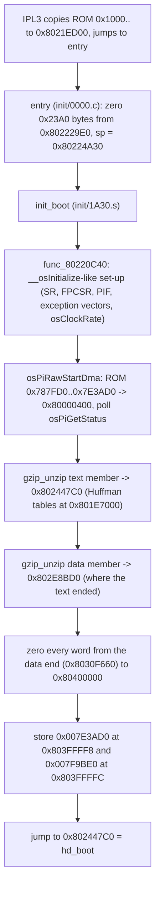

# Memory

Blast Corps runs in the N64's 4 MB of RDRAM (0x80000000-0x80400000, KSEG0)
with no memory manager to speak of. The layout is almost entirely fixed
addresses chosen by Rare:

- three code segments: `init` (the boot loader), `hd_code` (the game and
  libultra) and `hd_front_end` (the menus, the globe and the save code),
  the last two stored gzip-compressed in the ROM;
- two frame buffers at the bottom of RAM, the Z-buffer in the middle;
- one bump-allocated heap (`gHeapPtr`) that is reset to 0x8004B400 on every
  game-mode change and never freed piece by piece;
- a large `.bss` above the code that holds every fixed-size table (objects,
  vehicles, audio heap, display-list buffers, texture cache).

The front end is an overlay: it is inflated to 0x801E7000 when a menu mode
needs it, and the level heap simply grows over it when a level is played.

Everything below is from the US 1.1 code unless marked otherwise. See
[versions](../versions.md) for how US 1.0 differs; the address changes are
summed up at the end of this file.

## The code segments

The three segments, as the splat yamls (`init.us.v11.yaml`,
`hd_code.us.v11.yaml`, `hd_front_end.us.v11.yaml`), the top-level
`blastcorps.us.v11.yaml` and the linker scripts describe them:

| segment | ROM (compressed) | RAM | text | .data + .rodata | .bss |
|---|---|---|---|---|---|
| init | 0x001000-0x004CE0, not compressed | 0x8021ED00 | 0x8021ED00-0x80222740 (0x3A40) | 0x80222740-0x802229E0 (0x2A0; the inflate tables `border`, `cplens`.., `mask_bits`, `lbits`, `dbits`) | 0x802229E0-0x80224D80 (cleared by `entry`) |
| hd_code | text member 0x787FD0-0x7D73B4, data member 0x7D73B4-0x7E3AC7 (zero pad to 0x7E3AD0) | 0x802447C0 | 0x802447C0-0x802E8BD0 (0xA4410) | 0x802E8BD0-0x8030F660 (0x26A90) | 0x8030F660-0x803FF6C0 (the last 0xC0 bytes are `gStaticSegmentBuf`) |
| hd_front_end | text member 0x7E3AD0-0x7F63A1, data member 0x7F63A1-0x7F9BDD (zero pad to 0x7F9BE0) | 0x801E7000 | 0x801E7000-0x80208040 (0x21040, including the L3D RSP microcode text `gL3dText` at 0x80207090) | 0x80208040-0x80210E90 (0x8E50; `gL3dData` at 0x80210690) | 0x80210E90-0x8021ED00 (used up to 0x8021AC30, `ul_pfsisplug`'s .bss) |

Notes on the table:

- **init** is not compressed. The N64's IPL3 copies the start of the ROM
  from 0x1000 to the header's entry point, 0x8021ED00 (standard N64 boot
  behaviour, not code in this repo), so init simply runs where it lands. Its
  .text has a 0x40-byte zero blob at 0x3020 and its .data is the binary
  `init/3A40` (the RFC 1951 tables of the inflate code).
- **hd_code** is split by the linker scripts into `.hd_code` (text, with
  data tables embedded in the text: `gAtanTable`, `gAsinTable`, the
  `7D9D0_data` / `800E0_data` / `8E910` / `A0C30` blobs) and
  `.hd_code_data` (.data then .rodata, from 0x802E8BD0). The .bss is not
  linked as one section: `hd_code_bss.us.v11.ld` places the .bss of a few
  objects at their original addresses (00000.c at 0x80310D80, 22EE0.c at
  0x80368050, 2C560.c at 0x8036BEF0, 2D810.c at 0x8036BFC0, 30430.c at
  0x8036C770, 54E30.c at 0x803A6AF0, the libultra objects from 0x803FCD80
  to about 0x803FF360) and the rest of the .bss variables are symbols in
  `symbol_addrs.hd_code.us.v11.txt`.
- **hd_front_end** has the same split (`hd_front_end_bss.us.v11.ld`:
  11530.c at 0x8021A940, `ul_conteepread` at 0x8021ABB0, `ul_pfsisplug` at
  0x8021ABF0). Its .bss holds the save thread `gPakThread` (0x80218D30) and
  its 0x1000-byte stack `gPakThreadStack` (0x80218EF8).
- Each compressed code part is its own gzip member, and the two members of
  a segment are adjacent in the ROM; both loaders inflate them back to back,
  so the data lands right after the text.

There are no other code overlays. The only code that is ever loaded after
boot is the front end. (The RSP microcode is data: the F3D-style ucode
`gF3dText`/`gF3dData` and the boot / audio ucode live in hd_code, but slot 0
of the ucode table, L3D, lives in the front end; see
[rendering](rendering.md).)

### Boot: how init loads hd_code



Details, from `asm/init/1A30.s`, `asm/init/1F40.s` and the C in `init/`:

- `entry` (init/0000.c, asm) zeroes init's .bss with 8-byte stores
  (0x23A0 bytes from `gInflateHuftArena`, 0x802229E0), sets the stack to
  0x80224A30 and jumps to `init_boot`.
- `func_80220C40` (init/1F40.s) is init's own copy of libultra's
  `__osInitialize`: it sets `D_80224A40` to 1 (`__osFinalrom` in libultra),
  sets SR and the FPU control register, sets bit 3 of the PIF RAM word at
  0x1FC007FC, copies `__osExceptionPreamble` (16 bytes) to 0x80000000,
  0x80000080, 0x80000100 and 0x80000180, writes back the D-cache and
  invalidates the I-cache over 0x80000000-0x80000190, calls
  `func_802219A0` (probably `osMapTLBRdb`, by its position), computes the
  CPU clock from the ROM header word at PI address 4 (times 3/4) into
  `D_80222860`, and clears 0x40 bytes at 0x8000031C (the app NMI buffer)
  when the word at 0x8000030C (reset type) is 0.
- The whole compressed hd_code (both members, 0x5BB00 bytes) is DMA'd with
  `osPiRawStartDma` to 0x80000400, the bottom of the frame buffers, and
  polled to completion with `osPiGetStatus`.
- `init_unzip` is a register-saving wrapper: it stores the source and
  destination in `gInitUnzipSrc` / `gInitUnzipDst`, calls
  `gzip_unzip(&src, &dst, arena)` (init/1660.c) and returns the advanced
  pointers in a0/a1. The arena is 0x801E7000 (the empty front-end area). It
  is called twice; its fourth argument (13, then 10) is not used by
  `gzip_unzip`.
- The clear loop then zeroes from the destination pointer (the end of
  hd_code's .data, 0x8030F660) to 0x80400000: hd_code's .bss, the static
  segment buffer and the top of RAM.
- The two words stored at 0x803FFFF8 / 0x803FFFFC are the front end's ROM
  range. hd_code reads them through `gFeRomStartPtr` / `gFeRomEndPtr`
  (pointers in hd_code .data at 0x802FDB30 / 0x802FDB34 that hold
  0x803FFFF8 / 0x803FFFFC).
- `init_debug_printf` (init/1A00.s) is an empty stub, so the boot message
  (`D_80222850`) and the gzip error message are never shown.
- init does no explicit D-cache writeback after inflating hd_code before
  jumping into it. The almost 1 MB of zero stores that follow push every dirty
  line out of the 8 KB D-cache, which is presumably why this works
  (inference, not stated anywhere in the code).

init also contains a complete LZSS decoder that boot never calls:
`init_lzss_decode` / `init_lzss_read_bits` are the same algorithm as hd_code's
`lzss_decode` / `lzss_read_bits` (7F8B0.c), and the unlabelled code at
0x80220900 is a register-saving wrapper for them.

After boot nothing in init is used again: its RAM becomes the Z-buffer
(`gDepthBuffer` = 0x8021ED00) and the staging buffer for compressed loads.

### The front end overlay

`hd_load_front_end` (hd_code/46C20.c):

1. `osViBlack(1)`.
2. If `frontEndPresent` (0x80370C50) is 0: invalidate the D-cache and the
   I-cache over 0x801E7000 + 0x37D00; `hd_rom_load(*gFeRomStartPtr,
   0x801E7000, &size, 13, 10, 1)` with size = end - start (0x16110 bytes):
   both members are DMA'd to the staging buffer 0x8021ED00 and inflated
   back to back to 0x801E7000; then zero from the end of the inflated image
   (0x80210E90) to 0x8021ED00, i.e. the front end's .bss.
3. `frontEndPresent = 1`, `fe_pak_start_thread()` (the save thread lives in
   the front end), debug print "got front end".

When it is loaded:

- by `hd_mode_setup` (00000.c) for every game mode in its long front-end
  mask (boot screens, world/globe, load/erase/name entry, results, vehicle
  select, best times, pak manager, academy message, attract pictures, ...);
- directly by `hd_main_thread` (00000.c) for `MODE_WORLD`, for
  `MODE_LEVEL_STATUS` after `MODE_GLOBE_SEQ`, and for `MODE_REPLAY` after a
  carrier or timed end; and by `academy_advance_state` (41930.c) before the
  regrade screens (game states 9 and 11).

How it is "unloaded": nothing frees or overwrites it explicitly. The level
set-up does two things:

- `hd_setup_level` (00000.c), if `frontEndPresent`: asserts the pak thread
  is idle (`!pakBusy`, `pakToGameMessageQ` empty), removes its scheduler
  client `gPakSchedClient` and `osDestroyThread(gPakThread)`;
- `initlevel` (5CB60.c) sets `frontEndPresent = 0` near its end.

From then on the level heap may grow over 0x801E7000-0x8021ED00 (the
level set-up's debug print reports the space left as `0x8021ED00 -
gHeapPtr`). The next mode that needs the front end inflates it again from
the ROM.

`stats_save_status` (409D0.c) asserts `frontEndPresent` and then sets it to
1 before calling `hd_mode_setup`, so that set-up does not reload the
overlay.

## RDRAM layout

The map below is assembled from the linker scripts, `symbol_addrs.*.txt`,
the raw addresses in the code and `docs/shiftable.md`'s memory map. Sizes in
brackets are from the code (allocation sizes or array bounds).

```
0x80000000 +---------------------------------------------+
           | exception vectors (copied by init), libultra |
           | low-memory globals (osTvType, osResetType,   |
           | osAppNMIBuffer at 0x8000031C ...)            |
0x80000400 +---------------------------------------------+
           | gFrameBuffers[2]: 320x240 RGBA16 each        |  at boot: the compressed
           | (0x25800 bytes each)                         |  hd_code (0x5BB00 bytes)
0x8004B400 +---------------------------------------------+ <- gHeapPtr at every mode change
           | heap (bump allocator, grows up)              |
           |   0x8004B400 gRdpOutputBuffer [0xA000]       |  also the inflate Huffman
           |   0x80055400 ghost buffers [2 x 0x10000]     |  tables / LZSS window of
           |              (race levels only)              |  every run-time load
           |   ... texture table, motion blur, windows,   |
           |   level file, models, DL buffers ...         |
           |                                              |
0x801E7000 +- - - - - - - - - - - - - - - - - - - - - - -+ heap limit while the front end is in
           | hd_front_end text (+ L3D ucode text)         |
0x80208040 | hd_front_end .data/.rodata                   |
0x80210E90 | hd_front_end .bss (pak thread + stack, ...)  |  in a level: heap
0x8021ED00 +---------------------------------------------+ heap limit in a level
           | init (boot only), then:                      |
           | gDepthBuffer: 320x240 16-bit (0x25800)       |
           | = staging buffer of every compressed load    |
0x802447C0 +---------------------------------------------+
           | hd_code text                                 |
0x802E8BD0 | hd_code .data, .rodata                       |
0x8030F660 | hd_code .bss (see below)                     |
0x803FF600 | gStaticSegmentBuf [0xC0]                     |
0x803FF6C0 | (unused)                                     |
0x803FFFF8 | front end ROM start, ROM end (from init)     |
0x80400000 +---------------------------------------------+
```

Main blocks of hd_code's .bss (US 1.1, in address order; not complete):

| address | what |
|---|---|
| 0x8030F660 | start of .bss (camera flags first) |
| 0x80310820 / 0x803109D0 | `gIdleThread`, `gIdleThreadStack` [0x200] |
| 0x80310BD0 / 0x80310D80 | `gMainThread`, `gMainThreadStack` [0x2000] (00000.c's own .bss starts here) |
| 0x80312D80 | `gSchedStack` [0x2000] |
| 0x80314D80-0x803150A0 | PI manager command queue and buffer (`gPiMesgQueue`, `gPiMesgBuf`) |
| 0x803150A0 / 0x80315180 | `gDmaMesgQueue` (50 messages), `textureDmaMessageQ` (0x90 = `NUM_TEXTURE_DMAS`) |
| 0x803153D8 / 0x80315440 | `gTaskDoneQueue`, `gScheduler` (its OSThread at +0xB0) |
| 0x803156F8-0x80358028 | `gDynamicBufs[2]` (`DynamicBuf`, 0x21498 each: per-frame matrices, vertices, display lists) |
| 0x80358030 | `gLevelDl0`.. (per-level display-list buffer pointers) |
| 0x80358050 / 0x80358058 | `gFrameBufferPhys[2]`, `gDepthBufferPhys` |
| 0x8035806C / 0x80358070 / 0x80358074 | `gStaticSegment`, `gHeapPtr`, `gLevelData` |
| 0x80358088 | `gVehicleShadowPool` (`gVehicleShadows` = it rounded up to 0x40) |
| 0x80364460 | `gVehicles` (0x74-byte records) |
| 0x803669C0 | hd_code inflate state (`hd_inbuf`, `hd_slide`, ...) |
| 0x80367510-0x80367718 | `gSeqBuffer`, `gSeqFile`, `gSeqs`, `gAudioHeap` (the ALHeap) |
| 0x80367750 | `gDramStack` [0x400] (RSP dram stack) |
| 0x80368050-0x80368308 | audio manager state (22EE0.c .bss), audio OSThread |
| 0x80368308 | `gAudioThreadStack` [0x2000] |
| 0x8036A318 | `dmaBuffs` (the audio DMA buffer records), then `audDMAIOMesgBuf` |
| 0x8036AFB0 | `gYieldBuffer` [0x900] (RSP yield data) |
| 0x8036BEF0-0x8036C770 | scheduler and 2D810.c .bss, 30430.c (fade) .bss |
| 0x8036E660 / 0x8036E694 | `gUcodeText[]`, `gRdpOutputBuffer` (the pointer) |
| 0x80370C50 / 0x80370C58 | `frontEndPresent`, `gDmaIoMesg` |
| 0x80370C80-0x8039AF00 | `gAudioHeapBuf` [0x2A280]: the audio heap (banks, sequence table, synthesizer, players) |
| 0x8039B068-0x8039C960 | crates, TNT, save state (`gPfs`, `gSaveImage`, `pakBuffer`), blocks |
| 0x8039CAE0 | `gHdInflateHuftArena` (the arena pointer; the arena itself is 0x8004B400) |
| 0x803A6AF0-0x803A7430 | 54E30.c .bss (sequence state), collision scratch |
| 0x803A7440-0x803B8568 | texture animations, animation scratch, `gMtxCopyQueue` |
| 0x803B8570-0x803B8D40 | `gTexCache` (8-byte {id, physical address} pairs), `gTexCacheEnd`, `gTexTable`, `gTexDmaMesgs` |
| 0x803B9890 | `gCollTris` |
| 0x803BE780-0x803C2B88 | the visibility test's RSP task: dram stack and RDP output (`gCullOutput` 0x803BEB80) |
| 0x803C3250-0x803C4B58 | texture decode scratch and queue (`gTexDecodeScratch`, `gTexDecodeQueue`, `gTexDecodeReq`) |
| 0x803C4B70-0x803EB790 | effects: `gEffects`, `gFxDlA0/A1/B0/B1`, `gFxVtx0/1`, `gFxTexBuf0/1` [0x10000 each], texture caches |
| 0x803ED460-0x803FCD80 | per-vehicle blocks (`gDriverAnim`.., `gSkyfallAnim`.., `gShuttleAnim`..), destruction parts (`gFadingParts` 0x803F0900), `gObjects` (0x803F4030-0x803F7654), contacts, `gDynTris`, `gCommPts` |
| 0x803FCD80-~0x803FF360 | libultra .bss (`__osEventStateTab`, `__osContPifRam`, `__osPiAccessQueue`, timers, ...) |
| 0x803FF600-0x803FF6C0 | `gStaticSegmentBuf` |

Stacks, from the code: the boot stack top is 0x80224A30 (init .bss); the
idle thread's stack is 0x200 bytes, the main thread's, scheduler's and
audio thread's 0x2000 each, the front end's pak thread 0x1000.
`hd_init` fills the main thread's stack with 0x1122334455667788 and
`hd_check_stack` (00000.c) searches the pattern from the top after every
frame and prints "stack end =%d" where it first finds it overwritten.

The game never reads `osMemSize`: it assumes 4 MB and does not use an
Expansion Pak.

## The heap

### Allocator

There is no malloc. The heap is one pointer, `gHeapPtr` (`u8 *`, 0x80358070,
declared in `include/game/variables.h`), and allocating means "take the
current value, add the size":

```c
buf = gHeapPtr;          /* or gHeapPtr is passed as a load destination */
gHeapPtr += size;
align_up(&gHeapPtr, 0x10);   /* sometimes */
```

About fifty functions across hd_code and the front end do this inline
(grep `gHeapPtr +=` / `gHeapPtr =`). The helpers:

| function | file | what it does |
|---|---|---|
| `align_up(s32 *p, s32 a)` | hd_code/00000.c | rounds `*p` up to a multiple of `a` (`%`-based, any `a`) |
| `lvl_align_end(u32 x)` | hd_code/5CB60.c | after a packed model load: rounds up to 8, but only if `x` is not already a multiple of 4 (so 4-aligned ends stay 4-aligned) |
| `hd_rom_load(dev, dest, &size, p1, p2, method)` | hd_code/46C20.c | DMA + optional decompress into `dest`, usually `gHeapPtr`; the caller then adds `size` |
| `port_load_packed` / `lvl_load_object`, `lvl_load_model`, `lvl_load_model_plain` | hd_code/5CB60.c | packed model loads straight to the heap (they move `gHeapPtr` themselves) |
| `tex_load_table`, `tex_get_impl`, `tex_resolve_dl_impl`, `tex_load_to_heap_impl` | hd_code/5BF40.c | the 0x8000-byte texture table and every decoded texture, at the heap |

Nothing is ever freed. The heap is reset, all at once, by `hd_mode_setup`.
There is no overflow check anywhere: the only limit is in two debug prints
(below).

The audio code has its own heap: libultra's `ALHeap gAudioHeap` over
`gAudioHeapBuf` (0x2A280 bytes), set up once by `music_init_audio`
(1C460.c) with `alHeapInit` and filled with `alHeapDBAlloc`; see
[audio](audio.md).

### Reset and allocation order

`hd_mode_setup` (00000.c) runs before most mode switches:

1. `osViBlack(1)`, `osWritebackDCacheAll()`, then `osInvalDCache` over the
   whole 4 MB.
2. The static segment: `hd_rom_load(romStaticSegment, gStaticSegmentBuf,
   &size, 10, 0, 2)` (LZSS, 0xC0 bytes, to 0x803FF600). Its debug print
   reports `0x80400000 - end` as the space after it.
3. `gHeapPtr = 0x8004B400`, aligned to 16.
4. `gRdpOutputBuffer = gHeapPtr; gHeapPtr += 0xA000` (the RSP tasks'
   output buffer, `rsp_send_task` in 405F0.c).
5. On a race level outside attract / globe-sequence modes, `gHeapPtr +=
   0x20000` ("Allocating ghost buffer memory"). `ghost_init` (50670.c) uses
   the hard-coded addresses 0x80055400 and 0x80065400 for the two sample
   buffers, which is exactly this reservation.
6. `tex_load_table` (5BF40.c): the first time after a reset
   (`gTexTableLoaded = 0` is set just before), 0x8000 bytes for
   `gTexTable` (ROM 0x4CE0..+0x8000), and the texture cache is emptied.
7. `mb_init` (34430.c): the motion-blur buffer `gMbBuffer`, 0x5460 bytes.
8. The front end if the mode needs it (above), `spr_reset`, Yoshi windows
   (`yoshi_init`, debug print of the bytes used), `text_init`.

`hd_setup_level` (00000.c) continues for a level:

1. `lvl_load_file(levelno, gHeapPtr, &size)` inflates the level file and its
   display-list file (two adjacent gzip members; the ROM range is from the
   level's `.raw` to the next level's) and `gLevelData = gHeapPtr; gHeapPtr
   += size`, aligned to 16.
2. `initlevel` (5CB60.c) allocates collision grids, groups, texture
   loads, the object table (`lvl_load_object_table`, 0x800 bytes), every
   packed model and per-vehicle matrix buffers (6B4A0.c, 6E200.c, 71140.c,
   72B80.c, 75490.c, 83910.c, 8AEE0.c, 8DDB0.c ... each takes 0x200 to
   0x2800 bytes) and so on; a debug print reports "exit initlevel allocated
   %d bytes".
3. `lvl_alloc_dl_buffers`: four display-list buffers, twice (double
   buffered), sized per level: by default 6000/5000/100/2000 commands
   (profile 0) or 1000/1000/100/2000 (profile 1, `gLevelDlProfile`), with
   special sizes for levels 10, 11, 16, 17 and 29. 8 bytes per command.
4. HUD, water, effects, trails and so on (42240.c, 32E00.c, 39050.c,
   43A60.c, 853D0.c, 7FB50.c, ...).
5. Debug print: "Level %d: mem_pool=0x%x, code seg=0x%x, space=%d bytes"
   with space = 0x8021ED00 - `gHeapPtr`.

The front end allocates the same way while it runs (globe vertex buffers
0x17000 bytes in 11530.c, the world texture file in 09570.c, scene files in
0DE70.c, attract pictures in 1A240.c, ...). With the front end loaded, the
heap must stay below 0x801E7000; in a level, below 0x8021ED00. Neither limit
is checked.

Measured (bc_headless with `--print`, the nine attract-demo levels, no
input): after level set-up the heap pointer printed by step 5 was between
0x801F32C8 and 0x80219820, so every one of these levels' heap runs past
0x801E7000 into the front end's area. The space left below 0x8021ED00 ranged
from 21728 bytes (level 16) to 535904 bytes (level 2); `initlevel` itself
reported 848928 to 1342672 bytes allocated. (The audio set-up's "bytes
audio heap left over" print is not useful from the port: its libaudio
objects are native-sized, so the heap use differs from the N64's.) The
static-segment check printed 0x940 (2368) bytes free above its end at
0x803FF6C0. The front end was inflated again (`hd_load_front_end`) each
time the attract sequence went back to a menu-side mode: 8 times in 16000
frames.

## Loading from ROM

### DMA

All run-time ROM reads go through the PI manager (`osCreatePiManager` in
`hd_idle_thread`, 00000.c, priority 0x96, 0xC2 messages) and
`osPiStartDma`. The queues: `gDmaMesgQueue` with the single `OSIoMesg
gDmaIoMesg` for blocking loads, `textureDmaMessageQ` for texture loads
(blocking ones reuse `gDmaIoMesg`, queued ones take a 0x14-byte slot of
`gTexDmaMesgs`, index `nextdma`), and the audio manager's own
`audDMAMessageQ` / `audDMAIOMesgBuf` (22EE0.c). Only boot uses
`osPiRawStartDma`, and `hd_boot` reads 16 words of a debug command line at
PI address 0xFFB000 with `osPiRawReadIo`.

`hd_rom_load(devAddr, dest, &size, p1, p2, method)` (46C20.c) is the general
loader:

- If p1 or p2 is non-zero the data is compressed and is DMA'd to the
  staging buffer 0x8021ED00 (the Z-buffer); otherwise straight to `dest`.
- The target is `osInvalDCache`'d for `*size` bytes, then DMA'd in 0x4000
  byte pieces, each waited for, plus the remainder.
- method 1: `kiunzip` once if p1, once more if p2 (two adjacent gzip
  members); method 2: `lzss_decompress` with p1, then p2, as the offset
  width in bits; method 0: no decompression. Both decompressors use
  0x8004B400 as their work area (the inflate Huffman tables, or the LZSS
  ring window).
- When compressed, `*size` becomes the decompressed length (`dest` end -
  start); the caller adds it to `gHeapPtr`.

The arguments in use, from the call sites: front end (13, 10, 1), level
files (12, 10, 1), front-end scene files (12, 10, 1), single gzip files
(9..13, 0, 1: recording 17210.c, attract 17E10.c, copyright 55970.c,
controller picture 51690.c, traffic lights 1D990.c, boot banner/icon,
attract pictures, world textures), LZSS files (static segment 10, 0, 2;
sound bank `.ctl` files 13, 0, 2; one front-end file in 196F0.c 13, 0, 2),
and uncompressed reads (music sequences and the sequence table, 0, 0, 0).
For method 1 the p1/p2 values only mean "yes".

Other loaders bypass `hd_rom_load`:

- `port_load_packed` / `lvl_load_object` (5CB60.c, hand asm): the packed
  object table at ROM 0x6EC4C0 (0x800 bytes of offsets) gives each model's
  range; the model is DMA'd in one piece to 0x8021ED00 and two gzip members
  (model, display list) are inflated to the heap with `kiunzip_entry`.
- The texture loaders (5BF40.c): one DMA per table entry, ROM
  0x4CE0 + `gTexTable[n].rom` up to the next entry, into the heap or a given
  buffer, then `tex_decode` (60F60.c) in place. See [files](files.md).
- The audio DMA callback `__amDMA` (22EE0.c): 0x200-byte sample buffers,
  reused while a request falls inside one, and given back by
  `__clearAudioDMA` once `lastFrame + 1 < audFrameCt` (not used in the last
  audio frame); see [audio](audio.md).

### Decompression

There are two copies of Rare's gzip reader ("kiunzip", from its error
message "kiunzip: unknown method %d -- get newer version of gzip"), both an
adaptation of the classic public-domain `inflate.c`:

| | init (boot only) | hd_code (run time) |
|---|---|---|
| front end | `gzip_unzip`, `gzip_get_method`, `gzip_clear_bufs` (init/1660.c) | `kiunzip`, `kiunzip_get_method`, `kiunzip_clear_bufs` (hd_code/17A70.c); asm entry `kiunzip_entry` (7F8B0.c) |
| inflate | `inflate`, `inflate_block`, `inflate_dynamic` (init/0E30.c); `huft_build`, `inflate_codes`, `inflate_stored`, `inflate_fixed` (init/0050.c) | `hd_inflate`, `hd_inflate_block`, `hd_inflate_dynamic`, `hd_huft_build`, `hd_inflate_codes`, `hd_inflate_stored`, `hd_inflate_fixed` (hd_code/53220.c) |
| state | `inbuf`, `slide`, `inptr`, `outcnt`, `bb`, `bk`, `hufts`, `gInflateHuftArena` | the same with `hd_` prefixes, `gHdInflateHuftArena` |
| Huffman arena | 0x801E7000 | 0x8004B400 |

What differs from the reference `inflate.c`:

- No sliding window: `slide` is the output buffer itself, back-references
  are copied from earlier output (`slide[w++] = slide[d++]`), so the whole
  output must fit at the destination.
- `huft_build` takes each table from the arena by bumping `hufts` (8-byte
  `Huft` entries: `e`, `b`, then `n` or `t`) instead of malloc; `hufts` is
  reset per block. Every defensive error return is gone.
- `inflate_dynamic`'s code-length array is 286 + 30 entries.

The member format (from `kiunzip` and `kiunzip_get_method`):

| bytes | field | what the reader does |
|---|---|---|
| (0 or 1) | pad | if the first byte is not 0x1F, one byte is skipped |
| 2 | magic 0x1F 0x8B | skipped, not checked |
| 1 | method | must be 8 (deflate), else the error print and no output |
| 1 | flags | FHCRC (2), FEXTRA (4), FNAME (8), FCOMMENT (0x10) are skipped when set |
| 6 | mtime, xfl, os | skipped |
| ... | optional fields | skipped per the flags |
| ... | deflate data | inflated to `*dst` |
| 8 | CRC32, ISIZE | skipped, not checked (`inptr += 8`) |

After a member, `*src` points just past its trailer and `*dst` past its
output, so a second call reads the next member. The one-byte pad skip lets a
member start one byte after the place the caller pointed at; why the data
needs it is not clear from the code (possibly members at odd ROM offsets).

The LZSS format (`lzss_decode`, 7F8B0.c), method 2: flags MSB-first; a 1
bit is followed by an 8-bit literal, a 0 bit by an offset of `bits` bits (0
ends the stream) and a length of 15 - `bits` bits, copying length + 3 bytes
from the ring window (2^`bits` bytes at the work address, writes start at
index 1). The source end is rounded up to an even address.

`music_init_audio` (1C460.c) decompresses each bank `.ctl` twice: first to
0x8004B400 only to learn its size, then into an exact-size `alHeapDBAlloc`
block. In that first pass the destination and the LZSS window are the same
address, so its output is overwritten as it goes; only the length is used.

## Caches

The CPU's caches are handled by hand, as usual on the N64:

- Before every PI DMA into RAM the target is `osInvalDCache`'d: whole sizes
  in `hd_rom_load`, `tex_load_table` (0x8000), `lvl_load_object_table`
  (0x800), `port_load_packed`, the palettes (0x100). The texture loads
  (`LOAD_TABLE_ENTRY`, `tex_queue_load_impl`) invalidate only 0x1000 bytes,
  whatever the entry's size.
- `hd_load_front_end` invalidates both the D-cache and the I-cache over the
  0x37D00-byte overlay area before inflating code there.
- `hd_mode_setup` writes back the whole D-cache and invalidates all 4 MB.
  `hd_init` writes back the whole D-cache once at start.
- Data for the RSP is written back before each task: `rsp_send_task`
  (405F0.c) writes back the task, its data and the frame's `DynamicBuf` (or
  the whole D-cache when asked), and the front end and HUD write back the
  vertices and matrices they build (`osWritebackDCache` in 09570.c, 11530.c,
  0C450.c, 14B30.c, 30430.c, 13A70.c, ...). The visibility test (5FD50.c)
  invalidates its 0x20-byte RSP output before reading it.
- Boot: init writes back and invalidates only the exception vectors (see
  above).

The game's own caches in RAM: the texture cache (`gTexCache`, up to 250
{id, physical address} pairs, emptied when the texture table is reloaded at
each mode set-up), the effects' texture caches (`gFxTexCaches`, 60F60.c),
and the audio DMA buffers.

## Code references

- `src.us.v11/init/0000.c` `entry`; `asm/init/1A30.s` `init_boot`
  (boot), `init_unzip`, `init_lzss_decode`, `init_lzss_read_bits`;
  `asm/init/1F40.s` `func_80220C40`; `asm/init/1A00.s`
  `init_debug_printf`.
- `src.us.v11/init/1660.c` `gzip_unzip`, `gzip_get_method`,
  `gzip_clear_bufs`, `reverse_bits`; `init/0E30.c` `inflate`,
  `inflate_block`, `inflate_dynamic`; `init/0050.c` `huft_build`,
  `inflate_codes`, `inflate_stored`, `inflate_fixed`.
- `src.us.v11/hd_code/46C20.c` `hd_load_front_end`, `hd_rom_load`.
- `src.us.v11/hd_code/17A70.c` `kiunzip` ...; `hd_code/53220.c`
  `hd_inflate` ...; `hd_code/7F8B0.c` `lzss_decompress`, `lzss_decode`,
  `lzss_read_bits`, `kiunzip_entry`.
- `src.us.v11/hd_code/00000.c` `hd_boot`, `hd_idle_thread`, `hd_init`,
  `hd_check_stack`, `hd_mode_setup`, `lvl_load_file`, `hd_setup_level`,
  `lvl_alloc_dl_buffers`, `align_up`.
- `src.us.v11/hd_code/5CB60.c` `initlevel`, `port_load_packed`,
  `lvl_load_object`, `lvl_load_object_table`, `lvl_align_end`.
- `src.us.v11/hd_code/5BF40.c` `tex_load_table`, `tex_get_impl`,
  `tex_resolve_dl_impl`, `tex_queue_load_impl`.
- `src.us.v11/hd_code/1C460.c` `music_init_audio`; `hd_code/22EE0.c`
  `__amDMA`, `__clearAudioDMA`.
- `src.us.v11/hd_code/50670.c` `ghost_init`; `hd_code/34430.c` `mb_init`;
  `hd_code/405F0.c` `rsp_send_task`, `rsp_init_ucode_table`.
- Globals: `gHeapPtr`, `gLevelData`, `gRdpOutputBuffer`, `gFrameBuffers`,
  `gDepthBuffer`, `gDynamicBufs`, `gStaticSegmentBuf`, `frontEndPresent`,
  `gFeRomStartPtr`, `gFeRomEndPtr`, `gDmaMesgQueue`, `gDmaIoMesg`,
  `textureDmaMessageQ`, `gTexTable`, `gTexCache`, `gAudioHeap`,
  `gAudioHeapBuf`, `gMainThreadStack`.
- Structs: `DynamicBuf`, `FeDyn` (`include/game/types.h`); declarations of
  the globals in `include/game/variables.h`.
- Linker scripts: `init.us.v11.ld`, `hd_code.us.v11.ld`,
  `hd_code_bss.us.v11.ld`, `hd_front_end.us.v11.ld`,
  `hd_front_end_bss.us.v11.ld`.

## Modding notes

- **Free RAM.** Inside hd_code's window there are about 0x930 bytes between
  the end of `gStaticSegmentBuf` (0x803FF6C0) and 0x803FFFF8, and about
  0x40D0 bytes between the front end's last used .bss byte and 0x8021ED00
  (numbers from `docs/shiftable.md`). Anything bigger has to come from the
  heap.
- **Allocating memory for new code.** Take it from `gHeapPtr` at the right
  moment: after `hd_mode_setup` resets it (for per-mode data) or during
  `hd_setup_level` (per level). It will be gone at the next mode change.
  Keep track of the two limits yourself (0x801E7000 with the front end,
  0x8021ED00 in a level); the level set-up's debug print shows the space
  left.
- **Moving the heap or the ghost buffers.** The heap base 0x8004B400
  appears as a literal in `hd_mode_setup`, in `hd_rom_load` (work area),
  `port_load_packed` and `music_init_audio`; the ghost buffers are literal
  addresses in `ghost_init` that depend on the 0xA000 RDP buffer coming
  first. Change them together.
- **Growing a code segment.** hd_code must end (with .bss) below
  0x803FFFF8, the front end (with .bss) below 0x8021ED00, and the staging
  buffer (0x8021ED00-0x802447C0, 0x25AC0 bytes) must hold the largest
  compressed file. `docs/shiftable.md` covers the shiftable build that
  relinks around such changes.
- **Changing where the front end is in the ROM.** init's boot code writes
  the ROM range to 0x803FFFF8 / 0x803FFFFC as constants
  (`asm/init/1A30.s`); the port does the same in
  `port/src/platform/plat_core.c`.
- **Adding a compressed file.** Gzip it (method 8) and load it with
  `hd_rom_load(rom, gHeapPtr, &size, 1, 0, 1)` (p1 just has to be non-zero),
  then `gHeapPtr += size`. The packed size must fit in the 0x25AC0-byte
  staging buffer and the Huffman tables are built at 0x8004B400, so don't
  load a compressed file while the RDP output buffer there is in use.
- **Bigger display lists for a level.** Edit the sizes in
  `lvl_alloc_dl_buffers` (00000.c); each command is 8 bytes and every size
  is allocated twice.

## Differences between versions

From [versions](../versions.md) and the US 1.0 yamls, linker scripts and
symbol files:

| | US 1.1 | US 1.0 |
|---|---|---|
| hd_code ROM members | text 0x787FD0, data 0x7D73B4 | text 0x787FD0, data 0x7D74D7 |
| front end ROM range (init's constants at 0x803FFFF8/C) | 0x7E3AD0-0x7F9BE0 | 0x7E3BF0-0x7F9C80 |
| boot DMA length of hd_code | 0x7E3AD0 - 0x787FD0 | 0x7E3BF0 - 0x787FD0 |
| hd_code text / data start | 0xA4410 bytes / 0x802E8BD0 | 0xA4360 bytes / 0x802E8B20 |
| hd_code .bss | from 0x8030F660 | 0xB0 lower (00000.c .bss 0x80310CD0, `gHeapPtr` 0x80357FC0, `gAudioHeapBuf` 0x80370BD0, libultra from 0x803FCCD0) |
| `gStaticSegmentBuf` | 0x803FF600 | 0x803FF550 |
| front end text / data start | 0x21040 bytes / 0x80208040 | 0x21010 bytes / 0x80208010 |
| front end .bss | `gPakThread` 0x80218D30, 11530.c .bss 0x8021A940 | `gPakThread` 0x80216430, 11530.c .bss 0x80218030 (the globe files are linked later in 1.0) |

The fixed points are the same in both: 0x80000400 frame buffers, 0x8004B400
heap, 0x801E7000 front end, 0x8021ED00 init / Z-buffer / staging buffer,
0x802447C0 hd_code, 0x803FFFF8 front-end ROM range. init's code is
identical apart from the ROM constants in the boot function.

## Open questions

- Unnamed symbols in init, with suggested names (`init_boot`, `init_unzip`,
  `init_lzss_decode`, `init_lzss_read_bits`, `gInitUnzipSrc` and
  `gInitUnzipDst` are named now):
  - the unlabelled wrapper of `init_lzss_decode` at 0x80220900 ->
    `init_lzss_decompress` (it has no symbol to rename yet).
  - `func_80220C40` (init/1F40.s) -> `init_os_initialize` (init's
    `__osInitialize`).
  - `func_802219A0` (init/2CA0.s, "TLB setup helper") -> `osMapTLBRdb`,
    judging by where `__osInitialize` calls it; needs checking against the
    asm.
  - `D_80224A40` -> `__osFinalrom`; `D_80222860` -> `osClockRate` (init's
    copies); `D_80222850` -> the boot message string.
  - `func_80220700` (init/1A00.s): a second empty printf-style stub next to
    `init_debug_printf`; callers unknown.
- Why `kiunzip` skips one byte when a member does not start with 0x1F.
- The heap after level set-up is measured for the nine attract levels (see
  "Reset and allocation order"); the peak over a whole level, for all 60
  levels, and in the front-end modes is not measured yet.
- `hd_main_thread` loads the front end in `MODE_REPLAY` after a carrier or
  timed end, while the level is still in RAM. Since the measured level heaps
  all reach past 0x801E7000, that load overwrites level data; how the replay
  copes (whether it reloads the level first) is not traced.
- Whether any texture table entry is larger than the 0x1000 bytes the
  texture loaders invalidate.
- The parts of hd_code's .bss between the named blocks above are not all
  identified (the table is not complete).
