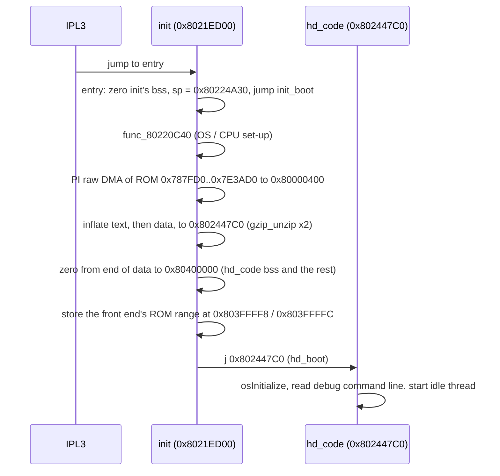
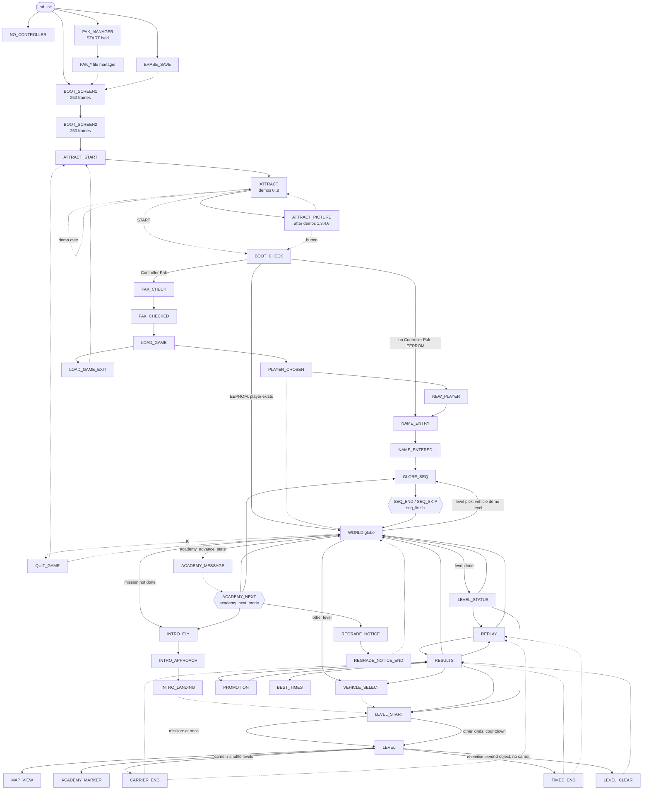

# Engine overview

Blast Corps is a single-player N64 game built on libultra with Rare's own
scheduler, loader and game loop. The game code is split into three
segments:

- **init** (`src.us.v11/init/`, linked at 0x8021ED00): a small boot stub
  that loads and inflates the main code and jumps to it. It also holds a
  copy of gzip's inflate.
- **hd_code** (`src.us.v11/hd_code/`, text at 0x802447C0): the engine and
  the in-game code. Its main file, `00000.c`, is Rare's `hd.c` (the name
  comes from its assert strings) plus `master_switch.c`, the game-mode
  switch.
- **hd_front_end** (`src.us.v11/hd_front_end/`, loaded at 0x801E7000): the
  menus, the level-select globe, the vehicle select and the save thread
  (Controller Pak / EEPROM). hd_code loads it from ROM when it is needed.
  A level load writes over it.

This page covers boot, the threads, the main loop, the game modes and the
order of work in a frame. It ends with a map of the source files. The
other pages in this folder cover each system in depth:
[memory](memory.md), [files](files.md), [levels](levels.md),
[rendering](rendering.md), [frontend](frontend.md), [audio](audio.md),
[vehicles](vehicles.md), [collision](collision.md),
[destruction](destruction.md), [carrier](carrier.md),
[scoring](scoring.md), [camera](camera.md). For the two US ROM revisions,
see [versions](../versions.md).

Unless a line says otherwise, everything here was read from the code
(US 1.1).

---

## 1. Boot



### init

- `entry` (`src.us.v11/init/0000.c`, asm `asm/nonmatchings/init/0000/entry.s`)
  is the ROM entry point. It zeroes 0x23A0 bytes starting at
  `gInflateHuftArena` (init's bss), sets `$sp` to 0x80224A30 and jumps to
  `init_boot`.
- `init_boot` (`asm/init/1A30.s`; splat comment: "boot") does the
  rest:
  1. calls `func_80220C40` (`asm/init/1F40.s`). It calls `__osGetSR`,
     `__osSetSR`, `__osSetFpcCsr`, `__osSiRawReadIo` / `__osSiRawWriteIo`
     (PIF), `osWritebackDCache`, `osInvalICache`, `osPiRawReadIo`,
     `__ll_mul` / `__ull_div` and `bzero`. That looks like init's own
     cut-down `osInitialize`, but this is **uncertain**: it has not been
     decompiled.
  2. `osPiRawStartDma(OS_READ, 0x787FD0, 0x80000400, 0x7E3AD0 - 0x787FD0)`
     copies the compressed hd_code text and data into low RAM, then it
     polls `osPiGetStatus` until the DMA is done.
  3. calls `init_unzip` twice (source 0x80000400, destination
     0x802447C0, work area 0x801E7000). It is an asm wrapper that keeps
     the source and destination pointers at 0x80224A30 / 0x80224A34 and
     calls `gzip_unzip` (`src.us.v11/init/1660.c`, Rare's "kiunzip": a
     gzip member header parser around `inflate`,
     `src.us.v11/init/0050.c` and `0E30.c`). The first call inflates the
     text and the second the data, which goes right after it.
  4. zeroes every word from the end of the inflated data up to
     0x80400000, which clears hd_code's .bss.
  5. stores the front end's compressed ROM range (0x7E3AD0, 0x7F9BE0) at
     0x803FFFF8 / 0x803FFFFC. hd_code reads them through `gFeRomStartPtr`
     and `gFeRomEndPtr` (`hd_load_front_end`).
  6. saves every register, calls `init_debug_printf` (an empty stub) with a
     string at 0x80222850, restores them and jumps to 0x802447C0 with
     `a0 = gp`.

  The NON_MATCHING test ROM (`tools_port/nm_rom.py`) replaces the tail of
  step 6 (init+0x1AE0..0x1BF8) with its own loader.

- The init segment is also the staging buffer for later compressed loads:
  `hd_rom_load` DMAs compressed data to 0x8021ED00 before it inflates it.
  So init's code is overwritten once the game is running.

### hd_boot and the idle thread

`hd_boot` (`src.us.v11/hd_code/00000.c`, the first function of hd_code):

1. `osInitialize()`.
2. reads 16 words from PI address 0xFFB000 with `osPiRawReadIo` and gives
   them to `parse_cmdline` (`26570.c`). This is a debug command line, read
   from past the end of the 8 MB ROM. A leading `-x` argument sets
   `gDebugFlagD` (`-d`), `gDebugArgV` (`-v`), `gDebugArgS` (`-s`),
   `gDebugArgJ` (`-j`), `gDebugArgM` (`-m`), `gDebugRamEeprom` (`-l`) or
   `gDebugCheats` (`-c`). `-C` sets both `gDebugStepGameState` and
   `gDebugCheats`. What a retail cartridge returns at that address is not
   known from the code.
3. creates the idle thread (id 1, priority 10, `hd_idle_thread`) and
   starts it.

`hd_idle_thread`:

1. `osDpSetStatus(4)` (clears the RDP freeze bit).
2. `osCreatePiManager(150, gPiMesgQueue, gPiMesgBuf, 0xC2)`.
3. creates the main thread (id 3, priority 10, `hd_main_thread`, stack
   `gMainThreadStack`, 0x400 u64 = 8 KB) and starts it. If `-d` was **not**
   given, it calls `osStartThread(&gMainThread)` a second time. Why is not
   known (see Open questions).
4. drops itself to priority 0 and spins forever.

### hd_init (the main thread's start-up)

`hd_main_thread` first calls `hd_init`, which runs once:

| step | what |
| --- | --- |
| `gGameMode = MODE_BOOT_SCREEN2` | a placeholder "previous" mode for the first switch |
| `osCreateMesgQueue(&gDmaMesgQueue, ..., 50)` | ROM DMA completions (`hd_rom_load`) |
| `osCreateMesgQueue(&textureDmaMessageQ, ..., 0x90)` | texture DMA completions (`NUM_TEXTURE_DMAS`) |
| `sched_create(gScheduler, gSchedStack + 0x400, 13, mode, 1)` | the scheduler thread and the VI manager; `mode` is `osViModeTable[2]` if `osTvType == 1` (NTSC), else `[0x10]`; a retrace message every field |
| `osCreateMesgQueue(&gTaskDoneQueue, ..., 16)` + `sched_add_client(gMainSchedClient, &gTaskDoneQueue, 1, 1)` | where the main thread's RSP tasks report back |
| `cont_init()` | controllers (`45BB0.c`); bit 0 of its result = controller 1 present |
| `music_init_audio()` | audio heap, banks, sequences, synth, audio thread (`1C460.c`, `22EE0.c`) |
| `osViSetSpecialFeatures(GAMMA_OFF)`, `(DITHER_FILTER_ON)` | VI features |
| `gFrameBufferPhys[0..1]`, `gDepthBufferPhys` | physical addresses of `gFrameBuffers[2][320*240]` and `gDepthBuffer` |
| `rsp_init_ucode_table()` | microcode slots: 0 = the line microcode (`gL3dText`), 1-3 = `gF3dText` (`405F0.c`) |
| `cont_boot_check_start()` | is START held on controller 1 at power-on? (`48D00.c`) |
| first `gNextGameMode` | `MODE_NO_CONTROLLER` if no controller 1; else `MODE_PAK_MANAGER` if START held (`gBootPakManager`); else `MODE_ERASE_SAVE` if `gBootEraseSave`; else `MODE_BOOT_SCREEN1` |
| stack guard | the lower half of `gMainThreadStack` (0x200 u64) is filled with 0x1122334455667788 |

---

## 2. Threads and message queues

| thread | OS id | priority | entry | created by | stack |
| --- | --- | --- | --- | --- | --- |
| VI manager | - | 254 (0xFE) | libultra | `sched_create` | libultra |
| PI manager | - | 150 (0x96) | libultra | `hd_idle_thread` | libultra |
| scheduler | 5 | 13 | `__scMain` (`2C560.c`) | `sched_create` from `hd_init` | `gSchedStack`, 0x400 u64 |
| audio | 4 | 12 | `__amMain` (`22EE0.c`) | `amCreateAudioMgr` from `music_init_audio`; started by `amStartAudioMgr` | `gAudioThreadStack`, 0x400 u64 |
| save (pak/EEPROM) | 2 | 11 | `fe_pak_thread` (front end `0E7B0.c`) | `fe_pak_start_thread`, from `hd_load_front_end` the first time the front end loads | `gPakThreadStack`, 0x1000 bytes |
| main (game) | 3 | 10 | `hd_main_thread` | `hd_idle_thread` | `gMainThreadStack`, 0x400 u64 |
| idle | 1 | 10, then 0 | `hd_idle_thread` | `hd_boot` | `gIdleThreadStack`, 0x40 u64 |

The save thread lives in the front end's code. `hd_setup_level` removes its
scheduler client and calls `osDestroyThread(&gPakThread)` when
`frontEndPresent` is set (it asserts `!pakBusy` and an empty
`pakToGameMessageQ` first). `initlevel` (`5CB60.c`) clears
`frontEndPresent`, so the next `hd_load_front_end` reloads the front end
and starts a new save thread. The level heap starts at 0x8004B400 and
`hd_setup_level` prints the free space up to 0x8021ED00, the end of the
front end's area (0x801E7000 + 0x37D00). That fits with level data going
over the front end, but the overlap itself has not been measured.

### The scheduler (`2C560.c`)

A Rare-modified copy of the SDK's `sched.c` (`BcSched`, `BcScTask` and
`BcScClient`, defined in that file). Messages on `sc->interruptQ`:

| message | source | handler |
| --- | --- | --- |
| 0x29A | VI retrace (every field) | `__scHandleRetrace` |
| 0x29B | SP done | `__scHandleRSP` |
| 0x29C | DP done | `__scHandleRDP` |
| 0x29D | pre-NMI (reset) | tell every client, blank the screen, spin forever |
| 0x29E | audio thread: "audio frame ready" | `sched_audio_request`: yield the graphics task or start audio |
| 0x29F | (timer) | forwards `gAudioFrameTimer`'s message |
| 0x2A0 | CPU fault | "*** CPU FAULT ***", spin |
| anything else | a `BcScTask *` sent on `gScheduler` | `sched_add_task` |

Each client has a `period` (its command-queue tasks are queued only on
retraces that are multiples of it) and a kind (`unkC`; kind 3 gets a
message every retrace).

| client | queue | period | kind |
| --- | --- | --- | --- |
| `gMainSchedClient` | `gTaskDoneQueue` | 1 | 1 |
| `gAudioSchedClient` | `__am.audioFrameMsgQ` | 2 | 2 |
| `gPakSchedClient` | `gPakRetraceQueue` | 1 | 3 (one message per retrace) |

`__scHandleRetrace` counts `sc->frameCount` (`gSchedFrameCount`, every
retrace). It counts `sc->retraceCount` (`gSchedRetraceCount`) only while
`gPaused` is clear, and that is the level clock: `gTimeInLevel` and
`gLevelStartTime` are in these retraces. It also records
`gLastRetraceTime`, performs a deferred buffer swap, moves due tasks from
the command queue, and arms `gAudioFrameTimer` (280000 counts) on even
retraces when an audio task is queued.

### Other queues

| queue | size | use |
| --- | --- | --- |
| `gDmaMesgQueue` | 50 | `hd_rom_load`'s 16 KB PI DMAs |
| `textureDmaMessageQ` | 0x90 | texture DMAs; each frame waits for `nextdma` of them |
| `gTaskDoneQueue` | 16 | RSP task done: `(slot << 16) \| id` |
| `gSiMesgQueue` | 1 | SI (controllers, EEPROM, pak) |
| `gPakRequestQueue` | 8 | commands to the save thread: `cmd \| arg << 8 \| player << 16 \| reply << 24` |
| `pakToGameMessageQ` | 8 | the save thread's results (only when `reply` is set) |
| `gPakRetraceQueue` | 1 | paces the save thread's retries, one per retrace |
| `__am.audioFrameMsgQ`, `__am.audioReplyMsgQ` | 8 each | audio frame tick (message 5) / audio task done |
| `audDMAMessageQ` | 0x48 | audio sample DMAs |

The save thread's commands (1-22) are listed in `fe_pak_thread`. See
[frontend](frontend.md).

### RSP tasks (`405F0.c`)

`rsp_send_task(dl, count, slot, frame, id, writebackAll)` fills
`gRspTasks[slot][gBufferIndex]`, sets `gRspSlotBusy[slot]` and sends it to
the scheduler. `frame` sets task flag 0x40, which means "swap the frame
buffer when the RDP finishes". `rsp_wait_task(id)` blocks on
`gTaskDoneQueue` until that id comes back, clearing the busy flag of every
slot that reports in. The ids used:

| id | task | sent by |
| --- | --- | --- |
| 0x4D2 (1234) | the frame (slot 3 in game, slot 1 in the front end; the globe also sends slots 2 and 0) | `hd_game_frame`, `fe_back_loop`, `fe_boot_screen_frame`, `fe_digger_frame`, `fe_globe_frame`, `fe_pak_error_frame` |
| 0x61F | a vehicle shadow texture render (slot 1) | `veh_render_shadow_tex` (`13A70.c`) |
| 0x54D | the motion-blur view render (slot 2) | `mb_render_view` (`34430.c`) |

---

## 3. The main loop (`hd_main_thread`)

```c
hd_init();
for (;;) {
    gPendingTune = 0;
    do {                                   /* the mode switch */
        gGameModeAfterNext = 0;
        switch (gNextGameMode) { ... per-mode set-up ... }
        gPrevGameMode = gGameMode;
        gGameMode     = gNextGameMode;
        gNextGameMode = gGameModeAfterNext; /* a set-up can chain a second mode */
    } while (gNextGameMode != 0);
    if (gPendingTune) music_start_tune(gPendingTune);

    while (gNextGameMode == 0) {           /* the frames of the mode */
        gFrameStartTime = osGetTime();
        font_age_cache();
        if      (gGameMode & MODE_WORLD)            { fe_globe_frame();  wait slots 2, 0; rsp_wait_task(0x4D2); }
        else if (gGameMode & <front-end menu modes>) { fe_back_loop();    rsp_wait_task(0x4D2); }
        else if (gGameMode & MODE_VEHICLE_SELECT)   { fe_digger_frame(); rsp_wait_task(0x4D2); }
        else if (gGameMode & (MODE_BOOT_SCREEN1 | MODE_BOOT_SCREEN2))
                                                    { fe_boot_screen_frame(); rsp_wait_task(0x4D2); }
        else                                        { hd_game_frame();   wait 0x61F / 0x54D if busy; rsp_wait_task(0x4D2); }
        hd_check_stack();
        gFramesInMode++; gPlayFrames++; if (!gPaused) gUnpausedFrames++;
    }
    if ((gGameMode & (MODE_LEVEL | MODE_MAP_VIEW)) && (gCarrierHit || gLevelDone)) rec_record(0, 0, 0);
    switch (gNextGameMode) {               /* request pseudo-modes */
        case MODE_SEQ_SKIP:     seq_finish(1); break;   /* sets gNextGameMode to a real mode */
        case MODE_SEQ_END:      seq_finish(0); break;
        case MODE_ACADEMY_NEXT: academy_next_mode(); break;
    }
    if (playerNumber == playerNumberAtStart && gNextGameMode == MODE_WORLD && academy_advance_state())
        academy_announce_state();          /* may replace gNextGameMode with MODE_ACADEMY_MESSAGE */
}
```

(Simplified from the code. The "front-end menu modes" mask is the long list
in `hd_main_thread`. Every mode that is not one of those, the globe, the
vehicle select or a boot screen runs `hd_game_frame`: attract, globe
sequences, intros, levels, map view, replays and level endings.)

- `gFrameStartLag` (retrace to frame start) and `gFrameCpuTime` (the CPU
  time of the frame function) are timings in units of 7825 `osGetTime`
  counts, about 1/100 of a retrace. They are not used to control anything
  that we know of.
- `hd_check_stack` scans the guard pattern and prints `"stack end =%d"` if
  it has been overwritten.

### Mode set-up helpers

- `hd_mode_setup` is called by most mode switches. In order, it:
  - blanks the screen (`osViBlack(1)`) and picks the mode's tune
    (`music_tune_for_mode`)
  - writes back and invalidates the whole D-cache (4 MB from 0x80000000)
  - zeroes the frame counters, `gBufferIndex` and `gHudAlpha`
  - reseeds both RNGs (`util_seed_rand`, `util_seed_rand2`) and clears the
    controller state
  - reloads the static segment (segment 1) from ROM into
    `gStaticSegmentBuf`
  - writes an empty frame (a framebuffer clear) as the first display list
  - **resets the heap**: `gHeapPtr = 0x8004B400`, then the RDP output
    buffer (0xA000 bytes), then a 0x20000-byte ghost buffer for race
    levels
  - reloads the texture table (`tex_load_table`) and resets the vehicle
    shadows and motion blur (`mb_init`)
  - clears the end-of-level and pause flags (`gLevelDone`, `gCarrierHit`,
    `gPaused` and the requests)
  - loads the front end for front-end modes (`hd_load_front_end`)
  - places the academy marker and resets the sprites
  - allocates the text windows (`yoshi_init`) and calls `text_init`

  The screen comes back on in `__scHandleRDP` when a frame finishes with
  `gFramesInMode == 3`.
- `hd_setup_level(status)` loads a level. In order, it:
  - resets the per-level state and kills the save thread (above)
  - starts the ghost for race levels
  - `lvl_load_file(levelno, gHeapPtr, &size)` inflates the level file onto
    the heap, which becomes `gLevelData`
  - `initlevel(gLevelData, status)` (`5CB60.c`; `status` is a saved
    mission state or 0)
  - `lvl_alloc_dl_buffers` (two sets of four level display-list buffers)
  - the HUD, effects, people, particles, trails, shells and water
  - the vehicle shadow textures, rendered on the RSP one at a time
  - the sky (`backdrop_init`), the camera start values, and the money
    from `nss.ip` or the player record

  See [levels](levels.md) and [memory](memory.md).
- `hd_load_front_end` inflates the front end to 0x801E7000 when it is not
  already loaded, zeroes the rest of its 0x37D00-byte area, sets
  `frontEndPresent` and starts the save thread.

### How a mode change happens

Game code never calls a mode's set-up directly. It asks for a new mode in
one of two ways:

1. **Directly:** `gNextGameMode = MODE_X;`. The current frame finishes, the
   frame loop sees `gNextGameMode != 0` and leaves, and the switch runs the
   set-up for `MODE_X`.
2. **Through a fade:** `fade_to_mode(MODE_X)` or
   `fade_to_mode_speed(MODE_X, speed)` (`30430.c`). This stores the mode
   in `postFadeLoop_done`. `fade_draw`, which runs every frame, raises the
   black overlay's alpha by `4.25 / speed` per scheduler frame
   (`gSchedFrameCount`, so it is counted in retraces, not game frames).
   When the alpha reaches 255 it sets `gNextGameMode`. At the default
   speed of 0.25 that is 17 per retrace, 15 retraces in all.
   `areWeFading()` is true in between. Unless the target is one of the
   bits in mask 0x40000000080004C2, the music fades out too.

A set-up can chain a second switch with `gGameModeAfterNext`.
`MODE_ATTRACT_START` chains to `MODE_ATTRACT`, `MODE_BOOT_CHECK` to
`MODE_NAME_ENTRY`, `MODE_WORLD` or `MODE_PAK_CHECK`, a mission's
`MODE_LEVEL_START` to `MODE_LEVEL`, and `MODE_RESULTS` to
`MODE_PROMOTION`. Some modes also rewrite `gNextGameMode` inside their own
set-up. `MODE_BEST_TIMES_RETURN` becomes `MODE_BEST_TIMES`, and
`MODE_ATTRACT` becomes `MODE_ATTRACT_PICTURE` after demos 1, 3, 4 and 6.

### Game modes

`gGameMode`, `gNextGameMode`, `gPrevGameMode` and `gGameModeAfterNext` are
`u64`s (`00000.c`). Each mode is one bit, defined in
`include/game/game.h`; hd.c's debug output calls them `game_mode` and
`loop_done`, and prints them as `lowest_set_bit(mode)`. Modes are tested
both with `==` and with masks (`gGameMode & (MODE_LEVEL | MODE_MAP_VIEW)`).
The modes by group (the full list with comments is in game.h):

| group | modes | per-frame function |
| --- | --- | --- |
| boot | `MODE_BOOT_SCREEN1` (0x10), `MODE_BOOT_SCREEN2` (0x20), `MODE_NO_CONTROLLER`, `MODE_BOOT_CHECK`, `MODE_ERASE_SAVE`, `MODE_PAK_MANAGER` and the `MODE_PAK_*` file-manager modes | `fe_boot_screen_frame`; the rest `fe_back_loop` |
| attract | `MODE_ATTRACT_START`, `MODE_ATTRACT` (0x2, the recorded demos), `MODE_ATTRACT_PICTURE` | `hd_game_frame` / `fe_back_loop` |
| players | `MODE_PAK_CHECK`, `MODE_PAK_CHECKED`, `MODE_LOAD_GAME`, `MODE_PLAYER_CHOSEN`, `MODE_NEW_PLAYER`, `MODE_NAME_ENTRY`, `MODE_NAME_ENTERED`, the erase modes, `MODE_LOAD_GAME_EXIT` | `fe_back_loop` |
| globe | `MODE_WORLD` (0x4000), `MODE_GLOBE_SEQ` (sequences and vehicle demos), `MODE_SEQ_END` / `MODE_SEQ_SKIP` (requests), `MODE_QUIT_GAME` | `fe_globe_frame` / `hd_game_frame` / `fe_back_loop` |
| academy | `MODE_ACADEMY_MESSAGE`, `MODE_ACADEMY_NEXT` (request), `MODE_REGRADE_NOTICE`, `MODE_REGRADE_NOTICE_END` | `fe_back_loop` |
| level start | `MODE_VEHICLE_SELECT`, `MODE_INTRO_FLY` (0x800), `MODE_INTRO_APPROACH` (0x1), `MODE_INTRO_LANDING` (0x1000), `MODE_LEVEL_START` (0x2000) | `fe_digger_frame` / `hd_game_frame` |
| play | `MODE_LEVEL` (0x4), `MODE_MAP_VIEW` (0x100), `MODE_ACADEMY_MARKER`, `MODE_YOSHI_PAGES` | `hd_game_frame` |
| level end | `MODE_CARRIER_END`, `MODE_TIMED_END`, `MODE_LEVEL_CLEAR`, `MODE_REPLAY`, `MODE_REPLAY_CARRIER_END` | `hd_game_frame` |
| results | `MODE_RESULTS` (0x8000000), `MODE_PROMOTION`, `MODE_LEVEL_STATUS`, `MODE_BEST_TIMES`, `MODE_BEST_TIMES_RETURN`, `MODE_GUEST_PLAYER` | `fe_back_loop` |
| never entered | `MODE_PRE_PROMOTION`, `MODE_UNUSED_33`, `MODE_UNUSED_WINDOW_13`, `MODE_UNUSED_41`, `MODE_UNUSED_52`, `MODE_BEST_TIMES_UNUSED` | (handled, but nothing sets them) |

### Mode flow

Arrows are the transitions in the code. A dashed arrow is a fade
(`fade_to_mode*`); a solid arrow sets `gNextGameMode` (or
`gGameModeAfterNext`) directly.



Notes on the flow (from the code):

- **Boot screens:** each runs `fe_boot_screen_frame` for 250 game frames
  (`gFramesInMode == 250`). `MODE_BOOT_SCREEN1`'s set-up then busy-waits
  15 retraces.
- **Attract:** `MODE_ATTRACT`'s set-up advances `gRecDemoNumber` and starts
  playback of a recorded demo (`rec_start_playback`, `17210.c`) on a real
  level loaded with `hd_setup_level`. When the playback ends,
  `rec_next` fades back to `MODE_ATTRACT`.
- **EEPROM or Controller Pak:** `MODE_BOOT_CHECK` sends pak command 15
  ("is the Controller Pak missing?"). If it is missing (or `gIgnorePak`
  is set), the game uses EEPROM (`gUseEeprom = 1`); otherwise it goes
  through `MODE_PAK_CHECK` and the load-game menu.
- **Globe picks:** the level chosen on the globe gets its next mode from
  `seq_get_loop_done` (`54E30.c`). Levels 38, 55, 28, 53, 7 and 19 first
  play a globe sequence. Otherwise `fe_player_loop_done_mode` returns
  `MODE_LEVEL_STATUS` (0x80) for a finished level, `MODE_INTRO_FLY`
  (0x800) for an unfinished mission, and `MODE_VEHICLE_SELECT`
  (0x20000000) for anything else.
- **Intro:** `chopper_update_mode` and the chopper's state 1 (`72B80.c`)
  step the intro through `INTRO_FLY` → `INTRO_APPROACH` → `INTRO_LANDING`,
  then fade to `MODE_LEVEL_START`. START or A skips to `MODE_LEVEL_START`
  and B goes back to the globe (not on level 0x32).
- **Level end:** `hd_build_frame_dl` switches a carrier or shuttle level
  to `MODE_CARRIER_END` (or `MODE_REPLAY_CARRIER_END`) once `gCarrierHit`
  or `gLevelDone` is set. `hud_update_objective` (`1D990.c`) switches the
  objective levels to `MODE_TIMED_END`. `hud_level_complete` /
  `hud_mission_failed` (`17E10.c`) and the objective code then fade to
  `MODE_RESULTS` or `MODE_REPLAY`; which one depends on whether the level
  was already done. See [scoring](scoring.md) and [carrier](carrier.md).
- **Results:** saving happens in `MODE_RESULTS`'s set-up (`saveIt`,
  `saveLevel`, `record_status`, `commpt_save_flags`,
  `academy_save_markers`). The results menu's choices (`fe_back_loop`)
  lead to the globe, the replay, a retry (`MODE_LEVEL_START`, or
  `MODE_VEHICLE_SELECT` for non-missions) or best times.

---

## 4. One frame in a level (`hd_game_frame`)

The frame is pipelined. At the top, `hd_game_frame` hands the display list
**built during the previous frame** to the RSP. It then runs this frame's
logic and builds the next display list into the other half of
`gDynamicBufs[2]` (`DynamicBuf`, 0x21498 bytes, `include/game/types.h`),
while the RCP draws the last one. When it returns, the main loop waits for
the RSP/RDP task it sent (`rsp_wait_task(0x4D2)`). So what is on screen is
always one game frame behind the logic.

In order:

1. **Debug cheat** (only with `gDebugCheats`, `-c`): on a new press of
   button bit 0x1 in a level, request the level done. Holding bit 0x8 too
   requests a carrier hit instead, and holding bit 0x2000 counts every
   RDU, person and building as done.
2. `nextdma = 0`. On frames after the first: `cull_start` for buffer 0
   (from the 6th frame of the mode), or the current vehicle's shadow
   texture render for buffer 1 (`veh_render_shadow_tex`, RSP task
   0x61F).
3. `mb_render_view` (the motion-blur view render, task 0x54D, when it is
   on).
4. `gFrameDrawTime = osGetTime()`. **Input:** `cont_start_read()` starts
   the SI read of the controllers.
5. **Submit:** `rsp_send_task(gDynamicBufs[gBufferIndex].dl, gFrameDlLen,
   3, 1, 0x4D2, 1)`, then `tex_reset_decode_queue()` and
   `gBufferIndex ^= 1`.
6. **Pause state machine:** `gPauseRequest` / `gUnpauseRequest` →
   `gPaused`. While paused, `gPausedBufferIndex` freezes the vehicle
   drawing on the paused picture, the music is turned down
   (`music_fade_to(0.5)`) and `MODE_LEVEL` ↔ `MODE_MAP_VIEW` follows the
   pause window on carrier and shuttle levels.
7. Carrier and chopper sounds, `util_check_board_zone`, and
   `veh_apply_switch` (a pending vehicle change while on foot).
8. **Input:** `cont_update()` collects the pads into `gContButtons` and
   `gContPrevButtons` (`45BB0.c`). Then the camera zoom buttons and the
   map-view toggle (bits 0x4 and 0x8), the map-view scroll, Z to leave
   the vehicle, and B to go back (globe sequences, replays, intros).
9. **Logic:**
   - `veh_update_others`, then `chopper_update` with the intro
     (`driver_update`, `chopper_update_mode`) or `people_update`
   - `veh_update_player`, `ghost_record`
   - `carrier_update` and `carrier_update_proximity`, `shuttle_update`
   - `anim_run_mtx_copies`
   - when not paused: the level-end checks (`obj_check_level_end`), the
     riders, TNT and blocks riding vehicles, `util_cam_path_step`,
     `rdu_update`, the power pill, academy markers, animated textures
     (`anim_tex_update_all`), money popups and counter (`hud_*`), and the
     turbo timeout
   - the level timer, `gTimeInLevel` (retraces since `gLevelStartTime`)
   - **camera:** `cam_apply_height_zone`, `cull_restart` for intros and
     the control-method window
10. **Build the scene:**
    - `obj_draw_all` (the objects' sub-display lists)
    - `cull_override_visible_cells`
    - `lvl_build_visible_dls` (the level's visible geometry for this
      buffer)
    - `water_update`
11. **More logic:**
    - `obj_run_effect_queue` and `obj_update_delayed_damage` (they keep
      running while paused if the carrier was hit)
    - `tnt_update`, `block_update`, `shell_update_all`, `crate_update`
    - the objective HUD (`hud_update_objective`) or the mission-failed
      trigger
    - `fx_draw_all`, `ptcl_update`, `commpt_update`
    - `mb_push_sample`, `dig_coach_update`, `bridge_update_levels`,
      `lvl_groups_update_tris`, `util_check_hint_events`
12. **Render:** `hd_build_frame_dl` builds the top-level display list. It
    sets the segments, clears the depth buffer, then sets the matrices
    (`cam_update` produces the view here; `guPerspective` uses `gCamFovy`,
    near 10, far 10000, or 20000 in replays). Then it draws the sky
    (`backdrop_draw`) and the four level display lists interleaved with
    shadows, motion blur, comm points, RDUs, TNT, blocks, shells, crates,
    effects, particles, the vehicles by layer, the ghost, water, people
    and the HUD. See [rendering](rendering.md). The same function
    switches to `MODE_CARRIER_END` when the level ends.
13. **Overlays:**
    - the objective HUD, the attract logo, pad picture and banner, and
      the intro windows
    - the replay menu
    - the `MODE_LEVEL_CLEAR` timeout (fade to results after the tune, or
      300 retraces)
    - credits on level 0x31, `text_flush_screen`, `fade_draw`
    - page turning in `MODE_YOSHI_PAGES`
    - START handling: skip the intro, the replay menu, start from attract,
      skip a sequence, or pause
    - `yoshi_draw` (the text windows) and `hd_handle_yoshi_selection`
    - HUD alpha
14. `hd_close_display_list` (`gDPFullSync`, end; asserts it is under
    `TOPLEVEL_DL_SIZE` = 0xB5E commands).
15. **Texture loads:** wait for the `nextdma` texture DMAs on
    `textureDmaMessageQ`, then decode them (`tex_decode_next`, `60F60.c`).
16. Jitter values from `gFrameDrawTime`, then the end-of-level latch: a
    `gLevelDoneRequest` becomes `gLevelDone`, and otherwise a
    `cmo_hit_request` becomes `gCarrierHit`. Both happen only here, once
    per frame, at the end.

**Audio** is not in this list. It runs on its own thread
(`__amMain`), one audio frame every second retrace: the timer and the
client period are both 2. Each frame builds `frameSize = 22050 * 2 / 60`
samples (rounded up to a multiple of 16), sends the audio task through the
scheduler's command queue, and steps music fades and tune pushes and pops.
The game thread only calls `snd_play`, `music_*` and so on. See
[audio](audio.md).

### The front-end frames

`fe_back_loop` (`hd_front_end/17990.c`) has the same shape as
`hd_game_frame`:

1. handles the pak reply and the text-window selection for the mode
2. sends last frame's display list (slot 1, id 0x4D2) and flips
   `gBufferIndex`
3. builds the new display list: background, player panel, title, medals
   and text, with `cont_start_read` and `cont_update` partway through,
   then `fade_draw` and `yoshi_draw`
4. waits for the texture DMAs and decodes them
5. picks the next mode once the current window is idle

`fe_boot_screen_frame`, `fe_digger_frame` and `fe_globe_frame` follow the
same pattern. Depending on its state, the globe sends either three tasks
(slots 2, 0 and 1) or one (slot 1).

### Frame pacing

There is no explicit wait for a vertical retrace in the main loop. The loop
is paced by `rsp_wait_task(0x4D2)`, whose message the scheduler sends when
the frame task's RDP part is done (`__scTaskComplete`). The swap
(`__scHandleRDP`) is:

- if `sc->frameCount != gSchedSwapFrame`, or the game is in one of the
  front-end modes listed there, it calls `osViSwapBuffer` at once and sets
  `gSchedSwapFrame = frameCount + 1`;
- otherwise it keeps the task in `gDeferredSwapTask`. The next
  `__scHandleRetrace` swaps it and only then posts the done message, so
  the main thread waits too.

So in game modes, a frame whose RDP finishes in the retrace interval right
after the previous swap is held back by one retrace. Our reading is that
this keeps each in-game picture on screen for at least two retraces (at
most 30 pictures per second on NTSC), while the front-end modes can swap
every retrace.

Measured (bc_headless, no controller input, no EEPROM, 16000 frames from
boot, `--trace`; the port models the RCP's time with its default
`--gfx-cycles`, so a light frame is never late): the two boot screens
(`MODE_BOOT_SCREEN1`, `MODE_BOOT_SCREEN2`) and the attract picture screen
(`MODE_ATTRACT_PICTURE`) took one retrace per frame (60 fps), while the
attract demos (`MODE_ATTRACT`, which play real levels) took two retraces in
10311 of 10319 frames (30 fps) and one in the other 8. So the deferred-swap
rule does cap play at 30 frames per second even when the RCP is fast. Each
boot screen lasted 251 frames. Game logic
runs once per loop iteration whatever the pacing. Timers that must follow
real time use the retrace counters (`gSchedRetraceCount`,
`gSchedFrameCount`), not frame counts, for example the level time, fades
and the "PRESS START" blink.

---

## 5. Source map

One line per file, from the function names in it. `ul_*.c` files are
libultra / libaudio functions (named by their SDK file) and are left out,
along with the one-function libultra files. The hd_code names in the
right-hand column are the prefixes used in the code.

### init (`src.us.v11/init/`)

| file | holds |
| --- | --- |
| `0000.c` | `entry`: ROM entry (asm) |
| `0050.c`, `0E30.c` | gzip `inflate`: `huft_build`, `inflate_codes`, `_stored`, `_fixed`, `_dynamic`, `_block` |
| `1660.c` | `gzip_unzip` (Rare's "kiunzip" front end), `gzip_get_method`, `reverse_bits`, `gzip_clear_bufs` |
| `asm/init/1A30.s` | the boot code `init_boot` and its unzip wrapper `init_unzip`, plus `init_lzss_decode` / `init_lzss_read_bits` (an unused LZSS decoder) |
| `asm/init/1F40.s` | `func_80220C40`: OS / CPU set-up (uncertain) |
| `1EA0.c`, `2170.c` ... `3A20.c` | `bzero`, raw PI/SI I/O, SR/FPCSR, caches, TLB probe, interrupt masks, init's exception handler (asm 2340) |

### hd_code (`src.us.v11/hd_code/`)

| file | holds |
| --- | --- |
| `00000.c` | hd.c + master_switch.c: `hd_boot`, threads, `hd_main_thread` (mode switch), `hd_game_frame`, `hd_build_frame_dl`, `hd_init`, `hd_mode_setup`, `hd_setup_level`, `lvl_load_file`, `lvl_alloc_dl_buffers`; also vehicle switching (`veh_apply_switch`, `veh_enter`, `veh_leave`, `veh_update_*`), vehicle shadows and layers, `cam_update` and camera helpers, money popups, `carrier_update_proximity` |
| `12D80.c` | textured-quad display-list helpers (`gfx_*`) |
| `13A70.c` | vehicle shadows: `veh_add_shadow`, `veh_render_shadow_tex` (RSP render-to-texture), object ground shadows |
| `14B30.c` | text renderer: `text_print`, queues, `text_flush_screen` |
| `168B0.c` | font glyph cache and string helpers (`font_*`) |
| `17210.c` | input recording and playback: attract demos, replays (`rec_*`) |
| `17A70.c` | `kiunzip`: hd_code's copy of the gzip front end |
| `17E10.c` | attract and title logo (`title_*`), attract messages, `hud_level_complete`, `hud_mission_failed` |
| `1A630.c` | sound-effect player (`snd_*`, libaudio sndplayer-style) |
| `1C460.c` | music: tune stack, fades, `music_init_audio`, `music_tune_for_mode` |
| `1D990.c` | objective levels: `hud_init_objective`, mission intro countdown, race, target, damage and RDU checks, objective HUD, per-level FOV and chopper/train start |
| `20460.c` | people (rescued civilians) and `chopper_fly_to_carrier` |
| `22EE0.c` | audio manager thread (`amCreateAudioMgr`, `__amMain`, audio DMA) |
| `23C20.c` | utilities: camera and shuttle paths, RNGs, distances, `util_itoa`, hint events |
| `26570.c` | text windows ("Yoshi" windows: `yoshi_*`), RDUs (`rdu_*`), `lowest_set_bit`, `parse_cmdline` |
| `2C560.c` | the scheduler (sched.c) |
| `2D810.c` | the sky / backdrop (`backdrop_*`) |
| `2E490.c` | 2D sprites (`spr_*`) |
| `30430.c` | screen fades and fade-to-mode (fade.c) |
| `30C70.c` | target marker, HUD sprite quads, point projection, player locator |
| `32E00.c` | HUD message panel (`hud_panel_*`) and the "digger coach" hints (`dig_*`) |
| `34430.c` | motion blur (mb.c: `mb_*`), used by turbo |
| `37530.c` | tyre trails (`trail_*`) |
| `39050.c` | bridges, water, drift quads, power pill, vehicle overlay HUD, carrier blast effect |
| `3E4C0.c` | target arrow and radar HUD |
| `405F0.c` | RSP task submission (`rsp_*`) |
| `409D0.c` | level statistics and status save (`stats_*`) |
| `41930.c` | academy / game-state progression (`academy_announce_state`, `academy_next_mode`, `academy_advance_state`) |
| `42240.c` | HUD boost dial, missile and ram icons |
| `43A60.c` | particles (`ptcl_*`) |
| `45BB0.c` | controllers (`cont_*`) |
| `46C20.c` | ROM loader (`hd_rom_load`) and `hd_load_front_end` |
| `46F60.c` | stick-to-steering helpers, angle maths |
| `479D0.c` | crates |
| `48D00.c` | TNT (`tnt_*`); boot START check (`cont_boot_check_start`) |
| `4B5E0.c` | pushable blocks (`block_*`) |
| `4DA80.c` | shells / missiles (`shell_*`) |
| `4EBE0.c` | spline movers (maze walkers, swings, bobbing, orbits) |
| `50670.c` | race ghost (`ghost_*`), `cull_override_visible_cells` |
| `51690.c` | controller picture for demos (`hud_*_pad`) |
| `52D70.c`, `53220.c` | academy markers and their window; `53220.c` also has hd_code's copy of inflate (`hd_inflate*`) |
| `54E30.c` | globe sequences (`seq_*`) |
| `55970.c` | attract demo banner |
| `55D40.c` | credits |
| `56010.c` | `debug_printf` |
| `56040.c` | vehicle collision against world, objects and vehicles; triangle tests; model and texture animation (`anim_*`) |
| `5BF40.c` | texture table and loading (`tex_*`) |
| `5CB60.c` | level loading: `initlevel`, object, model and vehicle spawning, collision grids (`lvl_*`) |
| `5FD50.c` | visibility culling (`cull_*`) and the level's visible display lists |
| `60D50.c` | camera height zones, camera level defaults |
| `60F60.c` | texture decoders (`tex_decode*`) and the effects system (`fx_*`) |
| `62740.c` | vehicle physics: throttle, steering, slopes, ground contact, riders, matrix chains (`veh_*`, `ground_*`, `mtx_*`) |
| `679E0.c` | integer matrix maths, wrap-around (maze) levels, effect spawns, vehicle state serialize |
| `69000.c`, `69930.c` | `math_asin`, `math_sin` / `math_cos` |
| `69BB0.c` | the driver on foot (`driver_*`) |
| `6B4A0.c` | Sideswipe |
| `6C5E0.c` | Thunderfist |
| `6E200.c` | Skyfall, Ramdozer |
| `71140.c` | Backlash |
| `72B80.c` | American Dream (`amdream_*`), the BCT chopper (`chopper_*`) |
| `75490.c` | the carrier (`carrier_*`), the crane |
| `772A0.c` | the train |
| `77E20.c` | level objects and destruction: damage, collision, falling and toppling parts, effects queue, level end (`obj_*`) |
| `7F8B0.c` | LZSS decompressor, `kiunzip_entry`, engine and horn sounds |
| `7FB50.c` | mission status save and restore (`record_status`, `apply_status`, `create_status`); J-Bomb |
| `83910.c` | barges |
| `853D0.c` | Ballista |
| `86ED0.c` | `veh_start_turbo` |
| `86F60.c` | police car |
| `88160.c` | A-Team van |
| `89250.c` | blast probes against objects and vehicles (`coll_*`) |
| `8A080.c` | radar markers, dynamic collision triangles |
| `8A2E0.c` | communication points (`commpt_*`) |
| `8AEE0.c` | Starski, Cyclone |
| `8DDB0.c` | the shuttle |
| `9xxxx.c`, `A0A30.c` | libultra / libc functions kept as asm (caches, interrupts, exceptions, `sqrtf`, `bzero`, ...) and a few libaudio functions |

### hd_front_end (`src.us.v11/hd_front_end/`)

| file | holds |
| --- | --- |
| `00000.c` | vehicle select (digger_loop.c: `fe_digger_*`) |
| `01C40.c` | player slots, name entry, medals, ticker, regrading (`fe_player_*`) |
| `06790.c` | promotion screen |
| `07390.c` | pak error frame |
| `07800.c` | grading (`fe_stats_*`), boot screens |
| `09570.c` | globe geometry and level icons (`fe_lvlsel_*`) |
| `0C450.c` | solar system object (`fe_solar_*`) |
| `0DE70.c` | 3D scenes (`fe_scene_*`), comm-point display |
| `0E7B0.c` | the save thread (pfsHandler.c: `fe_pak_*`, Controller Pak and EEPROM) |
| `10850.c` | best times (bestTimes.c) |
| `11530.c` | the globe (`fe_globe_*`) |
| `17990.c` | `fe_back_loop` (back_loop.c), the menu frame |
| `196F0.c` | front-end backgrounds (`fe_bg_*`) |
| `1A240.c` | attract picture screen |
| `1AE80.c` | restore from EEPROM |
| `1B100.c` | front-end model loading and animation |

---

## 6. Code references

- Boot: `src.us.v11/init/0000.c` `entry`; `asm/init/1A30.s`
  `init_boot`; `src.us.v11/init/1660.c` `gzip_unzip`;
  `src.us.v11/hd_code/00000.c` `hd_boot`, `hd_idle_thread`, `hd_init`.
- Main loop: `src.us.v11/hd_code/00000.c` `hd_main_thread`,
  `hd_game_frame`, `hd_build_frame_dl`, `hd_mode_setup`,
  `hd_setup_level`, `hd_check_stack`, `hd_close_display_list`.
- Scheduler and tasks: `src.us.v11/hd_code/2C560.c` (`sched_create`,
  `__scMain`, `__scHandleRetrace`, `__scHandleRDP`, ...),
  `src.us.v11/hd_code/405F0.c` (`rsp_send_task`, `rsp_wait_task`).
- Fades: `src.us.v11/hd_code/30430.c` (`fade_to_mode`,
  `fade_to_mode_speed`, `areWeFading`, `fade_draw`).
- Front-end frames: `src.us.v11/hd_front_end/17990.c` `fe_back_loop`;
  `07800.c` `fe_boot_screen_frame`; `00000.c` `fe_digger_frame`;
  `11530.c` `fe_globe_frame`.
- Main globals (`include/game/variables.h` unless noted): `gGameMode`,
  `gNextGameMode`, `gPrevGameMode`, `gGameModeAfterNext` (all
  `00000.c`), `gFramesInMode`, `gPlayFrames`, `gUnpausedFrames`,
  `gBufferIndex`, `gDynamicBufs`, `gFrameDlLen`, `gSchedFrameCount`,
  `gSchedRetraceCount`, `gScheduler`, `gMainThread`, `gPakThread`,
  `gRspSlotBusy`, `gHeapPtr`, `levelno`, `gLevelKind`, `gPaused`,
  `gPauseRequest`, `gUnpauseRequest`, `gLevelDone`, `gCarrierHit`,
  `gLevelDoneRequest`, `cmo_hit_request`, `frontEndPresent`,
  `gPendingTune`.
- Structs: `DynamicBuf`, `FeDyn` (`include/game/types.h`); `BcSched`,
  `BcScTask`, `BcScClient` (local to `2C560.c`); `RspTask` (local to
  `405F0.c`); `VehRecord` (local to `00000.c`).
- Constants: the `MODE_*`, `LEVEL_KIND_*` and `YW_*` values in
  `include/game/game.h`; `TOPLEVEL_DL_SIZE` (0xB5E) and
  `NUM_TEXTURE_DMAS` (0x90) in `00000.c`.

---

## 7. Modding notes

- **Skip the boot screens:** have `hd_init` set
  `gNextGameMode = MODE_ATTRACT_START` (or `MODE_BOOT_CHECK` to go
  straight to the player check) in place of `MODE_BOOT_SCREEN1`. The boot
  screens' length is the `gFramesInMode == 250` test in
  `fe_boot_screen_frame` (`hd_front_end/07800.c`).
- **Add a game mode:** pick an unused bit (game.h says bits 35 and 60 are
  never used) and add a `MODE_*` define. Add a case for it in
  `hd_main_thread`'s switch; most cases start with `hd_mode_setup()`. Add
  it to the right per-frame mask in the frame loop (if it is not in a
  mask it gets `hd_game_frame`). Check every other long mode mask that
  should include it (`hd_mode_setup`'s front-end load mask,
  `__scHandleRDP`'s immediate-swap mask, `fade_draw`'s start-black mask).
  Request it with `gNextGameMode = ...` or `fade_to_mode(...)`.
- **Change fade speed:** `fade_to_mode_speed(next, speed)`. The alpha step
  per retrace is `4.25 / speed`, so a larger `speed` is a slower fade.
  `fade_to_mode` uses 0.25.
- **Turn on the debug cheats in a build:** set `gDebugCheats = 1` (or give
  the `-c` command line). In a level, a new press of button bit 0x1 ends
  the level (see step 1 of the frame).
- **Find where something happens in a frame:** use the numbered list in
  §4. Anything that must only change between frames should be set as a
  request (like `gLevelDoneRequest`) and latched at the end of
  `hd_game_frame`, which is how the game does it.
- **Heap:** every mode set-up resets `gHeapPtr` to 0x8004B400. Memory
  allocated in one mode does not survive a mode change unless that mode
  re-creates it. See [memory](memory.md).

---

## 8. Differences between versions

From [versions](../versions.md): the main loop, scheduler, mode switch and
`hd_game_frame` are the same code in US 1.0 and 1.1, only relocated. In
init, the one changed function is the boot code (`init_boot`), and only
because it holds the code files' ROM offsets and lengths. None of the
files covered here has a `#if VERSION_US_V10` block.

---

## 9. Open questions

- **Second `osStartThread(&gMainThread)`** in `hd_idle_thread` when `-d` is
  not given: the main thread is already started at that point. What the
  second call does in this libultra (probably nothing), and why `-d` skips
  it, is not known.
- **What 0xFFB000 returns on a retail cartridge** (the debug command line
  `hd_boot` reads), and so whether any switch can be set on retail
  hardware.
- **`func_80220C40`** (init, `asm/init/1F40.s`): looks like an inlined or
  cut-down `osInitialize`. Suggested name `init_os_setup`.
- **`init_lzss_decode` / `init_lzss_read_bits`** (init, `asm/init/1A30.s`):
  an LZSS decoder like hd_code's `lzss_decode` / `lzss_read_bits`, with an
  unlabelled entry at 0x80220900 that calls it. Nothing in the boot path
  calls them; why init carries them is unknown.
- **`D_80222850`** → suggested `gInitBootMsg` (the string passed to the
  empty `init_debug_printf`).
- **`gDebugFlagD`, `gDebugArgV`, `gDebugArgS`, `gDebugArgJ`, `gDebugArgM`**:
  what `-v`, `-s`, `-j` and `-m` change (if anything reads them) has not
  been traced.
- **Frame pacing on real hardware:** the 30 fps cap is measured in the
  port (see "Frame pacing"), but how often heavy scenes take three or more
  retraces on a real N64 is not known.
- **`gAudioPreempt`** (audio thread: when set, it asks the scheduler to
  yield the graphics task for audio): no store to the symbol by name, but
  its address is `gScheduler + 0x264`, the scheduler's audio-list head,
  which the scheduler writes for every audio task (see [audio](audio.md)).
  It is one variable under two names; suggested fix: read it through
  `gScheduler`, or rename it `gSchedAudioListHead`.
- **`osTvType` other than 1** (PAL and MPAL) gets `osViModeTable[0x10]`
  (PAL LAN1 in the SDK table order) and a changed `osViClock`. Whether MPAL
  was meant to take that path is not known.
- `D_8036BF08` / `D_8036BF0C` (scheduler statistics copied every 480
  retraces) and the other unreferenced `D_8036BF*` words in `2C560.c` are
  unnamed. Suggested names: `gSchedStatPrev` / `gSchedStatCur`
  (uncertain).
