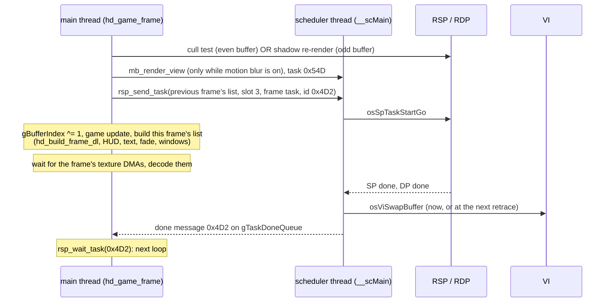

# Rendering

Blast Corps draws a 320x240 picture with the RCP's Fast3D-style microcode,
double-buffered, at most 30 pictures a second during play. Every frame the
CPU builds a new top-level display list in one of two per-frame buffers
(`DynamicBuf`, two of them), while the RCP draws the list built the frame
before. The list covers, in order: a depth clear, the sky backdrop and a flat
ground colour, the level's visible geometry, the buildings and other objects,
shadows, the vehicles, billboard effects and particles, and the 2D HUD,
text, message windows and the screen fade.

The game does almost everything itself on the CPU: it decompresses textures
into RAM, copies level and object display lists into the frame buffer with
texture animations patched in, builds billboard and shadow quads, and sorts
text by glyph. The RSP is used for three other jobs as well: rendering a
vehicle top-down into a 64x64 texture (the vehicle's shadow), rendering the
player's vehicle into a 120x90 texture for the turbo motion-blur trails, and
a visibility test that culls the level grid (a dedicated microcode whose RDP
output the CPU reads back).

Everything below is from the code unless marked otherwise. See
[memory](memory.md) for where the buffers sit in RAM, [levels](levels.md) for
the level file that the display lists come from, [camera](camera.md) for how
the eye and target are chosen, and [frontend](frontend.md) for the front
end's screens, which use the same scheduler and buffers.

## How it works

### Threads, tasks and the frame pipeline

The main thread (`hd_main_thread`, `src.us.v11/hd_code/00000.c`) runs one
frame function per loop: `hd_game_frame` for every in-game mode, or the
front end's (`fe_globe_frame`, `fe_back_loop`, `fe_digger_frame`,
`fe_boot_screen_frame`). An in-game frame goes like this:

1. At the start of `hd_game_frame` the RCP is idle (the previous loop waited
   for it). If `gBufferIndex` is 0 and the mode has run 6 frames or more,
   `cull_start` runs one step of the visibility test (below); if
   `gBufferIndex` is 1, `veh_render_shadow_tex` re-renders the shadow texture
   of the vehicle the player drives. So each of the two jobs runs every other
   frame.
2. `mb_render_view` sends the motion-blur view task if the blur is on.
3. `rsp_send_task` hands the list built during the previous frame
   (`gDynamicBufs[gBufferIndex].dl`, `gFrameDlLen` commands) to the
   scheduler: microcode slot 3, a frame task (it swaps the frame buffer), id
   0x4D2, with a write-back of the whole data cache.
4. `tex_reset_decode_queue`, then `gBufferIndex ^= 1`: from here on the CPU
   works on the other `DynamicBuf`, the other frame buffer and every other
   double-buffered array (vertex buffers, matrix pools, effect lists).
5. The game updates (vehicles, objects, mission state). Some updates write
   display-list fragments as they go: `obj_draw_all` (buildings),
   `lvl_build_visible_dls` (level geometry), `water_update`, `fx_draw_all`
   (billboards).
6. `hd_build_frame_dl` writes the top-level list, then `hd_game_frame` adds
   the mode's overlays (objective, attract-mode logo, credits), flushes the
   text, draws the fade and the message windows (`yoshi_draw`) and closes the
   list (`hd_close_display_list`: `gDPFullSync`, `gSPEndDisplayList`, and an
   assert that the length is under `TOPLEVEL_DL_SIZE`, 0xB5E commands).
7. It waits for every texture DMA queued this frame (`nextdma` messages on
   `textureDmaMessageQ`) and decodes the queued textures
   (`tex_decode_next`, once per non-palette DMA). The decoded textures are in
   RAM before the RSP gets this list at the start of the next frame.
8. Back in `hd_main_thread`: `rsp_wait_task(0x61F)` if the shadow slot is
   busy, `rsp_wait_task(0x54D)` if the blur slot is busy, then
   `rsp_wait_task(0x4D2)`, the done message of the frame task sent in step 3.

So the CPU builds frame N+1 while the RCP draws frame N, and the loop is
locked to the RCP: a frame cannot start until the previous picture's task
has reported done, which for a frame task happens when its buffer is swapped
in (see the scheduler below).

`hd_mode_setup` (called by most mode switches) blacks the screen
(`osViBlack(1)`), sets `gBufferIndex` to 0 and writes a list that only clears
the frame buffer to black (`hd_clear_framebuffer`,
`hd_close_display_list`) into buffer 0. That list is what the first
`rsp_send_task` of the new mode sends. The scheduler turns the screen back
on when it swaps a buffer in the mode's third frame (`gFramesInMode == 3` in
`__scHandleRDP`).

While paused, `gVehDrawBufferIndex` stays at the buffer that was current
when the pause began (`gPausedBufferIndex`), so the vehicles keep drawing
from the same double-buffered model data (frozen in place) while the rest
of the frame is still built.

### The top-level display list (`hd_build_frame_dl`)

The order, from the code (`src.us.v11/hd_code/00000.c`). "SEG2(x)" is a
list at byte offset x inside the frame's `DynamicBuf` (segment 2).

| # | what | code |
|---|---|---|
| 1 | segments 0 = 0, 2 = this `DynamicBuf`, 1 = the static segment (`gStaticSegment`); the static segment's `seg1RdpInitDl` and `seg1RspInitDl` | |
| 2 | depth clear: fill mode, the depth buffer set as the colour image, filled with 0xFFFC (far) | `gDepthBufferPhys` |
| 3 | matrices into the buffer: identity, 320x240 ortho, 1280x960 ortho; `cam_update` writes the view (`guLookAtReflect`, with the screen shake), the reflection-map `LookAt` and the culling view | `cam_update` |
| 4 | colour image = this frame's frame buffer; the sky (`backdrop_draw`), which returns the horizon row | `src.us.v11/hd_code/2D810.c` |
| 5 | fill rectangle from the horizon row to the bottom in a ground colour: 0x0001 (black) by default, hard-coded colours for levels 13, 14, 16, 52 and for level 15 | |
| 6 | `gSPLookAtX/Y`, projection = `persp` loaded then `view` multiplied (both on the projection stack), modelview = identity, perspective normalisation | |
| 7 | `guPerspective(persp, gCamFovy, 4/3, near 10, far 10000)` (far 20000 in the replay modes), colour dither magic-square, clip ratio 3 | |
| 8 | water, first pass | `water_draw(.., 0)`, `src.us.v11/hd_code/39050.c` |
| 9 | segment 8 = the level's display data; level list 0 (the visible part, built this frame) and the level file's fixed list 0, with Z off | `gLevelDl0`, `gLevelFileDl0` |
| 10 | Z on: level list 1 and fixed list 1 | `gLevelDl1`, `gLevelFileDl1` |
| 11 | parts fading out (`obj_draw_fading_parts`' list, SEG2(0x21410)), unless the mission is over | `src.us.v11/hd_code/77E20.c` |
| 12 | segment 10 = this buffer's object part matrices (`gObjPartMtx0/1`); shaded, back-face culled; the level's packed display lists (SEG2(0x0A4E0), from `lvl_build_dl_calls`) | |
| 13 | tyre trails (not in replays) | `trail_draw`, `src.us.v11/hd_code/37530.c` |
| 14 | vehicle shadows on the ground (layer 0), object blob shadows, motion-blur copies | `veh_draw_shadows`, `obj_draw_ground_shadows`, `mb_draw` |
| 15 | objects, first list (SEG2(0x0A580)); communication points; vehicle shadows on objects (layer 1); the chopper's shadow; RDUs; the power pill; TNT, blocks, shells, crates | `obj_draw_all`'s list A, `commpt_draw`, `rdu_draw`, ... |
| 16 | billboard effects, list A (`gFxDlA0/1`); particles; vehicles layer 0 | `fx_draw_all`, `ptcl_draw`, `veh_draw_layer(.., 0)` |
| 17 | the academy marker; level list 2 + fixed list 2; vehicles layer 1 | |
| 18 | level list 3 + fixed list 3; objects, second list (SEG2(0x0A918)); the sinking part (SEG2(0x21478)); vehicles layer 2 | |
| 19 | the race ghost; drifting quads; water, second pass; shadows on water (layer 2); people (levels with the chopper); billboard effects, list B (`gFxDlB0/1`); the carrier blast tint | `ghost_draw`, `fx_draw_drift_quads`, `people_draw`, `fx_draw_carrier_blast` |
| 20 | HUD: boost dial, vehicle panel, map-view player locator; `text_begin_frame`; missile and ram icons, vehicle overlay; money and "$N" popups (text); target markers; "PRESS START" / map-view captions (text, blinking); replay and fixed-camera icons; carrier target arrow; radar; level complete / mission failed; `text_flush_screen` | `src.us.v11/hd_code/42240.c`, `32E00.c`, `30C70.c`, `3E4C0.c`, `17E10.c`, `39050.c` |

Then, in `hd_game_frame`: the objective HUD (`hud_draw_objective`,
`src.us.v11/hd_code/1D990.c`) for non-mission levels; in attract mode the
logo (`title_draw_attract`), the controller display (`hud_draw_pad`) and the
demo banner; an empty debug hook (`hd_debug_dl_stub`); the credits on level
0x31; a second text flush; `fade_draw` (not in attract mode); the message
windows (`yoshi_draw`, `src.us.v11/hd_code/26570.c`); `fade_draw` in attract
mode (so there it covers the windows too); `hd_close_display_list`.

The level is drawn in four lists (0-3) and the objects in two (A, B), with
the vehicles' three layers in between. The code does not say what each pass
holds. The level file's header names the four record ranges
(`lvl_build_visible_dls`), and the vehicle models come with three display
lists each. A reasonable guess is opaque before translucent, but that is
**unconfirmed**.

### Per-frame buffers: `DynamicBuf`

`gDynamicBufs[2]` (0x803156F8 in US 1.1), `DynamicBuf` in
`include/game/types.h`, 0x21498 bytes each. Segment 2 points at the current
one, and the code addresses its matrices as `seg2Base[n]` (Mtx n is at
n * 0x40).

| offset | type | name | meaning |
|---|---|---|---|
| 0x000 | u8[0x80] | pad0 | not identified |
| 0x080 | Mtx | persp | seg2 Mtx 2: `guPerspective` |
| 0x0C0 | Mtx | ortho | Mtx 3: 320x240 ortho (z -20000..20000): HUD, text, fades |
| 0x100 | Mtx | orthoHi | Mtx 4: 1280x960 ortho: the backdrop |
| 0x140 | Mtx | view | Mtx 5: the camera (`guLookAtReflect`) |
| 0x180 | Mtx | cullView | Mtx 6: the visibility test's view (`guLookAt`, eye pulled in by `cam_eye_scale`) |
| 0x1C0 | Mtx | identity | Mtx 7: the modelview most drawing starts from |
| 0x200 | Mtx | unk200 | Mtx 8, not identified |
| 0x240 | Mtx | chopperShadowTrans | Mtx 9 |
| 0x280 | Mtx | chopperShadowRot | Mtx 10 |
| 0x2C0 | Mtx[0x49] | mtxPool | Mtx 11 + i: vehicle shadow i; Mtx 23: the radar sweep; Mtx 0x2D.. (`mtxPool[0x2D]`): object poses (`obj_draw_all`); `mtxPool[0x3C]`: comm points |
| 0x14C0 | Mtx | failSpinVehMtx | Mtx 0x54: the failing vehicle's spin |
| 0x1500 | Mtx | failSpinShadowMtx | Mtx 0x55: its shadow |
| 0x1580 | u8[0x40] | pad1580 | Mtx 0x56: the carrier target arrow's matrix (`hud_draw_target_arrow`) |
| 0x15C0 | Vtx[0x30] | shadowVtx | vehicle shadow quads, 4 per shadow (so at most 12 shadows) |
| 0x18C0 | Vtx[4] | chopperShadowVtx | |
| 0x1900 | | pad1900 | scratch other files lay out themselves (`VtxBuf` 13A70.c: blob-shadow vertices at 0x3900, `SpriteVtxBuf` 30C70.c, `TrailBuf` 37530.c, `DynBuf` 20460.c, ...) |
| 0x3C00 | LookAt | lookAt | the camera's, for reflection mapping |
| 0x48B0 | Gfx[0xB5E] | dl | the top-level display list |
| 0xA3A0 | u8[] | subDls | sub-lists: +0x140 level DL calls, +0x1E0 objects list A, +0x578 objects list B, +0x910 per-object lists C, +0x112B0 per-object lists D, +0x17070 fading parts, +0x170D8 sinking part |

The front end lays the same memory out its own way (`FeDyn` in
`include/game/types.h`; the globe and the player-select screen have their
own views).

### Frame buffers, depth buffer, VI

- `gFrameBuffers[2][320*240]`, u16 RGBA 5/5/5/1, at 0x80000400 (they end at
  0x8004B400, where the heap starts). `gFrameBufferPhys[2]` holds their
  physical addresses (`hd_init`).
- `gDepthBuffer` at 0x8021ED00, 320x240 16-bit, cleared each frame with fill
  colour 0xFFFC. The heap ends there (`hd_setup_level` prints
  `0x8021ED00 - gHeapPtr` as the space left).
- The static segment (segment 1: the RDP/RSP init lists and other fixed
  display lists) is loaded from ROM into `gStaticSegmentBuf` (0x803FF600, at
  the top of the 4 MB) by every `hd_mode_setup`.
- VI: `sched_create` calls `osViSetMode(&osViModeTable[mode])` with mode 2
  when `osTvType == 1` (NTSC) and 0x10 otherwise, and one field per retrace
  message. In the SDK's table order these are the NTSC and PAL "LAN1" modes
  (320x240, anti-aliased, non-interlaced); that comes from the SDK's
  numbering and is not checked against this ROM's table. `hd_init` turns VI
  gamma off and the dither filter on (`osViSetSpecialFeatures`).

### Microcode and RSP tasks (`src.us.v11/hd_code/405F0.c`)

`rsp_init_ucode_table` fills four slots, `gUcodeText[4]` / `gUcodeData[4]`:

| slot | microcode | used by |
|---|---|---|
| 0 | `gL3dText` / `gL3dData` (front end): the line build of the Fast3D-style ucode (G_LINE3D) | the globe's route lines (`fe_globe_frame`) |
| 1 | `gF3dText` / `gF3dData` | the front end's frames; the shadow render (`veh_render_shadow_tex`) |
| 2 | the same F3D | the motion-blur view (`mb_render_view`); the globe's scene |
| 3 | the same F3D | the in-game frame |

Slots 1-3 run the same microcode. The slot only picks the task record
(`gRspTasks[slot][gBufferIndex]`) and the busy flag (`gRspSlotBusy[slot]`),
so several tasks can be in flight at once (the globe sends three per frame).
The port's README identifies the F3D ucode as Fast3D and slot 0's as its line
build ("L3D Blast Corps" in RT64's database).

`rsp_send_task(data, count, slot, yield, id, writebackAll)` fills an
`OSScTask` inside an `RspTask` (0x60 bytes: the task, then the reply word
`(slot << 16) | id`):

| field | value |
|---|---|
| type | `M_GFXTASK`; task flags 0 (2 for a slot 4, which no caller uses) |
| boot | `gRspBootText`, size `gAspMainText - gRspBootText` |
| ucode / data | the slot's, sizes 0x1000 / 0x800 |
| dram stack | `gDramStack`, 0x400 bytes |
| output buffer | `gRdpOutputBuffer` (0xA000 bytes from the heap, `hd_mode_setup`) |
| data | the display list, `count * 8` bytes |
| yield buffer | `gYieldBuffer`, 0x900 bytes |
| scheduler flags | 3 (needs SP and DP), plus 0x40 when `yield` is set: a frame task, which swaps `framebuffer = &gFrameBuffers[gBufferIndex]` when done |
| reply | message `(slot << 16) | id` to `gTaskDoneQueue` |

Then it writes back the cache (the whole cache, or just the task, the list
and the current `DynamicBuf`) and sends the task to `gScheduler`.
`rsp_wait_task(id)` receives done messages until one with that id arrives,
clearing the busy flag of every slot that reports in. The task ids are 0x4D2
(1234: frames), 0x4D3 (the visibility test), 0x54D (the motion-blur view) and
0x61F (the shadow render). An output buffer is given, which suggests the
FIFO arrangement where the RSP writes RDP commands to DRAM. That is inferred
from the task setup, **not verified**.

### The scheduler (`src.us.v11/hd_code/2C560.c`)

A Rare-modified copy of the SDK's `sched.c` (its asserts name `sched.c`).
`BcSched`, `BcScTask` and `BcScClient` are defined in that file:

| struct | notes |
|---|---|
| `BcSched` | the interrupt queue (16 messages), the command queue (16), the thread, the client list, audio and graphics task lists (head and tail each), `curRSPTask`, `curRDPTask`, `retraceCount` (not counted while `gPaused`: the level clock, `gSchedRetraceCount`), `frameCount` (every retrace, `gSchedFrameCount`), RDP and graphics start times |
| `BcScTask` | next, state, flags (bits 0-1 parts needed, 2-3 parts done, 0x40 frame task), framebuffer, the `OSTask`, client, reply queue, message |
| `BcScClient` | next, queue, `period` (tasks from the command queue run on retraces that are multiples of it), `unkC` (3 = gets every retrace message) |

`sched_create` (from `hd_init`, priority 13) starts the VI manager, sets the
VI mode, blacks the screen, and routes SP (0x29B), DP (0x29C), pre-NMI
(0x29D), fault (0x2A0) and retrace (0x29A, every field) messages to the
interrupt queue. `__scMain` handles them:

- **Retrace** (`__scHandleRetrace`): counts `frameCount` and, unless paused,
  `retraceCount`; records `gLastRetraceTime`. If a finished frame is waiting
  (`gDeferredSwapTask`) it swaps it in now and posts its done message.
  Otherwise, if the displayed and the next buffer are the same and the RDP is
  frozen, it unfreezes it. It moves due command-queue tasks onto the lists,
  arms the audio timer every other retrace (`osSetTimer` 280000 counts), and
  sends 0x29A to clients with `unkC == 3`.
- **A task message**: `sched_add_task` appends it to the audio or graphics
  list and starts it if the RSP is idle.
- **Audio request** (0x29E): yields the running graphics task
  (`__scYield`, `osSpTaskYield`), or starts the audio task at once if the RSP
  is idle.
- **SP done** (`__scHandleRSP`): a yielded task gets the audio task run in
  its place, and resumes later. A finished one is marked done and, if
  nothing more is needed, completed. The next graphics task starts only if
  the head of the list is not a frame task still waiting for its RDP part
  (flags 0x47).
- **DP done** (`__scHandleRDP`): the frame's RDP part is done. It swaps the
  buffer now, unless a swap already happened at this retrace's start
  (`frameCount == gSchedSwapFrame`). In that case the swap waits for the next
  retrace (`gDeferredSwapTask`). Front-end modes (a long list of mode bits)
  always swap at once. On the mode's third frame it turns the screen on.
- **Pre-NMI** (the reset button): every client gets 0x29D, `gPreNmi` is
  set, the screen goes black and the thread spins forever.

**Frame rate.** After a swap at retrace N, `gSchedSwapFrame` is N + 1, and a
frame whose RDP part finishes during retrace N + 1 is held until N + 2. So in
every mode outside the front-end list, two swaps are at least two retraces
apart: at most 30 pictures a second (NTSC). Each `hd_game_frame` advances the
game by one step, so the game runs slower when a frame takes longer than two
retraces. Level timers count retraces (`gSchedRetraceCount`), not frames.

The scheduler also keeps timing statistics, all in 1/100 of a retrace
(`/ 7825` of the 46.875 MHz count): `gSchedRspTime`, `gSchedRdpTime`,
`gSchedGfxStartLag`, the longest audio yield `gSchedYieldMax` (reset every
480 retraces), and the main loop's `gFrameCpuTime` / `gFrameStartLag`.
Nothing in the code read here displays them; `sched_send_mesg` computes a
time remaining that it never uses (leftover debug code).

### Level geometry and visibility culling (`src.us.v11/hd_code/5FD50.c`)

The level is a grid of cells (`gLevelCols` x `gLevelRows`). Each geometry
record and each object belongs to a cell. The visible set is the sorted,
-1-terminated s16 list `gVisibleCells`.

**The visibility test.** `cull_start` (00000.c) builds a small display list:
the frame's projection, the culling view, eight vertices and the twelve
triangles of a box, then a `gDPTileSync`. `cull_step_delayed` waits
`gCullDelay` calls, then calls `cull_walk_grid`. That walk keeps a stack of
grid rectangles (`gCullQuadStack`). When the stack is empty it sorts the
cells found visible in the last pass into `gVisibleCells` and pushes the
whole grid again. Otherwise it pops one rectangle and tests it
(`cull_test_cells`):

1. The rectangle's height range from the level's grid of (min, max) pairs
   (`cull_grid_height_range`) and its eight corners (`cull_box_corners`, cell
   size from the level header).
2. `cull_rsp_test` runs the box through the separate culling microcode
   (`gCullUcodeText`, task `gCullTask`, id 0x4D3) and waits. The ucode writes
   its RDP output into `gCullOutput`. If the first word there is 0xE8000000
   (the closing tile sync, so no triangle survived clipping), the box is
   hidden. A 1x1 grid is always visible.
3. Visible: a single cell goes on the found list; a bigger rectangle is
   split into four, which are pushed.

There is **one box test per call, and the call happens every other frame**.
So the visible list is rebuilt over many frames and lags behind the camera.
`cull_restart(n)` resets the lists to "everything visible" (every cell
listed) and delays the walk by n calls. The game calls it when the camera
jumps or turns fast: map view on and off (10), mission intro modes (2 every
frame), the camera window (10), the end of a mission (0x32).
`cull_override_visible_cells` (in play) can change the list too. The port's
README checks a CPU model of this test against the real microcode.

The list gates game logic as well as drawing. `obj_draw_all` runs an
object's pose, texture animation and falling parts only when its cell is
listed.

**Building the level lists.** `lvl_build_visible_dls` builds four lists into
this buffer's `gLevelDl0..3[gBufferIndex]`. `lvl_alloc_dl_buffers` sizes
them per level, in commands: profile 0 6000/5000/100/2000, profile 1
1000/1000/100/2000, special cases for levels 10, 11, 16, 17 and 29. For each
list, `lvl_build_visible_dl` copies a fixed part, then every record whose cell
is listed (0x14-byte records: start, alternate start, end, id, cell). The
first record of an id gets its texture animation patched in
(`lvl_find_tex_anim`, `lvl_copy_dl_tex_anim`). Then come the group records
whose cell lists share a visible cell (`lvl_copy_visible_groups`).
`lvl_build_dl_calls` writes a `gSPDisplayList` for each list packed in
another range of the level file (SEG2(0x0A4E0)). The level file's own fixed
lists (`gLevelFileDl0..3`, relocated at load by `lvl_relocate_dls`) are
called after each built list.

### Models and how they are drawn

**Vehicles.** Each loaded vehicle model has a `VehRecord` in `gVehicles`
(0x74 bytes, defined in 00000.c; up to `gVehiclesEnd`):

| offset | name | meaning |
|---|---|---|
| 0x00 | unk0 | segment 6 data (the model) |
| 0x04 / 0x08 | unk4 / unk8 | segment 7 data, one per buffer (the parts' matrices, by the code's use) |
| 0x0C..0x14 | unkC, unk10, unk14 | the three layer display lists (odd buffer) |
| 0x30..0x38 | unk30, unk34, unk38 | the same, even buffer |
| 0x54 | unk54 | the display list the shadow render draws |
| 0x58 | unk58 | the display list the motion-blur view draws |
| 0x5C | type | vehicle type (`VEH_*`, `include/game/types.h`) |
| 0x60 | alpha | env alpha, set with `gDPSetEnvColor` before the lists |

`veh_draw_layer(gfx, layer)` sets segments 6 and 7, the env alpha and (for
a failed non-mission level) the spin matrix, calls the layer's list and
reloads the identity modelview. It draws the driver's record (type 0) only
when `gDriverHidden` is clear and either `gVehEntered` is set or an intro
mode is running. It skips the carrier after its explosion, and everything but the shuttle while the
player is hidden on shuttle levels. The parameter is called `lod`, but all
three layers are drawn every frame at different points of the list. They are
draw-order layers. **No distance-based level of detail was found in the
code read for this doc.**

Vehicle texture animations (tracks, a heading display) come from the
-1-terminated list `gTexAnimDefList` (`src.us.v11/hd_code/56040.c`).
`anim_tex_init` builds `gTexAnims` (`AnimChannel` records,
`include/game/types.h`). `anim_tex_find_patches` records every `G_SETTIMG` in
a model's lists that uses an animation's texture. `anim_tex_update_all` /
`anim_tex_step` advance the playing ones each frame, load the frame's
textures into 12 blocks of 0x1010 bytes (`gTexAnimBlocks`), and write their
addresses into the patched commands, with a blend amount in the next
`G_SETPRIMCOLOR` when two frames cross-fade.

**Buildings and objects** (`obj_draw_all`, `src.us.v11/hd_code/77E20.c`).
For each object in `gObjects` (`LevelObject`, `include/game/object.h`)
whose cell is listed, it writes into lists A and B a `G_MOVEWORD` that sets
segment 9 to the object's info block + 0x50, then a call to the object's own
sub-list in C and D. It copies the object's common commands into C and D.
For each part record whose damage conditions hold (the part percentages at
+0xEC), it copies the record's C and D command ranges, texture animations
patched (`obj_copy_dl_tex_anim`). A falling part gets a matrix push (from
`obj_falling_part_mtx`) and pop around its commands; it falls by
`c * c * -30000` per frame count c, and when it lands it shakes the screen
(10 frames, size 300). Objects with a pose get a spline matrix
(`spline_object_matrix`) pushed in A and B. Toppling parts are drawn last
(`obj_draw_toppling_parts`). Segment 10 points at this buffer's part
matrices (`gObjPartMtx0/1`, identity matrices allocated at level load by
`lvl_build_part_tris`).

**Matrices.** The world is in 1/32 units in game state (positions are
`>> 5` or `/ 32.0` before going into matrices). The 16.16 (`<< 11` world)
camera eye is in `gCamEyeX/Y/Z`. Projection is `persp * view` on the
projection stack and the modelview starts as identity, so model matrices are
world-space. Billboards and particles build their own facing matrices from
`gCamYaw` and the camera height (below).

### Textures (`src.us.v11/hd_code/5BF40.c`, `60F60.c`)

All game textures are entries of one ROM table. `tex_load_table` DMAs 0x8000
bytes from ROM 0x4CE0 into the heap (`gTexTable`), once per mode. Entry n is
8 bytes: ROM offset (from 0x4CE0), unpacked size, decoder type. The next
entry's offset ends it.

Ways to get a texture:

| function | does |
|---|---|
| `tex_get` (`tex_get_impl`) | cached: looks the id up in `gTexCache` ({id, physical address} pairs), else loads it at the heap pointer, decodes it and caches it. Used at level load (`lvl_resolve_tex_ids`). |
| `tex_resolve_dl` | rewrites every `G_SETTIMG` of a display list from a table id to the address, loading as above |
| `tex_load_to_heap` | loads and decodes at the heap, not cached (sprites, the backdrop) |
| `tex_queue_load` | starts the DMA into a given buffer without waiting and queues the decode. Used every frame for glyphs, billboard and particle frames and vehicle texture animations |
| `tex_load_palette` / `tex_queue_palette` | 0x100-byte palettes, waiting or queued |

Queued loads take an `OSIoMesg` slot each (`nextdma`, at most 0x90,
asserted). The decodes run at the end of the frame (step 7 above).
`tex_decode` copies the packed data to `gTexDecodeScratch` and expands it in
place by type. The types are LZ-style streams of s16 tokens: bit 15 set is a
back-reference (count in the low 5 bits, distance in the rest); otherwise a
literal:

| type | literal expands to |
|---|---|
| 0 | stored: a plain copy |
| 1 | one 16-bit texel (a 15-bit value with a 0 bit inserted at bit 6) |
| 2 | four 4-bit fields to the top of four bytes |
| 3 | two bytes, each shifted left one |
| 4 | two 16-bit texels from a table of u16 entries (the request's param) |
| 5 | one 32-bit texel from a 5-5-5 colour table plus a 4-bit alpha |
| 6 | two bytes, 3-bit fields spread out |

TMEM loading is done in the display lists with the usual `gDPLoadTextureBlock`
family (or `gDPLoadBlock` for the 2-texture backdrop and the radar). Most
in-game textures are loaded one per draw, with clamping and no mipmaps (the
`G_TX_NOLOD` arguments throughout).

**Level texture animation.** The level file has its own animation records
(range at level header +0x2C..+0x30: id, frame count, frame, fade flag,
alpha, period, timer, then the frames' texture addresses).
`lvl_step_tex_anims` steps them once a frame (frame advances every `period`
frames; a fading record's alpha = 0xFF * timer / period). The visible-list
builders patch the current (and, when fading, next) image into the copied
lists' `G_SETTIMG`s and OR the alpha into the `G_SETPRIMCOLOR`.

### The backdrop / sky (`src.us.v11/hd_code/2D810.c`)

`backdrop_init` (at level setup) loads the level's two backdrop textures
(`gBackdropTextures[level][2]`: id, pointer, log2 s and t scale, clamp/mirror
modes; the type in the code is misnamed `FadeEntry`). It sets
`gBackdropOffset` from the level's size (1200000 or 600000 divided by the
ground grid's width + depth in units, by mode, plus 32 on levels 0x11, 0x26,
0x34, 0x3B). Without both textures, `gBackdropLoaded` is 0 and there is no
sky.

`backdrop_draw(gfx, dyn, level, yaw, pitch, &height)`:
- the horizon row is `height = 120 - pitch * 0.22 + gBackdropOffset`
  (clamped at 0), with `gCamPitch` as the pitch;
- both 32x32 RGBA16 textures are loaded into TMEM (tiles 0 and 1) and
  combined in 2-cycle mode with bilinear filtering;
- one quad under the 1280x960 ortho (the vertex y is `height * 4 - 1`), its s
  coordinates scrolled by the yaw (`(yaw - 2048) * 0.5`, `gCamYaw`) so the
  sky turns with the camera, and its t coordinates by the height;
- the vertex buffer is double-buffered (`gBackdropVtxBuf`).

Below the horizon, `hd_build_frame_dl` fills a flat colour. The level's
geometry covers the rest, and where it doesn't, that flat colour shows.

### Fog

**No fog command appears in the decompiled C** (no `G_FOG`, fog colour or
fog position). Whether the level files' own display lists set any fog-related
render mode was not checked; it is an open question.

### Shadows (`src.us.v11/hd_code/13A70.c`, 00000.c)

**Vehicle shadows** are textures rendered at run time. `gVehicleShadows`
(up to `gVehicleShadowsEnd`) holds a `VehShadow` (`include/game/types.h`,
0x1040 bytes) per vehicle type on the level:

| offset | type | name | meaning |
|---|---|---|---|
| 0x0000 | u8[0x1000] | tex | 64x64 IA8 shadow texture |
| 0x1000 | f32 | renderDist | camera distance of the top-down render |
| 0x1004 | s32 | x | position, 1/32 units |
| 0x1008 | s32 | floorY | where the shadow lies |
| 0x100C | s32 | z | |
| 0x1010 | s32 | bodyY | the vehicle's own y |
| 0x1014 | s32 | groundY | the y given to `veh_update_shadow` |
| 0x1018 | s16 | halfWidth | quad half size |
| 0x101A | s16 | halfDepth | |
| 0x101C..0x1020 | s16 | rotX, rotY, rotZ | ground tilt and heading (4096 = 360 degrees) |
| 0x1022 | u8 | type | vehicle type |
| 0x1023 | u8 | layer | 0 ground, 1 on an object, 2 water (drawn at three points of the frame) |

`veh_render_shadow_tex` renders the vehicle's shadow display list (record
+0x54) into `tex`. It uses its own viewport, a 64x64 scissor and the texture
as an 8-bit colour image (CI8, cleared with fill colour 0x00010001), white
primitive colour, a 45-degree perspective looking straight down from
`renderDist`, and task id 0x61F on slot 1. All shadows are rendered at level
setup (waiting for each); during play the current vehicle's is re-rendered
every other frame. What the RDP writes into an 8-bit colour image, and so
the exact IA values, was not worked out.

`veh_draw_shadows(gfx, dyn, layer)` draws each shadow of that layer as a
textured quad (vertex colour 10,10,10, alpha 0x8C, render mode 0x504340,
`G_CC_MODULATERGBA`). Its matrix is built from the tilt, heading and
position (seg2 Mtx 11 + i). On a `SURFACE_SPIN_SHADOW` surface the player's
shadow is replaced by the 32x32 `gHudArrowTex` turned by the heading. The
chopper has its own (`veh_draw_chopper_shadow`, Mtx 9 and 10).

**Blob shadows** (`obj_draw_ground_shadows`): objects of kind
`OBJ_KIND_SHADOW_A..C` get a quad of the 64x64 IA8 `gObjShadowTex` on the
ground, half size `60 - height / 800` (shrinking with height above ground),
primitive colour 200,200,200,200. They are drawn without Z, except one object
on level 0x10 at a fixed position, which gets Z (a level-specific fix in
code).

### Billboards and effects (`src.us.v11/hd_code/60F60.c`, `12D80.c`)

Explosions, smoke and similar effects are 16 records (`gEffects`, 0x3C
bytes each), started by `fx_spawn` from an `EffectDef`
(`include/game/types.h`: texture-group id, cols, rows, format/size, colour,
tile width and height, frame count, then cols * rows * frames u16 texture
ids). An effect is a grid of `cols x rows` tiles, each a textured quad.
`fx_draw_all`, called each frame during the update:

- picks this buffer's lists (`gFxDlA0/1`, `gFxDlB0/1`; the record's byte
  +0x3B chooses B), matrices, vertices and fallback texture buffers;
- for each active record: `fx_build_matrix` (uniform scale, position moved by
  velocity with gravity and a 3/4 bounce at a floor, then turned to face the
  camera: pitch from the camera height, yaw `gCamYaw`), then a quad per tile
  (`fx_fill_quad`, `fx_draw_quad` -> `gfx_draw_textured_quad`), then a matrix
  pop; the frame advances and the record ends after the last frame;
- tile textures (`fx_get_texture`): definitions listed in `gFxCachedDefs` get
  one of the 0x1010-byte heap caches (`fx_alloc_texture_caches` carves as
  many as fit before the heap end, `gFxTexCachesFree`; they are freed after
  61 frames unused by `fx_age_texture_caches`). Others load into a 4 KB
  fallback slot per tile (`gFxTileSlots`, 16 slots). Either way the frame's
  texture id is queued (`tex_queue_load`).

`gfx_draw_textured_quad` picks the load by texel size and the mode by
format: RGBA and IA translucent (`RM_XLU_SURF` with `CVG_DST_SAVE`, Z or
not), I opaque.

### Particles (`src.us.v11/hd_code/43A60.c`)

One emitter at a time (`gEmitterActive`), up to 50 particles
(`gParticles`, 0x20 bytes: position, velocity, state 0 birth / 1 loop / 3
death, life, frame, fall time, age), from a `ParticleDef`
(`include/game/types.h`). `ptcl_start` takes the definition, sets up the one
shared quad (`gParticleQuad`, `size` units square) and the texture size.
`ptcl_update` emits `count` particles per frame for `bursts` frames in a
random cone (`spread`) and spin, applies gravity, and bounces them off the
floor height (`dy * 16 / bounce`). Particles run their birth, loop and death
texture sequences. After the emitter empties there is a 3-frame cooldown.
`ptcl_draw` sorts the particles by texture (`ptcl_sort_by_texture`, a Shell
sort) so each texture is loaded once, and gives each a facing matrix (tilt
toward the camera height, yaw `gCamYaw`) in `gParticleMtx[buf][n]`. They
are Z-buffered translucent. Textures go into a 0x1400-byte cache
(`gParticleTexCache`) by id (`ptcl_get_texture`).

### Motion blur (`src.us.v11/hd_code/34430.c`, mb.c)

The turbo effect. `mb_start(n, spacing, ...)` turns it on (up to 10
copies). Each frame `mb_render_view` renders the player's vehicle (record
+0x58) into a 120x90 RGBA16 texture (`gMbBuffer`, 0x5460 bytes), with the
depth buffer as scratch, from the camera eye, task 0x54D on slot 2.
`mb_push_sample` keeps an 11-entry ring of (player position, eye) samples.
`mb_draw` draws up to `gMbCopies` copies of that picture as six 120x15
strips (`mb_draw_strip`) on a curved 6x4 vertex grid 100 units out
(`gMbStripVtx`, built by `mb_start` from the view angle). Each copy is
placed by the inverse of a look-at matrix interpolated along the recorded
path (`mb_mtx4_invert`), each fainter than the one before. `mb_stop` fades
the copies out one per frame, unless `gTurboActive` holds the blur on.
Outside missions the turbo is cut 90 retraces after the level starts
(`hd_game_frame`).

### HUD, text and fonts

**Text** (`src.us.v11/hd_code/14B30.c`, drawtext.c; `168B0.c`, font.c).
`text_print` / `text_print_gradient` / `text_queue_string` don't draw. They
queue one quad per character into this buffer's vertex array (`gTextVtx[2]`)
and a `TextQuad` list (key = character code, + 0x8000 when the top colour
isn't black; vertex index; glyph texture). The capacity `maxCharacters` is
0x200 in front-end modes, the globe sequences, attract mode and levels 0x28
and 0x32; 0x9C in replays; 0xAC otherwise. `text_flush_screen` loads the
ortho projection and identity modelview, sets a translucent
`G_CC_MODULATERGBA` state, sorts the queued quads by key
(`text_shell_sort`) and draws them, reloading the texture only when it
changes. The frame list flushes twice: once at the end of
`hd_build_frame_dl` and once in `hd_game_frame` for the overlays.

Glyphs are 32x32 I4 textures (0x200 bytes) in an 80-slot cache
(`gGlyphTextures`, `gGlyphIds`, `gGlyphAge`). `font_get_glyph` returns a
cached one or queues its load into a free or aged-out slot, and sets its age
to 3. `font_age_cache` (every frame) counts the ages down. Font 0's
characters map to table ids from 0xF4C on (digits, capitals, some
punctuation, a few lower-case letters), each with its own advance; font 1
(wide strings) maps to 0xD4C + code.

**Sprites** (`src.us.v11/hd_code/2E490.c`): `spr_load` loads up to 64 slots
of frame images (and optional palettes) at the heap; `spr_draw` draws them
as texture rectangles, or as vertex quads with flag 4, optionally blinking.
`spr_draw_blinking` is used for the replay and fixed-camera icons.

**The radar** (`hud_draw_radar`, `src.us.v11/hd_code/3E4C0.c`), on mission
levels: a disc and grid in 2-cycle mode centred on screen (58, 195), turned
with `gCamHeading`. The grid's texture shift and the scale divisor (1200,
2400 or 4800 game units, which are 1/32 of a world unit, per screen pixel) depend on the player's distance to the carrier (thresholds
0x55F0 and 0xABE0). It draws the carrier blip (blinking when zoomed in) and
the target blip if they fall inside the disc, an arrow toward
`gEndObjectX/Z`, and a sweep texture turning 4 degrees a frame.
`hud_draw_target_arrow` is the 3D arrow toward the carrier's target: green
to red as the carrier gets within 1500 to 500 units, blinking under 250.

Other HUD pieces: the boost dial and the missile/ram icons
(`src.us.v11/hd_code/42240.c`), the vehicle panel and coach portraits
(`hud_panel_draw`, `32E00.c`), on-screen target markers projected from 3D
(`hud_draw_target_marker`, `hud_project_point`, `30C70.c`), the objective,
laps and timers (`hud_draw_objective`, `hud_format_time`, `1D990.c`), the
vehicle overlay and the carrier blast tint (`39050.c`).

**HUD alpha.** `gHudAlpha` fades the HUD in by 16 a frame up to 0xFF (0xB4
in replays) in play, and out by 16 a frame while a window, the turbo start
or a window demand is up.

**Screen shake.** `cam_update` adds an offset to the camera target while
`gShakeTime` runs, each axis `gFrameDrawTime % size - size / 2` (with
`/ 100` and `/ 10000` for y and z). `gFrameDrawTime` is `osGetTime()` taken
when the frame is sent, so the shake depends on timing. The size decays by
1/6 a frame. Callers set (time, size) pairs such as (10, 300) for a landing
part, (10, 400), (20, 800).

### Screen transitions and fades (`src.us.v11/hd_code/30430.c`, fade.c)

- `fade_to_mode_speed(next, speed)` starts a fade to black: alpha rises by
  `4.25 / speed` per retrace from `gFadeStartTime`. At 0xFF the game switches
  to `next` (`gNextGameMode`). `fade_to_mode` uses speed 0.25 (17 a retrace,
  15 retraces). The music fades too, except for some target modes. While a
  fade runs, `areWeFading()` is 1, and many inputs and mode changes check it.
- On a mode's first frame `fade_draw` starts some modes black (name entry,
  pak files, academy message, attract picture, regrade notice, erase, quit,
  and the shuttle level's intro) and fades them in at `gFadeInStep` per
  retrace. For most of those it holds back the pending message window until
  the fade-in ends (`fade_window_held`).
- The fade itself is one full-screen fill rectangle in 1-cycle mode with
  `G_RM_CLD_SURF` and primitive colour (0, 0, 0, alpha), drawn after
  everything else but the message windows.
- **Mission failed** (`hud_mission_failed`, `17E10.c`): after 180 retraces
  a full-screen quad (`gFadeVtx[buffer]`) fades to white over 90 retraces,
  holds, then fades to the results or the replay. Level 0x31 and the shuttle
  level (0x32) are handled differently. **Level complete**
  (`hud_level_complete`) opens the window, plays the tune, and fades to the
  results at speed 0.75.
- **Attract demos** end with the same quad fading to black at 2.125 per
  retrace, then a black fill, with the vehicles still drawn over it
  (`title_draw_attract`).

There are no wipes in the in-game code read here; every transition is an
alpha fade.

## Code references

| file | contents |
|---|---|
| `src.us.v11/hd_code/00000.c` (hd.c) | `hd_main_thread`, `hd_game_frame`, `hd_build_frame_dl`, `cull_start`, `veh_draw_shadows`, `veh_draw_chopper_shadow`, `veh_draw_layer`, `veh_update_fail_spin`, `cam_update`, `hd_clear_framebuffer`, `hd_close_display_list`, `hd_init`, `hd_mode_setup`, `hd_setup_level`, `lvl_alloc_dl_buffers` |
| `src.us.v11/hd_code/405F0.c` | `rsp_init_ucode_table`, `rsp_send_task`, `rsp_wait_task` |
| `src.us.v11/hd_code/2C560.c` (sched.c) | `sched_create`, `sched_add_client`, `__scMain`, `__scHandleRetrace`, `__scHandleRSP`, `__scHandleRDP`, `__scTaskComplete`, `sched_start_next_task`, `__scYield` |
| `src.us.v11/hd_code/5FD50.c` | `cull_restart`, `cull_step_delayed`, `cull_walk_grid`, `cull_test_cells`, `cull_rsp_test`, `lvl_build_visible_dls`, `lvl_build_visible_dl`, `lvl_step_tex_anims`, `lvl_find_tex_anim`, `lvl_copy_dl_tex_anim`, `lvl_copy_visible_groups` |
| `src.us.v11/hd_code/5CB60.c` | level load: `lvl_relocate_dls`, `lvl_resolve_tex_ids`, `lvl_build_part_tris` |
| `src.us.v11/hd_code/77E20.c` | `obj_draw_all` and the part drawing helpers |
| `src.us.v11/hd_code/5BF40.c` | `tex_load_table`, `tex_get`, `tex_resolve_dl`, `tex_load_to_heap`, `tex_queue_load`, palettes |
| `src.us.v11/hd_code/60F60.c` | texture decode queue and decoders; billboard effects (`fx_spawn`, `fx_draw_all`, `fx_build_matrix`, ...) |
| `src.us.v11/hd_code/56040.c` | vehicle texture animations (`anim_tex_init`, `anim_tex_find_patches`, `anim_tex_update_all`, `anim_tex_step`) |
| `src.us.v11/hd_code/12D80.c` | `gfx_begin_textured`, `gfx_draw_textured_quad` |
| `src.us.v11/hd_code/13A70.c` | vehicle shadow records and render, blob shadows |
| `src.us.v11/hd_code/2D810.c` | `backdrop_init`, `backdrop_draw` |
| `src.us.v11/hd_code/30430.c` (fade.c) | `fade_draw`, `fade_to_mode`, `fade_to_mode_speed`, `areWeFading` |
| `src.us.v11/hd_code/17E10.c` | attract logo and fade, level complete, mission failed |
| `src.us.v11/hd_code/14B30.c`, `168B0.c` | text queue and flush; glyph cache |
| `src.us.v11/hd_code/2E490.c` | sprites |
| `src.us.v11/hd_code/3E4C0.c` | radar, target arrow |
| `src.us.v11/hd_code/34430.c` (mb.c) | motion blur |
| `src.us.v11/hd_code/43A60.c` | particles |
| `src.us.v11/hd_code/39050.c`, `37530.c`, `30C70.c`, `42240.c`, `32E00.c`, `1D990.c`, `26570.c`, `20460.c` | water, drift quads, power pill, carrier blast, vehicle overlay; tyre trails; target markers; dial and icons; vehicle panel; objective HUD; message windows; people |

Main globals: `gDynamicBufs`, `gBufferIndex`, `gFrameDlLen`,
`gFrameBuffers`, `gFrameBufferPhys`, `gDepthBuffer`, `gDepthBufferPhys`,
`gStaticSegment`, `gScheduler`, `gMainSchedClient`, `gTaskDoneQueue`,
`gRspTasks`, `gRspSlotBusy`, `gUcodeText`, `gUcodeData`, `gRdpOutputBuffer`,
`gYieldBuffer`, `gDramStack`, `gSchedFrameCount`, `gSchedRetraceCount`,
`gVisibleCells`, `gLevelDl0..3`, `gLevelFileDl0..3`, `gLevelSegment8`,
`gVehicles`, `gVehicleShadows`, `gTexTable`, `gTexCache`, `nextdma`,
`no_palette_dmas`, `gCamFovy`, `gPerspNorm`, `gHudAlpha`.

Structs in `include/game/`: `DynamicBuf`, `FeDyn`, `VehShadow`,
`AnimChannel`, `EffectDef`, `ParticleDef` (types.h); `LevelObject`
(object.h). File-local: `VehRecord` (00000.c), `RspTask` (405F0.c),
`BcSched` / `BcScTask` / `BcScClient` (2C560.c), `TextQuad` (14B30.c),
`Particle` (43A60.c), `MbSample` (34430.c), `TexTableEntry` / `DecodeReq`
(5BF40.c, 60F60.c NON_MATCHING blocks).

## Modding notes

- **Field of view:** `cam_set_level_fovy` (`1D990.c`) sets `gCamFovy` to 45,
  or 80 on the levels in `gWideFovLevels` (5 entries).
- **Draw distance:** the far plane is the `guPerspective` call in
  `hd_build_frame_dl` (10000; 20000 in replays). The level's visible set
  comes from the cell test, which uses the same projection.
- **Ground colour below the sky:** the `switch (levelno)` after
  `backdrop_draw` in `hd_build_frame_dl` (RGBA5551 fill words).
- **Sky height:** `120 - pitch * 0.22 + gBackdropOffset` in `backdrop_draw`;
  the offsets in `backdrop_init`.
- **Fade speed:** `fade_to_mode` passes 0.25; the step is `4.25 / speed`
  per retrace.
- **Radar:** its centre (58, 195) appears in several places in
  `hud_draw_radar` (and its fixed vertices); zoom thresholds and scales are
  at the top of that function.
- **Text capacity:** `maxCharacters` in `text_init` (the heap cost is
  `maxCharacters * 140` bytes).
- **Level list sizes:** `lvl_alloc_dl_buffers` (8 bytes per command, two
  copies). Nothing checks overflow while the lists are built.
- **Top-level list size:** `TOPLEVEL_DL_SIZE` (0xB5E). The `DynamicBuf`
  layout is fixed (`STATIC_ASSERT_SIZE`, and asm reads it at fixed
  offsets), so growing the list means moving `subDls` and every offset that
  `hd_game_frame` and `hd_build_frame_dl` pass.
- **Adding a draw pass:** insert it in `hd_build_frame_dl` at the right
  depth in the order above. Set your own render state (each pass sets what
  it needs and the next one doesn't restore anything), and use matrices and
  vertices that are double-buffered by `gBufferIndex`, since the RCP is still
  reading the other buffer.
- **The 30 fps cap** is the swap deferral in `__scHandleRDP`. The game
  steps once per `hd_game_frame`, so lifting the cap would make it run
  faster, not smoother. The level timers count retraces.
- **Shadows:** quad colour and alpha (10, 10, 10, 0x8C) in
  `veh_draw_shadows`; render distance and size come from `veh_add_shadow`'s
  callers.
- **Limits:** 16 effects and 16 tile slots, 50 particles and one emitter,
  80 glyph slots, 64 sprite slots, 12 vehicle shadows (`shadowVtx` holds 48
  vertices), 0x90 texture DMAs per frame.

## Differences between versions

None known for this system. [versions](../versions.md) lists the nine
functions that changed between US 1.0 and US 1.1, and none of them is in
rendering. Only addresses move: for example `gDynamicBufs` is at 0x80315648
in US 1.0, and `gFrameBuffers` and `gDepthBuffer` are at the same addresses
in both.

## Open questions

- What each of the four level lists and the two object lists holds (opaque,
  decal, translucent?); the same for the vehicles' three layers.
- The exact RDP output of the shadow render into an 8-bit colour image and
  how it reads back as IA8.
- Whether the level files' display lists use fog.
- The combiner formulas of the backdrop (`0xFC24A3FF, 0x1FFC9238`), radar and
  logo are written as raw words; decoding them would say how the two sky
  layers blend.
- The contents of `seg1RdpInitDl` / `seg1RspInitDl` (the viewport and
  default modes) are in the static segment, not in C.
- `DynamicBuf.pad0`, `unk200` (Mtx 8) and the scratch area 0x1900-0x3C00 are
  only partly identified.
- Unnamed variables near this system: `D_8036BF08` / `D_8036BF0C` (sched.c:
  a statistic copied every 480 retraces; perhaps a "previous max" pair),
  `D_8036BF28`, `D_8036BF30`, `D_8036BF58..74`, `D_8036BF98` (sched.c .bss,
  unreferenced here), `D_80366BA8`, `D_80366A10`, `D_80366A11` (attract fade
  state in `title_draw_attract`), `D_802FDB14` (cleared at level setup).
